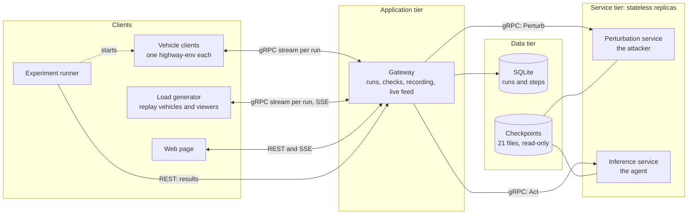
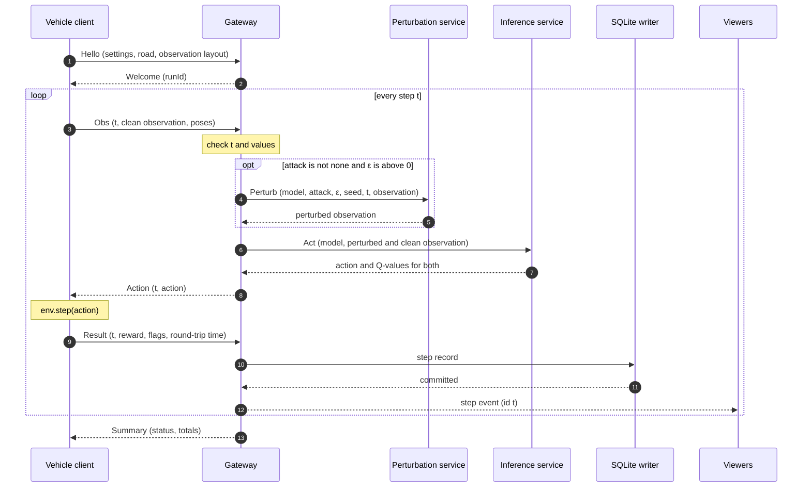
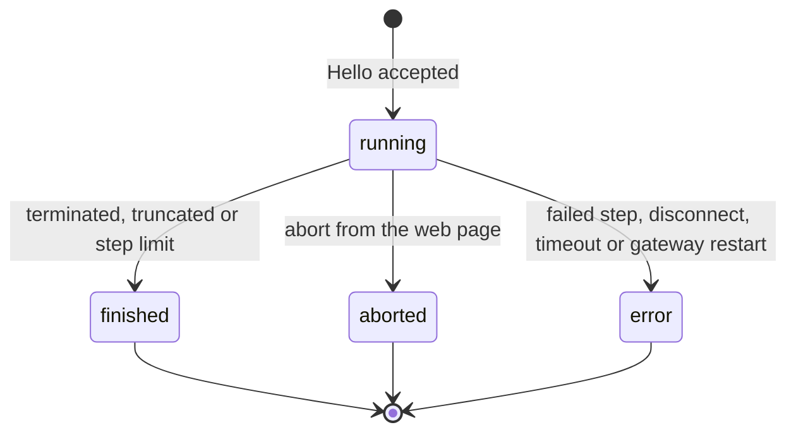
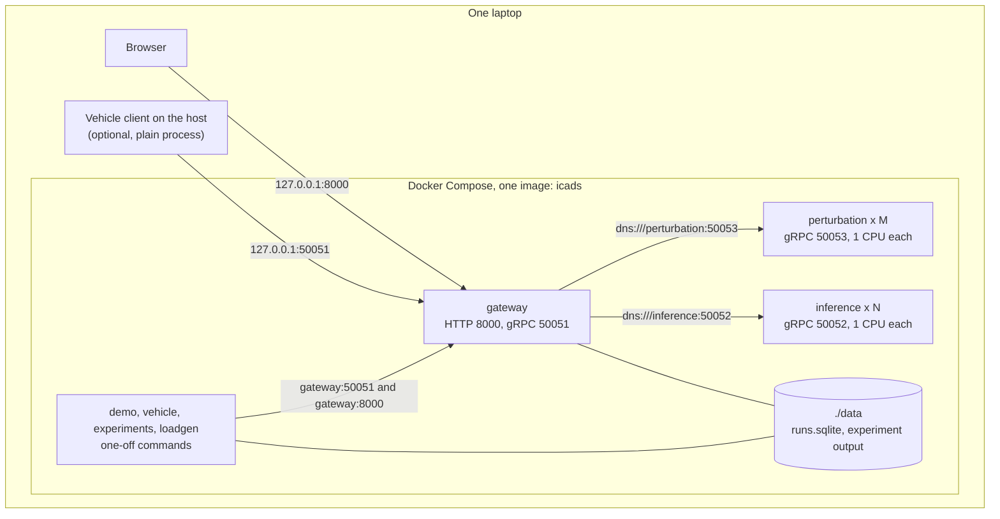

# Internet Connected Autonomous Driving System: Architecture

Status: v1.0, 21 November 2026. This is the agreed architecture. It settles decisions A1 to A4 of the specification (`SPEC.md` v0.7, section 6) and everything that depends on them. Requirements tables, the test matrix and the schedule will return in the specification. To change the architecture, change or add a row in the decision log (section 3) and update the sections it points to.

Sources:

- the project proposal (`proposal.pdf`, objectives B1 to B4)
- the specification: the v0.6 short form, v0.7, and the long v0.5 in commit `4e87737`
- the course module DSNSWK120 "Internet" (https://moduler.aau.dk/course/2025-2026/DSNSWK120?lang=en-GB)
- the code of the models repository (https://github.com/Internet-CADS/models, `entries/05_wocar_dqn_r3`) and of highway-env, which was read to check the facts used below

## 1. Context and constraints

Driving environments run as vehicle clients. Each one sends its observations over the network to the service. The service applies a bounded state perturbation, asks the DRL agent for an action and returns it. It also records each step and shows it live in a web page (B1 to B4).

Fixed by the specification and not reopened here:

- `highway-v0` only, simulation only.
- The agent: the 21 pretrained checkpoints from the models repository (vanilla DQN, SA-DQN and WocaR-DQN, 7 seeds each). No training.
- Perturbations: random L∞ noise, 10-step PGD, MinBest and worst-Q, each bounded by ε ∈ {0, 0.0025, 0.005, 0.0075, 0.01}.
- No communication faults and no fallback action.
- Lockstep: the environment waits for each action. A step that cannot be completed ends the run as failed.
- "Secure" means robust to state perturbations. No network-security work.
- One machine, CPU only, started with one command.
- About 3 build weeks and about 3 implementers.

The specification's principles:

- The same seed, model, attack and ε give the same observations and actions, however many runs or replicas are active.
- A perturbation is a pure function of the observation, model, attack, ε, seed and step.
- Both the clean and the perturbed observation are stored for every step.

From the course: a multilayer internet application whose scalability and quality of service are assessed by experiment, and whose user interface is evaluated systematically (section 18).

## 2. Terms

| Term | Meaning |
|---|---|
| Run | One episode, from reset until termination, truncation or the step limit. Identified by a `runId`. One run is one stream on the gateway. |
| Step | One observation, one action and one environment step, indexed by `t` from 0. |
| Vehicle client | A process that owns one highway-env instance and plays one run at a time through the gateway. |
| Replay vehicle | A load-test client that sends a recorded run instead of running highway-env. Its runs are labelled `synthetic`. |
| Replica | One process of a stateless service. Any replica can answer any call. |
| Clean / perturbed observation | What the environment produced / what the agent receives. |
| Clean action | The action the agent picks on the clean observation. It is shown next to the applied action and is used for the action-flip rate. |
| Viewer | A browser, or a simulated browser, following a run over server-sent events. |

## 3. Decision log

A1 to A4 are the open decisions of specification v0.6. The other decisions follow from them.

| ID | Decision | Rejected | Why |
|---|---|---|---|
| D1 | Vehicle clients, one gateway, and stateless perturbation and inference services (A1) | One simulation service calling a remote agent (v0.4); vehicles talking straight to the agent | The environments become real clients of the service (B1), and the tiers are distinct (course K4). The simulator's CPU load stays out of the service, so load tests measure the service. |
| D2 | The vehicle client starts its own run (A4) | The web page assigns runs to idle vehicles | The vehicle owns the environment. This needs no registry of idle vehicles, and the usability tasks only observe runs. Starting runs from the page is a stretch item. |
| D3 | Perturbations run in a separate perturbation service (A3) | A process pool inside the gateway; inside the inference service; inside the vehicle client | Gradient attacks are the expensive stage, so they get their own tier that can be scaled. The gateway stays I/O only: no PyTorch, and nothing that blocks its event loop. Attacker and agent stay apart. |
| D4 | One gRPC stream per run on the vehicle link (A2) | One call per step; WebSocket with JSON; one HTTP request per step; a NATS broker | A run is a session with state. One stream per run keeps messages in order, detects a disconnect at once and lets the gateway push an abort. The `.proto` file is a typed contract shared by all implementers. No fallback transport. |
| D5 | Single gRPC calls to the two services, spread over replicas by gRPC's round robin (A2) | Streams to the services; a proxy such as Envoy | Pure functions: any replica can answer any step, and a failed call can be retried on another one. Built-in balancing needs no extra component. |
| D6 | REST and server-sent events for the browser (A2) | One WebSocket | Monitoring is one-way. The browser reconnects and resumes from `Last-Event-ID` by itself, and plain HTTP is easy to load-test. |
| D7 | A plain-PyTorch `policy` package that loads the saved weights | Importing the models repository's loader | The repository's loader changes `sys.path` and the working directory and needs `auto_LiRPA`. The network is a plain 50-128-128-5 MLP. |
| D8 | The 21 checkpoint files are copied into this repository with a source note | A git submodule; a download script | Builds and the one-command start work offline. A submodule would pull in the whole models repository. |
| D9 | The inference service also returns the action for the clean observation | Computing it in the perturbation service or the gateway | Every action the system reports comes from one place, through one code path. |
| D10 | Attacks are bounded only by the ε-ball around the clean observation, with no clipping | Clipping to [-1, 1] | These are the same attack functions as in the repository, so crash rates are comparable. |
| D11 | Random numbers come from a generator seeded with (run seed, step) | One running random stream, as in the repository | The result does not depend on which replica serves a step or on the order of requests. |
| D12 | One PyTorch thread per process; capacity is added with replicas | Multi-threaded PyTorch | Results are bit-identical across replicas, and one replica uses one CPU in the scaling experiment. |
| D13 | SQLite in WAL mode, with one writer thread that commits in groups | JSON Lines files; PostgreSQL; DuckDB or Parquet; Redis | One file and no server. SQL serves the run list and the analysis, and readers can read while the writer writes. SQLite's single writer matches the single gateway. |
| D14 | A step is stored before it is shown | Showing a step first and storing it later | A viewer never sees a step that a crash then loses, and resuming always works from the store. |
| D15 | Experiment results come only through the gateway's REST API | Result files written by the vehicles; reading the SQLite file directly | One source of truth, and the experiments demonstrably run through the service. |
| D16 | The scaling experiment scales the perturbation service | Micro-batching and a synthetic delay in the inference service | The perturbation stage is what saturates. The tiny inference network may never saturate. |
| D17 | One Docker image and Docker Compose; plain processes for development | One image per service | One build and one lock file. Image size does not matter on a laptop. |
| D18 | One Python package, with a subpackage per component | A uv workspace with one package per component | Less packaging work. The rule that the vehicle client never loads PyTorch becomes a CI check. |
| D19 | Measurement from per-step timings, `/load`, the load generator and `docker stats` | Prometheus and Grafana | Enough for the experiments, without another stack to run. |
| D20 | A minimal static web page (plain JavaScript and a canvas) with a perturbation overlay | A front-end framework; streamed video frames; a dashboard tool | No build step. It draws what the agent observed and how the attack shifted it. |
| D21 | The gateway's run logic is independent of gRPC | Run logic written inside the gRPC handlers | The logic can be tested without gRPC, and an HTTP vehicle transport can be added later as a second adapter. |
| D22 | No in-process reference mode; the comparison test is deferred | A local driver inside the vehicle client | It is not needed at runtime. The test can be added later because the attacks and the policy are plain shared functions. |

## 4. Components



| Component | Runs as | Does | Never |
|---|---|---|---|
| Vehicle client | A process, one run at a time | Owns one highway-env instance, opens the run, sends observations and poses, applies the action, reports reward and flags. Can pace itself. | Imports the policy, the attacks or PyTorch |
| Gateway | Exactly one process | Admission, input checks, calls to the two services, storing every step, the live feed, the REST API, serving the page | Steps an environment, runs PyTorch, picks an action |
| Perturbation service | N replicas | Applies the run's attack to one observation and checks the bound | Keeps state between calls, picks an action |
| Inference service | N replicas | The agent: action and Q-values for the perturbed and the clean observation | Keeps state between calls |
| Web page | Browser | Lists, watches and replays runs, aborts a run, downloads a log | Starts runs |
| Experiment runner | Command-line tool | Plays a grid through vehicle clients, fetches results through REST, writes tables and plots | Reads the SQLite file |
| Load generator | Command-line tool | Runs replay vehicles and viewers, and measures round trip and viewer delay | Produces results (its runs are labelled `synthetic`) |
| Store | SQLite file | Holds runs and steps | Is written by anything but the gateway's writer thread |

Rules that hold across components:

- Only the inference service picks actions. The vehicle client applies what it receives, and the gateway and the perturbation service never choose.
- Only vehicle clients step environments.
- Only the gateway writes to the store, and only through its writer thread.
- The perturbation and inference services keep no state between calls. Any replica can answer any call, and the same call always gets the same answer.
- Only the perturbation and inference services load PyTorch. The vehicle client never imports the policy, the attacks or PyTorch (checked in CI).

## 5. One step and the life of a run



1. The vehicle client resets highway-env with the run's seed and opens a stream with `Hello`. `Hello` carries the run's settings, the environment settings, the observation layout and scaling, the action names and the road geometry.
2. The gateway checks the `Hello` and its run limit, stores the run as `running` and answers `Welcome` with the `runId`. A refused `Hello` gets a `Summary` with status `refused`, and nothing is stored.
3. At each step the vehicle sends `Obs`: `t`, the clean observation (50 values) and the vehicle poses the observation was taken from.
4. The gateway checks `t` and the values. If the attack is `none` or ε is 0, the perturbed observation is the clean one. Otherwise the gateway calls `Perturb` on a perturbation replica.
5. The gateway calls `Act` on an inference replica with the perturbed observation, plus the clean one if it differs. The reply carries the action and Q-values for both.
6. The gateway sends `Action` with `t` and the action. The vehicle steps its environment and sends `Result`, which carries:
   - the reward
   - the terminated, truncated and crashed flags
   - the vehicle's own round-trip time for this step
   - on the last step only, the final vehicle poses
7. The gateway hands the complete step record to the writer thread. Once the record is committed, the step is published to the run's viewers.
8. After termination, truncation or the step limit, the gateway sends `Summary` with status `finished` and closes the stream.



## 6. Interfaces

### 6.1 Vehicle link: one gRPC stream per run

Sketch of the protocol. Field numbers are settled when the `.proto` files are written.

```proto
syntax = "proto3";
package icads.v1;

service Gateway {
  // Vehicle sends Hello, then Obs and Result per step.
  // Gateway sends Welcome, then Action per step, and Summary last.
  rpc Drive(stream VehicleMsg) returns (stream GatewayMsg);
}

message VehicleMsg { oneof msg { Hello hello = 1; Obs obs = 2; Result result = 3; } }
message GatewayMsg { oneof msg { Welcome welcome = 1; Action action = 2; Summary summary = 3; } }

message Hello {
  uint32 protocol_version = 1;          // 1
  string scenario = 2;                  // "highway-v0"
  string env_config_json = 3;           // environment settings, checked against the reference
  uint64 seed = 4;                      // environment seed, also seeds the perturbation
  uint32 max_steps = 5;                 // default 60
  string model_id = 6;                  // "wocar_dqn/1"
  string attack = 7;                    // none, random_linf, pgd, minbest, worst_q
  float epsilon = 8;
  float pace_hz = 9;                    // 0 = unpaced; informational only
  ObsSpec obs_spec = 10;
  repeated string action_names = 11;    // in index order
  Road road = 12;
  map<string, string> labels = 13;      // experiment, cell, synthetic
}
message ObsSpec {
  repeated string features = 1;         // presence, x, y, vx, vy
  uint32 vehicles = 2;                  // 10 rows, ego first
  bool absolute = 3;                    // false: rows 1 to 9 are relative to the ego
  map<string, Range> ranges = 4;        // scaling per feature, read from the environment after reset
}
message Range { float low = 1; float high = 2; }
message Road  { repeated Lane lanes = 1; }
message Lane  { repeated Point polyline = 1; float width = 2; }
message Point { float x = 1; float y = 2; }
message Pose  { uint32 id = 1; float x = 2; float y = 3; float heading = 4; float speed = 5; }

message Welcome { string run_id = 1; }
message Obs     { uint32 t = 1; repeated float obs = 2; repeated Pose poses = 3; }   // poses: ego first
message Action  { uint32 t = 1; uint32 action = 2; }
message Result  { uint32 t = 1; float reward = 2; bool terminated = 3; bool truncated = 4;
                  bool crashed = 5; float rtt_ms = 6; repeated Pose final_poses = 7; } // final_poses on the last step only
message Summary { string run_id = 1; string status = 2;   // finished, aborted, error, refused
                  string reason = 3; string message = 4;
                  uint32 steps = 5; float total_reward = 6; bool crashed = 7; }
```

Rules:

- Order on a stream: `Hello`, then `Welcome`. Then, for t = 0, 1, 2 and so on: `Obs`, `Action`, `Result`. `Summary` always comes last, after which the gateway closes the stream. Any other order ends the run with `PROTOCOL_VIOLATION`.
- An abort is pushed as a `Summary` with status `aborted` as soon as it is requested. The vehicle stops when it reads it, and anything it still sends is ignored.
- Observations and poses are protobuf `float` (float32), so they arrive bit-identical.
- The vehicle measures its own round-trip time (`Obs` sent to `Action` received) and reports it in the `Result` of the same step. No timestamps are compared between processes.
- `pace_hz` is informational only. Pacing happens in the vehicle client and never changes a result.
- gRPC keepalive pings run on the connection, so a dead peer is noticed even while a run is idle.

### 6.2 Perturbation and inference services: single gRPC calls

```proto
service Perturbation {
  rpc Perturb(PerturbRequest) returns (PerturbReply);
}
message PerturbRequest { string model_id = 1; string attack = 2; float epsilon = 3;
                         uint64 seed = 4; uint32 t = 5; repeated float obs = 6; }
message PerturbReply   { repeated float obs = 1; string replica_id = 2; float handle_ms = 3; }

service Inference {
  rpc Act(ActRequest) returns (ActReply);
  rpc ListModels(ListModelsRequest) returns (ModelList);
}
message ActRequest { string model_id = 1; repeated float obs = 2;
                     repeated float clean_obs = 3; }   // empty when not perturbed
message ActReply   { uint32 action = 1; repeated float q = 2;
                     uint32 clean_action = 3; repeated float clean_q = 4;
                     string replica_id = 5; float handle_ms = 6; }
message ListModelsRequest {}
message ModelList { repeated Model models = 1; }
message Model     { string id = 1; string group = 2; uint32 seed = 3; uint64 frame = 4; }
```

Rules:

- Both calls are pure functions: the same request gives the same reply on any replica. That is what makes a retry safe (section 13).
- `Act` runs the network once, on a batch of one or two observations. When `clean_obs` is empty, `clean_action` and `clean_q` equal `action` and `q`.
- Ties between Q-values go to the lowest action index, which is what `argmax` does in PyTorch.
- The gateway reaches each service through one gRPC channel whose target lists every replica:
  - In Compose: `dns:///perturbation:50053` and `dns:///inference:50052`. Docker's DNS returns one address per replica.
  - With plain processes: an explicit list, such as `ipv4:127.0.0.1:50071,127.0.0.1:50072`.
- The channel uses gRPC's built-in `round_robin` policy, so consecutive calls go to consecutive replicas.
- If round robin over Docker's DNS does not work (the first check in section 21), the gateway opens one channel per named replica and rotates over them itself.
- The replica count is fixed during a measurement. Changing it means restarting the stack.
- Both services implement the standard gRPC health service (`grpc.health.v1`). The Compose health checks and the gateway's `/healthz` use it.

### 6.3 REST

| Method and path | Purpose |
|---|---|
| `GET /` | The web page (static files from `web/`) |
| `GET /v1/runs` | Runs, newest first. Query parameters: `status`, `model`, `attack`, `experiment`, `synthetic` (default `false`), `limit`, `offset` |
| `GET /v1/runs/{runId}` | One run: settings, status, reason and totals |
| `GET /v1/runs/{runId}/log` | The run as JSON Lines: a `run` line with the settings, one `step` line per step (timings included), then an `end` line |
| `DELETE /v1/runs/{runId}` | Abort a running run. The vehicle receives a `Summary` with status `aborted` |
| `GET /v1/models` | The served models, from `ListModels` |
| `GET /healthz` | Gateway up, store open, both services reachable |
| `GET /load` | Active runs and the run limit, viewers, event-loop lag, writer queue length, calls in flight per service |

Runs are created only through the vehicle link (D2).

### 6.4 Server-sent events

**Run list: `GET /v1/events`.** The gateway sends one `run` event whenever a run is created or changes status:

```
event: run
data: {"runId":"r-7f3a","status":"running","modelId":"wocar_dqn/1","attack":"pgd","epsilon":0.005,"seed":7,"labels":{},"createdAt":"2026-12-01T10:15:02Z","steps":0,"crashed":false}
```

The page opens this stream first, then loads `GET /v1/runs`, and merges the two by `runId`. The stream has no ids, so after a reconnect the page reloads the list.

**One run: `GET /v1/runs/{runId}/events`.**

```
event: meta
data: {"runId":"r-7f3a","settings":{...},"road":{...},"obsSpec":{...},"actionNames":["LANE_LEFT","IDLE","LANE_RIGHT","FASTER","SLOWER"]}

id: 42
event: step
data: {"t":42,"poses":[[0,512.3,4.0,0.0,24.1],...],"obs":[...],"obsPerturbed":[...],"linf":0.005,"action":1,"q":[...],"cleanAction":3,"cleanQ":[...],"reward":0.31,"terminated":false,"truncated":false,"crashed":false}

id: 60
event: end
data: {"status":"finished","reason":null,"steps":60,"totalReward":21.4,"crashed":false,"finalPoses":[...]}
```

- `poses` lists `[id, x, y, heading, speed]` for each vehicle, ego first. Units are metres, radians and metres per second.
- On every connection the gateway sends, in order:
  1. `meta`
  2. every stored step after the browser's `Last-Event-ID`, or all steps if there is none
  3. live steps as they are committed
- For a finished run, the gateway then sends `end` and closes the response. The page closes its `EventSource` when it receives `end`, so the browser does not reconnect.
- Recent steps of active runs come from memory, and older ones from SQLite (section 7).
- Each viewer has a bounded queue. A viewer whose queue is full is disconnected, and its browser reconnects with its `Last-Event-ID` and catches up from the store. A slow viewer never delays a run.
- A page keeps at most two streams open (the run list and the open run). That is well within the browser's limit of six HTTP/1.1 connections per host.

### 6.5 Status and reason codes

| Status | Reason codes |
|---|---|
| `refused` (not stored) | `OVERLOADED`, `PROTOCOL_VERSION`, `SPEC_MISMATCH` (environment settings, observation layout or actions differ from the reference), `UNKNOWN_MODEL`, `UNKNOWN_ATTACK`, `BAD_EPSILON` |
| `error` | `PROTOCOL_VIOLATION`, `BAD_OBS_SHAPE`, `NON_FINITE_OBS`, `OBS_OUT_OF_RANGE`, `PERTURBATION_UNAVAILABLE`, `INFERENCE_UNAVAILABLE`, `SERVICE_ERROR`, `VEHICLE_DISCONNECTED`, `VEHICLE_TIMEOUT`, `GATEWAY_RESTART` |
| `aborted` | `ABORTED_BY_USER` |
| `finished` | none |

## 7. Gateway

- **Process.** One Python process with one asyncio event loop that runs both servers:
  - the gRPC server for the vehicle link, on port 50051
  - the HTTP server for REST, server-sent events and the static page, on port 8000
- **Run logic.** Plain Python that knows nothing about gRPC. It takes and returns plain data classes (`on_hello`, `on_obs`, `on_result`, `abort`, `on_disconnect`). The gRPC handler only converts messages. Another vehicle transport (section 20) would be a second converter.
- **Sessions.** One in-memory session per active run holds the settings, the next expected `t`, the totals, a buffer of the last 256 steps and the viewer queues. Nothing in a session is needed to compute a perturbation or an action.
- **Admission.** At most `ICADS_MAX_RUNS` active runs (default 64, a placeholder until measured). A `Hello` beyond the limit is refused at once with `OVERLOADED`. There is no waiting queue.
- **Checks on `Hello`:**
  - protocol version and scenario
  - environment settings equal to the reference settings shipped in the package (the environment part of the repository's rev3 configuration)
  - observation layout: 5 features, 10 rows, relative positions, ranges present
  - 5 action names
  - model known, attack known
  - ε finite and not negative
- **Checks on `Obs`:**
  - `t` is the expected index
  - exactly 50 values, all finite, all within [-1, 1] (± 1e-6)
  - after `Perturb`, the gateway computes the stored ‖δ‖∞ itself from the two vectors. If it exceeds ε + 1e-6, the run ends with `SERVICE_ERROR`.
- **Store writer.** One thread owns the SQLite connection (WAL mode, `synchronous=NORMAL`).
  - It waits for the first queued record, takes everything else that is queued, writes it all in one transaction and commits.
  - Under load, records group themselves into larger transactions. When idle, each step is committed at once.
  - After the commit it hands the records back to the event loop, which publishes them.
- **Readers.** REST requests and viewer catch-up use their own read-only connections on worker threads, so the event loop never waits on SQLite.
- **Fan-out.** Each step event is serialised to JSON once, and the same bytes go on every viewer's queue.
- **Restart.** At start-up, runs that a previous gateway process left as `running` are set to `error` with `GATEWAY_RESTART`.
- **Event-loop lag** is measured by a periodic timer and reported by `/load`.
- The gateway runs no PyTorch and picks no actions.

## 8. Perturbation service

The service loads the 21 models through the policy package at start-up and uses one PyTorch thread.

`Perturb(model, attack, ε, seed, t, obs)` returns the perturbed observation x' for the clean observation x:

- **Random numbers.** A NumPy generator seeded with (seed, t) draws u: 50 values, uniform in [-1, 1]. Every attack and every ε uses the same u at a given seed and step.
- **`random_linf`:** x' = x + ε·u.
- **`pgd`, `minbest`, `worst_q`:**
  1. Compute Q(x) once. Let `best` be its argmax and `worst` its argmin.
  2. Start at x' = x + ε·u.
  3. Repeat 10 times: x' = clip(x' + (ε/10)·sign(∇ loss(x')), x − ε, x + ε). The step size is at least 1e-6.
- **Losses**, all maximised:
  - `pgd`: the cross-entropy of Q(x') against `best`
  - `minbest`: the largest Q(x') among the other actions, minus Q(x') of `best`
  - `worst_q`: Q(x') of `worst` minus Q(x') of `best`
- **No clipping to the observation range.** Values may go up to ε beyond [-1, 1], as in the repository (D10).
- **Self-check.** Every value must be finite and within ε + 1e-6 of x. Otherwise the call fails, which the gateway reports as `SERVICE_ERROR`.

The attacks are ported from `perturb()` in `entries/05_wocar_dqn_r3/evaluate.py`. The module header names the source file and commit.

One difference from the repository: there, random numbers come from one running stream per attack and ε (`RandomState(1234)`). Here they come from (seed, t). Individual episodes therefore differ from the repository's evaluation, so crash-rate statistics are compared, not single steps.

## 9. Inference service and the policy package

- **The network.** The policy package rebuilds the checkpoints' network: 50 → 128 → 128 → 5, with ReLU between the layers and a single output head. The `dueling` flag in the repository's configuration has no effect for `highway-v0`.
- **Loading.** The network is an `nn.Sequential` with the same layer order as the repository's `model.features`, so the saved state dicts load with strict key matching. It does not need `auto_LiRPA`.
- **Model ids** have the form `<group>/<seed>`: `vanilla_dqn/1` to `vanilla_dqn/7`, `sa_dqn/1` to `sa_dqn/7` and `wocar_dqn/1` to `wocar_dqn/7`. Each group uses its peak-of-mean frame: 1,500,000 for vanilla DQN, 1,600,000 for SA-DQN and 1,450,000 for WocaR-DQN.
- **Regression test.** Q-values recorded once with the repository's own loader on a few fixed observations are kept as a test fixture. A test checks the policy package against them.
- **The service** loads all 21 models at start-up (about 2 MB), uses one PyTorch thread, and answers `Act` and `ListModels`.

## 10. Vehicle client, experiment runner and load generator

**Vehicle client** (`icads vehicle`):

- Usage: `icads vehicle --model wocar_dqn/1 --attack pgd --epsilon 0.005 --seed 7 [--pace 1] [--max-steps 60] [--label key=value]`. It connects to `127.0.0.1:50051` by default.
- It creates `highway-v0` with the reference settings shipped in the package, copied from the repository's rev3 configuration:
  - 4 lanes, 15 other vehicles, 60-step episodes
  - simulation at 5 Hz, policy at 1 Hz
  - a `Kinematics` observation of 10 vehicles × (presence, x, y, vx, vy), normalised, relative to the ego and sorted by distance
  - the 5 meta-actions
- It flattens the 10 × 5 observation row by row into 50 values, as the repository's adapter does.
- After `reset(seed)` it reads the observation scaling from the environment (`observation_type.features_range`) and sends it in `Hello`, together with the road geometry.
- It gives each vehicle a small id the first time it sees it, so the page can follow vehicles between steps.
- It plays one run at a time and exits when it receives `Summary`.
- `--pace` sleeps between steps. 1 Hz is real time, because one step is one simulated second.
- It never imports the policy, the attacks or PyTorch.

**Demo** (`icads demo`, Compose profile `demo`): three paced vehicle clients side by side on the same seed:

- vanilla DQN without an attack
- vanilla DQN under PGD at ε = 0.01
- WocaR-DQN under PGD at ε = 0.01

**Experiment runner** (`icads experiment grid.json`):

- The grid file lists the experiment id, the model groups, the checkpoint seeds, the attacks, the ε values, the number of episodes and the number of worker processes.
- Environment seeds 0, 1, 2 and so on are the same in every condition, as in the repository's evaluation. The clean condition (ε = 0) is run once per model, not once per attack.
- Worker processes (by default one per free core) run vehicle-client episodes one after another from a shared queue, unpaced. Every run carries the labels `experiment` and `cell`.
- A failed episode is run once more with the same settings. Both runs stay in the store, and the failure is counted in the report.
- When the grid is done, the runner fetches the run summaries and logs through REST, never from the SQLite file. It writes Parquet tables, plots and a manifest (the grid, the code commit and the image id) to `data/experiments/<id>/`.
- Metrics: crash rate, mean return, episode length and action-flip rate (the applied action differs from the clean action). Each is computed per condition, as the mean over checkpoint seeds together with its spread.

**Load generator** (`icads loadgen profile.json`):

- **Replay vehicles.** Each one sends a recorded run (a JSON Lines log exported from a real run) through the gateway step by step, ignoring the actions it gets back. There is no highway-env, so one process can drive many runs. All its runs carry the label `synthetic` and never count as results.
- **Viewers.** Server-sent-event clients that follow runs like browsers.
- **Profiles** set the number of runs, pacing (for example 1 Hz) or unpaced, the attack, the number of viewers per run and the duration.
- **Measurement.** It measures with its own clock:
  - vehicle round-trip time: `Obs` sent to `Action` received
  - viewer delay: `Result` sent to the matching step event received
  - throughput, refusals and failed runs

## 11. Web page

The page is deliberately minimal: `web/index.html`, `web/app.js` and `web/style.css`. Plain JavaScript and a `<canvas>`, no framework, no build step, served by the gateway.

**Run list.** A plain table, newest first, with model, attack, ε, status and steps. Load-test runs are hidden. It is updated live from `/v1/events`.

**Run view.** The same view serves live and finished runs:

- The scene: lanes from the road geometry and vehicles as rectangles from the poses. The ego is highlighted and the view follows it.
- The perturbation overlay, which can be switched on and off: a semi-transparent "ghost" car where the agent believes each observed car is (see below).
- One line of text: step, chosen action, clean action, and a mark when the two differ.
- The five Q-values, with the highest marked.
- Attack, ε and the largest change actually applied (‖δ‖∞).
- A step slider with marks at the steps where the attack changed the action, and a "follow live" option.
- How the run ended and why, an abort button while it runs, and a link to download the log.

The open run is kept in the address (`#run=<runId>`), so a link opens it. To compare two runs, open them in two tabs.

**How the overlay works.**

- Rows 1 to 9 of the observation describe the nearest vehicles relative to the ego. Row 0 is the ego itself, in absolute values.
- For each row whose clean `presence` is 1, the page converts the perturbed x and y back to metres with the scaling from `meta`: `value = low + (v + 1) / 2 · (high − low)`.
- It draws the ghost at the ego's true position plus that offset.
- Only observed vehicles get a ghost: the nearest 9 within 200 m, ahead of the ego or up to about 10 m behind it. The ego gets no ghost.

What to expect: highway-env's default scaling is ±200 m along the road, ±16 m across it (for 4 lanes) and ±80 m/s for speeds. An attack at ε = 0.01 therefore moves a ghost up to 2 m along the road but only 0.16 m across it. The overlay mostly shows a car that the agent believes is nearer or farther than it really is. Speed changes (up to 0.8 m/s) are not drawn.

## 12. Data model

The store is the SQLite file `data/runs.sqlite`. Vectors are stored as little-endian float32 blobs.

`runs`:

| Column | Content |
|---|---|
| `run_id` | Primary key, assigned by the gateway |
| `status`, `reason`, `message` | `running`, `finished`, `aborted` or `error`, with the reason code (section 6.5) |
| `created_at`, `ended_at` | Wall-clock times |
| `protocol_version`, `scenario`, `env_config` | From `Hello`; `env_config` as JSON |
| `seed`, `max_steps`, `model_id`, `attack`, `epsilon`, `pace_hz` | Run settings |
| `labels` | JSON, for example `{"experiment": "e1", "cell": "pgd-0.005", "synthetic": "true"}` |
| `road`, `obs_spec`, `action_names` | JSON, used by the page |
| `steps`, `total_reward`, `crashed`, `final_poses` | Totals, and the poses after the last step |

`steps`, with primary key (`run_id`, `t`):

| Column | Content |
|---|---|
| `obs_clean`, `obs_perturbed` | 50 float32 each |
| `linf` | ‖δ‖∞, computed by the gateway |
| `action`, `q`, `clean_action`, `clean_q` | From `Act`; `q` and `clean_q` hold 5 float32 each |
| `reward`, `terminated`, `truncated`, `crashed` | From `Result` |
| `poses` | float32 [n × 5] (id, x, y, heading, speed), ego first: the scene the observation was taken from |
| `perturbation_replica`, `inference_replica` | Which replica answered |
| `perturb_ms`, `infer_ms` | Call times as seen by the gateway |
| `perturb_handle_ms`, `infer_handle_ms` | Handling times reported by the services |
| `gateway_ms` | `Obs` received to `Action` sent |
| `rtt_ms` | The vehicle's round-trip time |
| `committed_at` | Wall-clock commit time |

Poses are always stored, so every run can be watched and replayed. A step takes about 1 KB. The reduced experiment grid is 3 groups × 3 checkpoint seeds × 17 conditions × 100 episodes, about 15,000 episodes of at most 60 steps each. It stays under about 1 GB.

Exports: JSON Lines per run through REST (`/v1/runs/{runId}/log`), and Parquet written by the experiment runner.

## 13. Failure, timeout and overload rules

No substitute action is ever applied. A run either completes every step or ends with a status and a reason.

| Situation | Effect |
|---|---|
| A `Perturb` or `Act` call gets no answer within 5 s, or the replica is unavailable | Retried once; round robin sends the retry to the next replica. A second failure ends the run as `error`, with `PERTURBATION_UNAVAILABLE` or `INFERENCE_UNAVAILABLE`. |
| A service answers with an error (for example the perturbation self-check) | Not retried, because the call is deterministic. The run ends as `error`, `SERVICE_ERROR`. |
| The vehicle's stream breaks | The run ends at once as `error`, `VEHICLE_DISCONNECTED`. |
| 30 s pass without a message from the vehicle | `error`, `VEHICLE_TIMEOUT`. |
| Wrong shape, NaN or Inf, a clean value outside [-1, 1], or a message out of order | Only that run ends, as `error` with `BAD_OBS_SHAPE`, `NON_FINITE_OBS`, `OBS_OUT_OF_RANGE` or `PROTOCOL_VIOLATION`. |
| Abort from the page | The run becomes `aborted`. The vehicle receives `Summary` and stops. |
| The gateway process dies | Vehicles see their streams break and exit with an error. At its next start the gateway sets the runs it left as `running` to `error`, `GATEWAY_RESTART`. |
| More runs than the limit | `Hello` is refused at once with `OVERLOADED`. Running runs are not affected. |

Runs with status `error` or `aborted` are excluded from the results and counted in the report. The 5 s and 30 s limits only detect dead peers. They are not deadlines on driving, which is lockstep.

## 14. Reproducibility rules

- Perturbation randomness comes only from (seed, t) (section 8). Nothing depends on the order of requests, on which replica answers or on how many runs are active.
- PyTorch uses one thread per process: `torch.set_num_threads(1)` in code, and `OMP_NUM_THREADS=1` and `MKL_NUM_THREADS=1` in the image. Capacity grows by adding replicas, not threads.
- float32 is used everywhere, on every link.
- Every service runs from the same image, so the versions of PyTorch, NumPy and highway-env are the same everywhere.
- Ties between Q-values go to the lowest action index.
- The vehicle client seeds the environment through `reset(seed)`.

With these rules, results are bit-identical within one setup: the same image on the same kind of machine. On a different CPU the last digits of a computation can differ, which in rare near-ties can flip an action. The report states this.

## 15. Scaling and quality of service

Where the load is:

- **Environment stepping.** Stepping highway-env is CPU-heavy Python. It happens in the vehicle clients, outside the service. Load tests use replay vehicles, so the load generator does not become the bottleneck.
- **Gradient attacks.** These are the expensive service work: about ten forward and backward passes per step. The perturbation service is therefore the tier the scaling experiment scales (D16).
- **Inference.** One forward pass of a network with about 24,000 parameters. Its replicas exist for the failure test.
- **The gateway** is one process. Its health shows in event-loop lag, writer queue length and calls in flight (`/load`).
- **Several gateways** are discussed in the report but not built. Runs would be assigned to gateways by `runId`, viewers would be routed to the gateway that owns the run, and the store would move to PostgreSQL.

Measurements:

| Test | Load | Varies | Reports |
|---|---|---|---|
| Capacity | N runs at 1 Hz, 5 viewers each, without and with PGD | N = 10, 50 | Round-trip and viewer-delay percentiles, failed runs |
| Throughput | Unpaced replay vehicles, PGD in every run | Concurrency 1 to 64 | Steps per second, round-trip percentiles, saturation point |
| Scaling | As throughput, at saturation | Perturbation replicas 1, 2, 4 | Steps per second and p95 per replica count, scaling efficiency, the bottleneck |
| Overload | Twice the run limit at once | | Refusals, and the effect on admitted runs |
| Failure | Steady load, 2 or more replicas of each service | Kill one perturbation replica, one inference replica, the gateway | Failed runs (none expected when a replica is killed), statuses after a gateway restart |

**Metrics:**

- vehicle round-trip time and viewer delay at p50, p95 and p99
- steps per second, refusals and failed runs
- CPU and memory per container (`docker stats`)
- event-loop lag and writer queue length (`/load`)

**Placeholder targets** from v0.5, to be set after the first measurement:

- with one run and no attack, vehicle round trip p95 ≤ 50 ms
- viewer delay p95 ≤ 500 ms with 5 viewers per run
- 50 runs at 1 Hz with 5 viewers each, and no failed runs

**Measurement rules:**

- The load generator runs inside Compose, next to the services.
- Each replica is limited to one CPU, and the replica count stops at the number of free cores.
- Every result states the hardware, the core count, the CPU limits, the replica counts, Docker or plain processes, and that the load generator shares the machine.

## 16. Deployment and packaging



- **One image.** The Docker image `icads` holds the package, the page and the checkpoints. Every service runs the same image with a different command.
- **Commands:**
  - `docker compose up` starts the gateway, 2 inference replicas and 2 perturbation replicas.
  - `docker compose --profile demo up` adds the demo vehicles.
  - `docker compose run --rm vehicle ...`, `docker compose run --rm experiments ...` and `docker compose run --rm loadgen ...` run the one-off tools.
  - `docker compose up --scale perturbation=4` changes the replica count.
- **Network.** Only the gateway's two ports are published, on 127.0.0.1. The two services are reachable only on the Compose network. The page is used on the machine that runs the system.
- **Data.** `./data` is mounted at `/data` for the store and the experiment output.
- **Development.** Plain processes, for example `icads gateway`, `icads inference --port 50061` and `icads perturbation --port 50071`. The gateway is given explicit address lists.

Sketch of `compose.yaml`:

```yaml
x-icads: &icads
  image: icads
  build: .

services:
  gateway:
    <<: *icads
    command: ["gateway"]
    ports: ["127.0.0.1:8000:8000", "127.0.0.1:50051:50051"]
    environment:
      ICADS_INFERENCE: dns:///inference:50052
      ICADS_PERTURBATION: dns:///perturbation:50053
      ICADS_MAX_RUNS: "64"
    volumes: ["./data:/data"]
    depends_on:
      inference: { condition: service_healthy }
      perturbation: { condition: service_healthy }
  inference:
    <<: *icads
    command: ["inference", "--port", "50052"]
    healthcheck: { test: ["CMD", "icads", "health", "127.0.0.1:50052"] }
    deploy: { replicas: 2, resources: { limits: { cpus: "1" } } }
  perturbation:
    <<: *icads
    command: ["perturbation", "--port", "50053"]
    healthcheck: { test: ["CMD", "icads", "health", "127.0.0.1:50053"] }
    deploy: { replicas: 2, resources: { limits: { cpus: "1" } } }
  demo:
    <<: *icads
    profiles: ["demo"]
    command: ["demo", "--gateway", "gateway:50051"]
    depends_on: [gateway]
  # vehicle, experiments and loadgen: like demo, under a "tools" profile
```

## 17. Code layout

```
.
├── docs/                 SPEC.md, ARCHITECTURE.md, proposal.pdf
├── icads/                one Python package
│   ├── protocol/         .proto files, generated gRPC code (committed), reference environment settings
│   ├── policy/           the network and the checkpoint loader
│   ├── attacks/          the four attacks, ported from the models repository
│   ├── gateway/          run logic, gRPC adapter, REST and SSE, store and writer thread
│   ├── inference/        inference service
│   ├── perturbation/     perturbation service
│   ├── vehicle/          vehicle client and demo
│   ├── experiments/      grid runner, result fetching, Parquet and plots
│   ├── loadgen/          replay vehicles, viewers, profiles
│   └── cli.py            one entry point: icads <command>
├── web/                  index.html, app.js, style.css
├── checkpoints/          the 21 .pth files and SOURCE.md (repository, commit, original paths)
├── tests/
├── Dockerfile
├── compose.yaml
├── pyproject.toml        with one lock file
└── README.md
```

- The generated gRPC code is committed. CI regenerates it and fails if anything changes, so nobody needs the code generator just to run the system.
- CI checks that importing `icads.vehicle` never loads PyTorch, `icads.policy` or `icads.attacks`.
- Shared code lives in `protocol`, `policy` and `attacks`. Components do not import each other.

## 18. Course objectives

| Objective (DSNSWK120) | Where the architecture meets it |
|---|---|
| K1, K2: internet technologies | gRPC over HTTP/2, with a long-lived stream for a session and single calls for stateless functions; REST; server-sent events with resume; client-side load balancing of HTTP/2 connections (sections 6 and 15) |
| K4: multilayer architecture using common patterns | Clients, an application tier (the gateway), a service tier (perturbation and inference) and a data tier (SQLite). Patterns: API gateway, stateless replicas, a session per run, admission control, publish and subscribe for viewers |
| S2: systematic evaluation of the user interface | The minimal page is built for the task-based usability test (section 11) |
| S3: justify requirements and architecture | The decision log (section 3) |
| S4: scalable architecture and quality of service, assessed by experiment | Section 15 |

## 19. Assumptions

| ID | Assumption | Source | If it turns out wrong |
|---|---|---|---|
| AS1 | All 50 observation values may be perturbed | Supervisor Q1, default | Add a feature mask to `Perturb` and to the run settings |
| AS2 | Copying the 21 checkpoint files into this repository, and porting the attack code with attribution, is acceptable | Supervisor Q2, default | Replace the copy with a download script that fetches the same files at the commit recorded in `SOURCE.md` |
| AS3 | The load target is 50 concurrent runs with 5 viewers each | Supervisor Q3, placeholder | Raise the run limit and measure again; no design change |
| AS4 | Vehicles are the clients, and communication faults stay out of scope | Supervisor Q5, default | Faults would be a new stage on the vehicle link, which is not designed |
| AS5 | One local page is enough: no accounts, no per-user history | Supervisor Q6, default | Extra pages on the same REST and SSE interfaces |
| AS6 | The page is used on the machine that runs the system | This document | Publish port 8000 on the local network (one line in `compose.yaml`) |
| AS7 | highway-env's observation scaling is as described in section 11 | The highway-env source | Nothing changes: the scaling is read from the environment and sent in `Hello`, not hard-coded |

## 20. Deferred and stretch items

- **Comparison test (deferred).** Run a few seeded episodes directly (environment, attacks and policy in one process) and through the full system, then compare every step. It needs no architecture change, because the attacks and the policy are plain shared functions.
- **Starting runs from the page (stretch).** The page would assign runs to idle vehicle clients.
- **HTTP and JSON vehicle transport (stretch).** Together with an experiment comparing it with gRPC. It would be a second adapter in front of the gateway's run logic.
- **Several gateway processes.** Discussed in the report only (section 15).

Removed from earlier versions: the in-process reference mode of the vehicle client, micro-batching in the inference service, and the synthetic handling delay for load tests.

## 21. First checks (week 1)

- Docker's DNS returns every replica of a scaled service, and gRPC's `round_robin` policy uses them all. If not, the gateway uses one channel per named replica (section 6.2).
- The gRPC server and the HTTP server can share one asyncio event loop in the gateway.
- The policy package matches the repository's loader on the fixture observations (section 9).
- The ported attacks match the repository's `perturb()` on a few fixed observations when they are given the same random draws.
