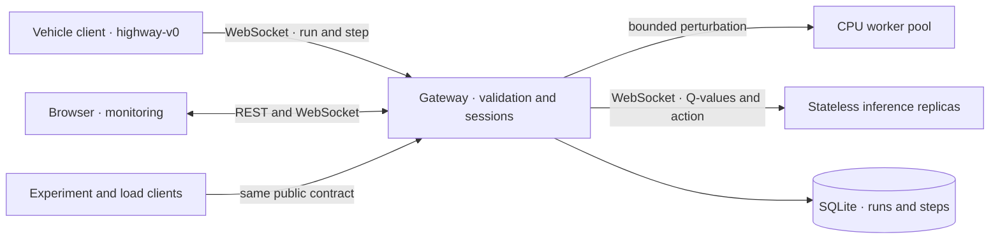

# Implementation plan

19 November 2026 · Implementation authorised

The system serves pretrained policies to seeded `highway-v0` clients on one CPU-only machine, records the effect of bounded state perturbations, and makes runs observable and reproducible. The proposal's objectives are service communication (B1), robust DRL under state perturbations (B2), web monitoring (B3), and evaluation (B4). Decisions and pending supervisor confirmations are tracked in [DECISIONS.md](DECISIONS.md).

## Requirements and acceptance tests

| ID | Priority and source | Requirement | Acceptance test |
|---|---|---|---|
| R1 | MUST [P-B1] [SPEC] | Vehicle clients own distinct environments and request actions from a separate inference tier through the gateway. | Complete one run end to end, then run at least three simultaneous clients and check run IDs, sequences and records for isolation. |
| R2 | MUST [P-B2] [SPEC] | Serve all 21 selected rev3 checkpoints using a pinned, traceable loader. | Load all 21 with strict state-dict matching. Compare Q-values and greedy actions against the source constructor on fixed seeded observations, with exact action agreement and Q-values within absolute tolerance 1e-6. |
| R3 | MUST [P-B2] [SPEC] | Support random L∞, 10-step PGD, MinBest and worst-Q at ε ∈ {0, 0.0025, 0.005, 0.0075, 0.01}. | Verify exact clean identity at zero, finite outputs, fixed-seed repeatability, agreement with the reference at matched random starts and L∞ ≤ ε + 1e-6 at every evaluated step. |
| R4 | MUST [P-B1] [SPEC] | Validate finite inputs, lengths, model IDs, budgets and step ordering. Keep each run in lockstep. Mark unfinished runs failed when a step or service cannot complete. | Reject malformed and non-finite inputs with a documented error. Verify a failed step has no applied action from the gateway, failed runs are excluded from experiment statistics, and healthy concurrent runs complete after a replica stops. |
| R5 | MUST [P-B3] [P-B4] [SPEC] | Durably record both observations with the agent response and the resulting simulation state. | Compare every committed step against the vehicle and inference messages. Reopen SQLite after restart and verify step integrity and terminal status. |
| R6 | MUST [P-B3] [ASSUMED] | Show vehicle states, selected action, action scores, perturbation budget and magnitude, both observations and the action comparison on the monitoring page. | Two independent viewers see the same recorded step and required fields. A later viewer can inspect the same sequence through replay. |
| R7 | MUST [P-B4] [SPEC] | Preserve deterministic observations, perturbations and actions across concurrent runs and replica counts. | Run a fixed grid twice with one replica and with two or more replicas under concurrent traffic. Compare observations, actions, perturbations and simulation outcomes by run configuration and step. |
| R8 | MUST [P-B4] [ASSUMED] | Measure performance, admission control and replica loss on a single machine. | Report local RTT and viewer-delay percentiles, throughput by replica count, limit rejections and healthy-run outcomes after a replica exits. Record host details and load-generator overhead. |
| R9 | MUST [P-B4] [SPEC] | Run a reproducible robustness grid through the deployed service and produce report-ready plots and tables. | Repeat a smoke grid and compare outcomes. For the main grid, compare WocaR and vanilla at ε = 0.01 for each gradient method and report the cross-method mean and seed spread, including any deviation from the reference ranking. |
| R10 | MUST [SPEC] [ASSUMED] | Provide one-command local start, documented reproduction steps, and CI on pushes. | Start on a fresh supported setup using the README. Run the unit and integration suite and repeat the demo. |
| R11 | SHOULD [ASSUMED] | Evaluate monitoring tasks with about five participants. | Record task completion and time for locating a run, identifying the chosen action and comparing observations, plus SUS if confirmed by the course. |
| R12 | MUST [P-B2] [ASSUMED] | Document the RL state, action and reward formulation, the bounded observation threat model, and how the pretrained defences respond. | The report explains the prior model adaptation and evaluates the trade-off between clean driving and perturbed driving. The supervisor confirms the method-design scope. |

## Architecture and contract

| Interface | Contract |
|---|---|
| `open` on `/ws/vehicle` | Protocol version, environment seed, model group and checkpoint seed, method, ε, max steps and lane geometry. Returns a run ID and binds it to the vehicle WebSocket. |
| `step` on `/ws/vehicle` | Zero-based sequence, 50 normalized values and pre-action vehicle poses. Returns matching sequence, discrete action and five Q-values. Gateway validates the input, perturbs it and calls inference. |
| `outcome` on `/ws/vehicle` | Same sequence on the vehicle connection, reward, terminated/truncated/crashed flags and resulting vehicle poses. Gateway atomically commits the step and publishes it. The vehicle waits for acknowledgement before proceeding. |
| `fail` on `/ws/vehicle` | Failure reason on the vehicle connection, for client-side termination when the gateway remains reachable. |
| `infer` on `/ws/infer` | Stateless request with run ID, sequence, model ID, inference vector and optional clean vector. Returns five Q-values, greedy action and processing time. A second forward pass supplies the clean action and scores when ε is nonzero. |
| Browser HTTP | `GET /runs`, `GET /runs/{id}` and `GET /runs/{id}/log`. JSON history and JSONL export come from SQLite. |
| Browser WebSocket | `/ws/runs/{id}?after={seq}` provides run metadata, ordered committed steps and terminal status. Reconnects catch up from the durable log. |
| Health and load | `GET /healthz` and `GET /load` report gateway readiness, active sessions and the admission limit. |

A step record carries run ID, sequence, checkpoint identity, clean and perturbed vectors, perturbation method and budget, L∞ magnitude, selected and clean actions and scores, reward and termination flags, lane and vehicle references or poses, and timestamps and durations for the vehicle, gateway and inference boundaries. Logs persist pre-action and post-action poses so replay shows which observation led to which result. Store wall-clock timestamps for ordering and use monotonic clocks for durations.

One gateway owns the session state machine (`running`, `completed`, `failed`). It allows one outstanding step per run, routes inference requests round-robin over available replicas using reusable connections, and durably commits each acknowledged outcome. Requests affected by a replica failure fail their runs. After a short cooldown, the gateway tries failed replicas on a later request. A finite request timeout detects failures while the simulator stays paused. A session inactivity timeout handles a vanished vehicle and persisted incomplete sessions become failed after gateway restart. An explicit rerun starts an episode with a fresh run ID. Admission is configurable. Bound per-viewer buffering and let slow viewers resume from SQLite.

The `cads/` package contains the shared Pydantic message definitions, vehicle client, gateway, SQLite store, inference service, monitoring assets and evaluation runners. `experiments/` holds grid manifests, and `tests/` contains protocol and service checks. Use Python 3.13, `uv.lock`, Ruff, pytest, Compose and GitHub Actions. Keep pinned checkpoint assets in the authorised models checkout.

## Experiments and milestones

- Run all three model groups with at least three checkpoint seeds per group and 100 episodes per condition as budget allows. Use the five approved budgets for all four methods, sharing an identical clean baseline at ε = 0. Pair the same environment seeds across conditions. Export Parquet and produce crash rate, mean return, episode length and action-flip results with seed-level spread. Report observed attack performance for this simulation configuration.
- For service QoS, measure p50/p95/p99 RTT and viewer delay, completed steps/s, CPU and memory with 1, 2 and 4 replicas where hardware allows. Include fixed-rate request generation for comparable throughput measurements and actual lockstep simulator clients for end-to-end measurement. Probe 10 and 50 active runs with up to five viewers each, admission beyond the configured limit, and a replica exit during load. Set performance thresholds from the first local measurement.

| Milestone | Target | Work and exit criterion |
|---|---|---|
| M0 | Week 1 | Checkpoints, equivalent inference, perturbation bounds and baseline timing verified in [FEASIBILITY.md](FEASIBILITY.md). Record decisions and authorise implementation. |
| M1 | Build week 1 | Protocol/vehicle, gateway/inference and UI/packaging owners deliver one clean run through the actual service boundary, with SQLite and a minimal monitoring page. |
| M2 | Build week 2 | Add the four methods, full monitoring and replay, same-seed test, and worker isolation. Validate multi-viewer behaviour and graceful failure. |
| M3 | Build week 3 | Add multiple replicas, admission and load harness. Run local measurements, finish Compose and CI, freeze features after testing. |
| M4 | Week 5 | Run the reduced grid and monitoring evaluation, generate figures and tables, and rehearse the demo. |

Rights confirmation, cross-seed variation, simulator CPU cost and concurrent session correctness are the main project risks. Keep model data in the pinned checkout, pair seeds and report seed spread, measure simulator and service latency independently, and exercise premature disconnects, duplicate sequences and gateway restarts in tests. If schedule slips, defer nonessential chart polish and advanced replay controls first. If experiment compute is limited, reduce excess seeds toward three, then episode counts, keeping all four methods and recording the final grid.
