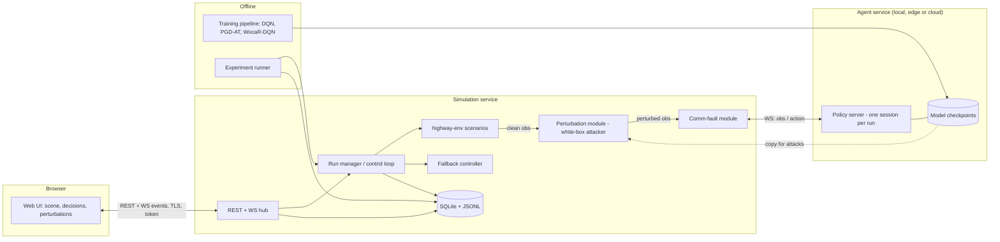

# Internet Connected Autonomous Driving System: Technical Specification and Options Study

Status: DRAFT v0.2 for team and supervisor review. Not yet agreed.

Purpose of this document: work out the realistic options for building the system described in the project proposal, recommend one, and define requirements, interfaces, verification and a schedule so the team can decide.

## 0. Conventions

- "Proposal" means `proposal.pdf` (one page: A Introduction, B Detailed Objectives with four bullets, C References). It is the only authoritative source. Bullets are cited as B1 to B4 in the order they appear.
- Every requirement carries a source tag: `[P-A]`, `[P-B1]` to `[P-B4]` (stated in the proposal), or `[ASM]` (our assumption, to be confirmed). Nothing tagged `[ASM]` is a proposal requirement.
- "Uncertain" marks technical facts from memory that were not verified against documentation while writing. Verify them in the first week (see section 9, WP0).
- Keywords: MUST = needed to satisfy the proposal or a safety/security basic; SHOULD = valuable, droppable under schedule pressure; MAY = stretch.

## 1. Project summary (from the proposal)

### 1.1 Goal

Develop an internet-connected autonomous driving system that integrates a robust deep reinforcement learning (DRL) agent. The system supports interaction between multiple driving environments and the agent through an internet-based interface or service, and the agent keeps operating safely under state perturbations. A web-based visualisation interface monitors the driving process and the agent's decisions (Proposal A).

### 1.2 Detailed objectives (Proposal B)

| ID | Proposal text, paraphrased closely | Notes |
|----|-----------------------------------|-------|
| B1 | An internet-based application or service enabling communication between driving environments and an autonomous vehicle (agent). Environments such as highway, merge and roundabout from the highway-env website may be used, "or other driving environments". | The environment link in the proposal is `highway-env.farama.org/environments/merge/`. |
| B2 | A robust DRL method for secure autonomous driving under state perturbations. Sub-tasks: formulate driving as an RL task, analyse the impact of state perturbations, develop defence strategies. | |
| B3 | A web monitoring and visualisation interface showing vehicle states, selected actions, encountered perturbations and the agent's responses. | |
| B4 | Experiments evaluating the proposed method and system. | |

### 1.3 Sources of perturbation named in the proposal

"Malicious attacks, unreliable communication, or sensor noise" (Proposal A). The system must therefore be able to emulate all three: adversarial perturbation, communication degradation, and random noise.

### 1.4 Reference methods (Proposal C)

1. Liang et al., 2022, "Efficient adversarial training without attacking: Worst-case-aware robust reinforcement learning" (WocaR-RL), NeurIPS 35.
2. Zhang et al., 2021, "Robust reinforcement learning on state observations with learned optimal adversary", arXiv:2101.08452.
3. Xu et al., 2022, "Trustworthy reinforcement learning against intrinsic vulnerabilities: Robustness, safety, and generalizability", arXiv:2209.08025.

Observations from the references (from memory, uncertain on details): WocaR-RL trains an agent to maximise a worst-case-aware objective without running an attack at each training step, and its published experiments include a DQN variant for discrete actions (Atari) and a PPO variant for continuous control; Zhang et al. (2021) learn an optimal adversary alongside the agent (ATLA); Xu et al. is a survey. Whether WocaR-RL's public code transfers directly to highway-env is not known and is the single largest technical risk (section 5, decision D3).

### 1.5 Stakeholders

| Stakeholder | Interest |
|-------------|----------|
| Student team | Deliver a working system and report within the semester. |
| Supervisor / examiners `[ASM]` | Academic soundness of the robust-RL method and experiments; demonstrable system. |
| Demo audience / users of the web UI `[ASM]` | Understand what the agent does and what perturbations occurred. |

### 1.6 Constraints

The proposal states no deadline, budget, team size, hardware, language or deployment target. We therefore assume (all `[ASM]`, confirm in section 10):

- ASM-1: One semester (about 14 weeks of work), team of 3 to 5 students, part-time on this project alongside other courses.
- ASM-2: Compute: student laptops (no GPU assumed for serving), optionally one GPU workstation or university cluster for training. Cloud spend of at most about 20 EUR/month for a demo VM.
- ASM-3: The proposal's "autonomous vehicle" is a simulated vehicle in highway-env. No physical vehicle is required (the proposal names only simulation environments).
- ASM-4: Remote monitoring is read-only. Teleoperation (a human driving the vehicle remotely) is not required by the proposal and is out of scope.
- ASM-5: Open-source tools only; Python as the main language (the RL ecosystem and highway-env are Python).
- ASM-6: Safety means simulated collision avoidance and graceful degradation, not functional-safety certification. ISO 26262, ISO 21448 (SOTIF), ISO/SAE 21434 and UNECE R155/R156 are relevant to real vehicles but not claimed here.

### 1.7 Out of scope (explicit, so the team can contest it)

Real vehicles or scaled hardware; teleoperation; V2X radio stacks (C-V2X, ITS-G5); perception from raw camera/lidar (the agent consumes the simulator's state observation); certification; multi-agent learning (other vehicles are scripted by highway-env).

## 2. Terminology

| Term | Meaning here |
|------|--------------|
| Environment / sim | A highway-env scenario (`highway-v0`, `merge-v0`, `roundabout-v0`, ...) stepped by our simulation service. |
| Agent | The DRL policy, served as a network service that maps an observation to a discrete action. |
| Run / episode | One execution of an environment from reset to termination or truncation, identified by `runId`. |
| State perturbation | Modification of the observation the agent receives, bounded in L-infinity norm by epsilon in normalised observation space (threat model of the reference papers). |
| Communication fault | Delay, jitter, loss or disconnect on the agent link. Distinct from state perturbation. |
| Clean / perturbed observation | What the environment produced / what the agent actually receives. |

## 3. Requirements

### 3.1 Functional requirements

| ID | Requirement | Priority | Source |
|----|-------------|----------|--------|
| FR-01 | The system MUST let a client create, list, stop and fetch the log of runs for scenarios `highway`, `merge`, `roundabout`, with seed and step limit as parameters. | MUST | P-B1 |
| FR-02 | The agent MUST run as a separate network service, reachable only through the defined protocol (section 7). The simulation MUST NOT import the policy. | MUST | P-B1, P-A |
| FR-03 | One agent service instance MUST serve at least 3 concurrent runs (different scenarios) without cross-talk (sessions keyed by `runId`). | MUST | P-A "multiple driving environments", ASM |
| FR-04 | The agent MUST return one discrete action per observation, optionally with Q-values (or equivalent action scores) for display. | MUST | P-B3 |
| FR-05 | A perturbation module MUST be insertable between environment and agent with modes: `none`, uniform random noise, gradient-based attack on the agent's Q-values (FGSM and multi-step PGD, minimising the Q-value of the originally preferred action), all bounded by a configurable epsilon in normalised space. A learned-adversary attack MAY be added. Perturbations MUST be seeded and reproducible. | MUST (first three), MAY (learned) | P-B2, P-A |
| FR-06 | A communication-fault module MUST emulate added latency, jitter, packet or message loss, and disconnects on the agent link, configurable per run. | MUST | P-A "unreliable communication" |
| FR-07 | If no valid action arrives before the step deadline, the simulation MUST apply a defined safe fallback action and record the event. | MUST | P-A "safe operation" |
| FR-08 | A training pipeline MUST produce (a) a non-robust baseline DQN and (b) at least one robust agent, with checkpoints plus metadata (algorithm, seed, epsilon, config hash, git commit). | MUST | P-B2 |
| FR-09 | Every step MUST be logged with: `runId`, `t`, raw observation, perturbed observation, perturbation metadata (mode, epsilon, norm of delta), action, action scores, reward, termination/truncation flags, fallback flag, timestamps for send/receive. | MUST | P-B3, P-B4 |
| FR-10 | The web UI MUST show live, per run: vehicle states, selected action, encountered perturbations, and the agent's response. At least 2 browsers MUST be able to watch the same run. | MUST | P-B3 |
| FR-11 | The UI SHOULD show the clean versus perturbed observation, the perturbation magnitude, and whether the perturbed action differs from the action the agent would pick on the clean observation. | SHOULD | P-B3 "responses of the agent" |
| FR-12 | The UI SHOULD replay a finished run from its log. | SHOULD | ASM |
| FR-13 | A batch experiment runner MUST execute a grid (agent x attack x epsilon x seed x scenario) headlessly and write result tables and plots reproducibly. | MUST | P-B4 |
| FR-14 | Control endpoints (create/stop run, change perturbation) MUST require authentication; viewing MAY use a separate read-only token. | MUST for any non-localhost deployment | ASM, P-A "secure" |
| FR-15 | The same scenario, seed, config and deterministic agent MUST yield identical clean observation sequences. | MUST | P-B4 (reproducible experiments), ASM |

### 3.2 Non-functional requirements

Numeric thresholds are `[ASM]`; they are chosen to be testable and will be recalibrated after the first measurements (section 8).

| ID | Category | Requirement | Source |
|----|----------|-------------|--------|
| NFR-LAT-1 | Latency | Agent service round trip (request received to response sent, CPU inference of an MLP policy) p95 <= 10 ms; observation sent to action received p95 <= 50 ms on one machine or LAN, with one active session. | ASM |
| NFR-LAT-2 | Latency | The step deadline is configurable (default 200 ms). Deadline misses are counted and reported per run. | ASM |
| NFR-LAT-3 | Latency | Time from a step being logged to the corresponding UI update p95 <= 500 ms on a LAN with 5 viewers. | ASM |
| NFR-PERF-1 | Throughput | Headless lockstep evaluation, with a local agent loopback, achieves >= 50 steps/s per run on a laptop (uncertain; to be measured in WP0). | ASM |
| NFR-SAF-1 | Safety | Under any communication fault in FR-06, including permanent agent loss, the simulation process never crashes or hangs; runs end normally with fallback actions recorded. | P-A |
| NFR-SAF-2 | Safety | The fallback action is never `LANE_LEFT`/`LANE_RIGHT`/`FASTER`; it is `IDLE` or a simple rule-based controller (see D3 and D6). | ASM |
| NFR-SAF-3 | Robustness | For the chosen epsilon values, the robust agent's crash rate under the strongest implemented attack is lower than the baseline's, with non-overlapping 95% confidence intervals; and its clean-return loss versus baseline is at most 15%. Targets are placeholders and MUST be set with the supervisor after baseline measurements. | P-B2, ASM |
| NFR-REL-1 | Reliability | The simulation client reconnects to a restarted agent within 5 s (exponential backoff) and resumes the run or fails it cleanly. A 1 hour soak test with random agent restarts shows no unhandled exception. | ASM |
| NFR-REL-2 | Reliability | Completed steps are durably written (flushed) within 1 s; a service restart loses at most the last second of a run. | ASM |
| NFR-SEC-1 | Security | All non-localhost traffic uses TLS (`wss://`, `https://`). | ASM |
| NFR-SEC-2 | Security | Agent link and control API require a bearer token or equivalent; invalid or missing credentials are rejected and logged. | ASM |
| NFR-SEC-3 | Security | All inbound messages are validated against the schema with size and rate limits; malformed input never crashes a service. | ASM |
| NFR-SEC-4 | Security | No secrets in the repository; dependencies pinned with a lock file; container images run as non-root. | ASM |
| NFR-PRV-1 | Privacy | The system processes only simulation data and no personal data. If user accounts are added later, a data-protection review is required first (GDPR applies if the team is in the EU). | ASM |
| NFR-COST-1 | Cost | Serving and demo run on a laptop-class machine plus at most one small cloud VM (about 20 EUR/month). Training fits the available GPU/CPU budget (to be stated in WP0). | ASM-2 |
| NFR-FEAS-1 | Feasibility | Only open-source components; one-command local start (`docker compose up`); CI runs unit and integration tests on every push. | ASM |
| NFR-MNT-1 | Maintainability | Protocol schemas defined once in a shared package and versioned; breaking changes bump the protocol version. | ASM |

## 4. Key design facts about highway-env that shape the options

These are from memory of the highway-env documentation (Farama/Gymnasium based) and MUST be verified in WP0.

- Environments follow the Gymnasium API: `reset(seed=...)` returns `(obs, info)`; `step(a)` returns `(obs, reward, terminated, truncated, info)`.
- Default observation `Kinematics`: a matrix of `vehicles_count` (default 5) rows by features (default `presence, x, y, vx, vy`), ego vehicle first, normalised to a configured range. Flattened it is a short vector, so an MLP policy suffices and CPU inference is cheap.
- Default action `DiscreteMetaAction` has 5 actions: `0 LANE_LEFT`, `1 IDLE`, `2 LANE_RIGHT`, `3 FASTER`, `4 SLOWER`. Note that index 0 is not a no-op.
- Default policy frequency is low (on the order of 1 Hz) with a higher simulation frequency (on the order of 15 Hz); configurable.
- Other vehicles are driven by built-in IDM/MOBIL models. Merge and roundabout have non-straight road geometry, so a front end cannot assume horizontal lanes.
- Rendering uses pygame and can produce `rgb_array` frames; headless rendering is possible but needs care in containers (uncertain).

## 5. Architecture options

For each decision: options with pros and cons, rough effort in person-weeks (pw) for the whole team-level task, cost, the requirements affected, then a recommendation, main risks and a fallback. Effort figures are estimates with wide error bars (factor 2).

### D1. Where does the driving intelligence run?

| Option | Description | Pros | Cons | Effort / cost |
|--------|-------------|------|------|---------------|
| D1-a In-process | Policy is a Python object called by the simulator in the same process. | Simplest; fastest; ideal for training and large evaluations. | Does not satisfy B1 (no internet interface); no latency/fault story. | 0 pw extra |
| D1-b Remote agent service (cloud or any host) | Policy served by a separate network service; simulator sends observations, receives actions. | Directly realises B1 and "internet-connected"; allows testing latency, loss and security; matches the proposal's picture of an agent that interacts with environments through a service. | Added latency and failure modes; needs fallback logic; more moving parts. | 2 to 3 pw; free locally, small VM for WAN demo |
| D1-c On-vehicle policy, cloud only for monitoring and data | Driving decisions local; the internet carries telemetry and updates. | Realistic for real vehicles (safety-critical control must not depend on a network); no latency risk on the control loop. | The agent-environment link would not be internet-based, so B1 reads as only partly met; connectivity-loss experiments become trivial. | 2 pw |
| D1-d Hybrid: remote agent with local fallback policy | D1-b plus a simple local controller on the simulator side used when the remote answer is late or missing. | Satisfies B1; gives principled degradation (FR-07, NFR-SAF-1); closest to how a real vehicle would be built. | Slightly more code; fallback policy design needs care. | 3 to 4 pw |
| D1-e Edge | Agent on a nearby node (same LAN/campus) between vehicle and cloud. | Lower latency than cloud. | In this project it is the same code as D1-b with a different host; no extra design. | covered by D1-b |

Recommendation: D1-d. Remote agent service as the primary path (D1-b), with the in-process mode (D1-a) kept as an evaluation/training shortcut behind the same agent interface, and a local fallback (`IDLE` at minimum). Edge versus cloud is a deployment choice, not an architecture choice (D10).
Risks: latency makes the fallback fire often at high policy frequency; mitigated by lockstep mode (D6) and by measuring.
Fallback if the remote path proves unstable: D1-a for all experiments, keep the service only for the demo.
Implications: FR-02, FR-03, FR-07, NFR-LAT-*, NFR-SAF-1/2.

### D2. Simulation platform and the meaning of "vehicle"

| Option | Pros | Cons | Effort / cost |
|--------|------|------|---------------|
| D2-a highway-env only (highway, merge, roundabout) | Named in the proposal; lightweight (CPU, pure Python); discrete meta-actions suit DQN-type methods; fast iteration; scenarios ready. | Abstract kinematic simulation; no sensors; limited realism. | 1 pw |
| D2-b highway-env plus a second environment (e.g. `intersection-v0` or `racetrack-v0`) | Tests generalisation; proposal allows "other driving environments". | Extra tuning and training time per environment. | +1 to 2 pw |
| D2-c CARLA (or SUMO for traffic-level) | Realistic, sensors, rich visuals. | Needs a GPU and significant setup (CARLA recommends a capable GPU; uncertain on exact requirements); perception becomes the problem, outside the proposal; very high schedule risk. | 6+ pw, GPU |
| D2-d Scaled physical vehicle (e.g. Donkey Car, F1TENTH, Duckietown) | Real hardware, real network. | Cost (hundreds of EUR per vehicle), build time, safety in lab, tiny overlap with the proposal's highway/merge/roundabout; field testing logistics. | 8+ pw, hardware budget |

Recommendation: D2-a with D2-b as a stretch (SHOULD: one extra scenario, `intersection-v0` or similar, only after the main experiments run). The environment is wrapped behind a thin factory so a new scenario is a config change.
Risks: results may not transfer to richer simulators; state this limitation in the report.
Fallback: none needed; D2-a is the floor.
Implications: ASM-3; hardware-in-the-loop and field tests are not planned (section 8).

### D3. Learning stack and robust method

Decision split: (i) algorithm family, (ii) library/code base, (iii) how robustness is obtained.

(i)+(iii) Robust training options:

| Option | Description | Pros | Cons / risks | Effort |
|--------|-------------|------|--------------|--------|
| D3-a Baseline DQN only, plus noise augmentation | Train vanilla DQN; add random-noise training. | Easy; always works. | Weak against gradient attacks; does not meet B2's "defence strategies" in a research sense. | 1 to 2 pw |
| D3-b PGD adversarial training (attack inside training loop) | Train on observations perturbed by an online attack (min-Q PGD). | Well understood; implementable by us; strong baseline. | Costly per step (multi-step attack per update); hyperparameter-sensitive; can reduce clean performance. | 2 to 3 pw |
| D3-c Certified-style regularisation, SA-DQN (Zhang et al., 2020, NeurIPS; not in the proposal's reference list) | Regularise the Q-network using convex-relaxation or interval bounds on the output under perturbation (it uses the `auto_LiRPA` library; uncertain). | Principled robustness, close family to WocaR; reference code exists (uncertain). | Needs bound-propagation tooling; harder to debug; slower training. | 3 to 4 pw |
| D3-d WocaR-DQN (Proposal C1) | Worst-case-aware training: estimates a worst-case Q-value and trains on it, avoiding an inner attack loop. | The primary reference of the proposal; efficient training; likely cleanest story for the report. | Public code targets Atari-style image inputs (uncertain); porting to a low-dimensional highway-env state and tuning epsilon is real work; it may require reimplementation from the paper. | 4 to 6 pw |
| D3-e Learned adversary (ATLA/PA-AD style; Proposal C2) | Co-train an adversary policy. | Strongest attack class; good for evaluation. | Doubles training complexity; unstable. | 4+ pw; recommend only as evaluation attack, MAY |

(ii) Code base: `stable-baselines3` DQN for the baseline and for the environment wrappers (mature, uses Gymnasium); custom PyTorch for the robust variants (or the authors' code if it can be adapted). Alternative: CleanRL single-file DQN, easier to modify for custom losses. We recommend CleanRL-style single-file PyTorch for all variants so the loss changes are visible and comparable (judgement call; both are fine).

Recommendation: a staged ladder, so that something robust always exists:
1. Stage 1 (week 3): vanilla DQN baseline, trained and evaluated clean.
2. Stage 2 (week 5): PGD adversarial training (D3-b) plus noise augmentation as the first robust agent.
3. Stage 3 (week 9): WocaR-DQN (D3-d), ported or reimplemented, compared with Stage 1 and 2.
4. Stretch: SA-DQN style regulariser (D3-c) and learned adversary as an attack (D3-e).
Main risk: Stage 3 does not converge on highway-env or takes more time than planned. Fallback: report Stage 2 as the robust method and document the WocaR attempt honestly (still a valid B2 outcome: "analyse the impacts of perturbations and develop defence strategies").
Also keep an eye on a known pitfall: highway-env rewards and the discrete meta-action make some scenarios hard for DQN without reward and observation-range tuning; allow time for this (WP2).
Implications: FR-08, FR-05, NFR-SAF-3, NFR-COST-1 (training on CPU is feasible for MLP policies within hours per run; uncertain, measure in WP0).

### D4. Threat model, perturbation placement and attack set

Where perturbations are applied:

| Option | Pros | Cons |
|--------|------|------|
| D4-a Sim-side module before the agent link (clean obs from env, perturbed obs sent) | Full knowledge of clean obs; exact epsilon control; seeded; logs raw and perturbed. | The attack module needs a copy of the model weights for gradient (white-box) attacks, so it is a second consumer of checkpoints. |
| D4-b Network proxy (tc/netem, Toxiproxy, mitmproxy) between sim and agent | Realistic placement; no code in sim. | Can only degrade timing/delivery or tamper with bytes; cannot compute gradient attacks; hard to enforce an L-infinity bound. |
| D4-c Inside the agent service ("attack mode") | Has the model; simple. | Mixes attacker and defender in one trust domain; the logged "raw" observation is then not at the sim; confusing for the security story. |

Recommendation: D4-a for state perturbations (attacker module with its own copy of the checkpoint, white-box), plus D4-b (Toxiproxy or Linux `tc netem` in a container with NET_ADMIN) for communication faults, with an in-process delay/drop shim as a portable fallback (macOS laptops cannot run `tc` natively).
Attack set: none; uniform noise; FGSM min-Q; PGD min-Q (10 to 50 steps, tuned); stretch: learned adversary. Epsilon grid in normalised observation space, e.g. {0, 0.01, 0.02, 0.05, 0.1} (placeholder, calibrate so the baseline degrades visibly at the upper end).
Important design point: perturbations of a normalised kinematic vector may violate physical consistency (e.g. `presence` flag). Decide which features are attackable (open question Q4); the proposal does not say.
Implications: FR-05, FR-06, FR-09, FR-15.

### D5. Communication technology and protocol

Payload is small (a few hundred bytes per message at 1 to 15 Hz), so bandwidth is not a differentiator. Latency, ease of implementation, browser support and tooling are.

| Option | Pros | Cons |
|--------|------|------|
| D5-a HTTP/REST request per step (`POST /act`) | Simplest; stateless; easy to test with curl and load-balance; works through proxies. | New connection or header overhead per step; no server push (browser needs a second channel). |
| D5-b WebSocket with JSON messages | Persistent, low overhead, full duplex, works for both agent link and browser; trivial with FastAPI. | Application-level reconnect, ordering, schema and backpressure are ours; JSON slower than binary (irrelevant at this rate). |
| D5-c gRPC bidirectional streaming (protobuf) | Strong typed schema, deadlines built in, HTTP/2, code generation. | Browsers need gRPC-Web plus a proxy (Envoy); heavier tooling for a student team. |
| D5-d MQTT broker (e.g. Mosquitto) | Standard IoT/vehicle-telemetry style; QoS levels; good for loss-prone links. | Broker to run; request/response pattern awkward (need correlation ids); added hop latency; per-session topics. |
| D5-e ZeroMQ / raw TCP | Fast and flexible. | No browser support, hand-rolled framing and security. |

Recommendation: D5-b WebSocket + JSON for the agent link and for the browser event feed, plus plain REST (`FastAPI`) for run control and log download. Messages carry `protocolVersion`, `runId`, `seq` and timestamps (section 7). Schemas live in one shared Python package (Pydantic) and are exported as JSON Schema for the front end.
Risks: head-of-line blocking if one connection multiplexes sessions; avoid by one WebSocket per run (`/ws/agent/{runId}`), not a single shared queue.
Fallback: D5-a (`POST /act`) behind the same Python client interface, selectable by config. This is also the easiest thing to debug.
Implications: NFR-LAT-1/2, NFR-MNT-1, FR-03.

### D6. Time model: lockstep versus real-time

| Option | Description | Pros | Cons |
|--------|-------------|------|------|
| D6-a Lockstep | Simulator pauses until the action arrives (with a long timeout). | Deterministic; reproducible experiments; latency has no effect on outcome. | Hides the latency problem; not a model of a real vehicle. |
| D6-b Real-time paced with deadline | Simulator advances at a fixed rate; if the action misses the deadline, the fallback is applied and the late action is discarded (or applied next step). | Makes latency and loss matter, which is the point of "internet-connected"; allows measuring deadline-miss impact. | Non-deterministic with real networks; harder tests. |
| D6-c Hybrid, selectable per run | `mode: lockstep|realtime` in the run config. Evaluation grids use lockstep; communication experiments use real-time with emulated (seeded) delay. | Gets both. | Two code paths (small: only the wait/deadline logic differs). |

Recommendation: D6-c. Default step deadline 200 ms (ASM), configurable; the draft's 2000 ms timeout is far above any plausible control deadline for a 1 to 5 Hz policy and would make fallback almost meaningless.
Seeded delay injection (D4-b shim) gives reproducible real-time experiments. Fallback: D6-a only.

### D7. Data pipeline and storage

| Option | Pros | Cons |
|--------|------|------|
| D7-a JSON Lines file per run | Trivial, append-only, human-readable, matches the draft. | Querying across runs is awkward; no index; large for batch grids. |
| D7-b SQLite (runs and steps tables) | Stdlib, single file, SQL queries for the UI and experiment analysis. | Single-writer; schema migrations. |
| D7-c PostgreSQL / TimescaleDB | Multi-user, scalable, time-series features. | Another service to operate; overkill for the data volume (about 10^5 to 10^7 rows). |
| D7-d Columnar files (Parquet) for batch results | Compact, fast with pandas/polars. | Not for live append. |
| D7-e InfluxDB/Prometheus + Grafana | Ready dashboards for metrics. | Not designed for per-step vehicle state plus perturbation records; extra services. |

Recommendation: D7-b SQLite as the system of record (WAL mode), with a JSONL export per run, and Parquet for batch experiment outputs. Raw and perturbed observations are both stored from day one (kept from the draft; it is the right call). Large batch evaluations write directly to Parquet without the live pipeline.
Fallback: D7-a only.
Estimate: 300 steps/run x ~1 KB/step = 0.3 MB/run; 10^4 runs = 3 GB; fine.
Implications: FR-09, FR-12, FR-13, NFR-REL-2.

### D8. Monitoring and visualisation interface

| Option | Pros | Cons | Effort |
|--------|------|------|--------|
| D8-a Custom single page: JS + `<canvas>`, driven by structured events (vehicle poses plus road geometry) | Precise control; shows actions, Q-values, perturbations; no build step; light. | Must draw roads for merge and roundabout (curved lanes); more front-end work. | 2 to 3 pw |
| D8-b Stream rendered frames from highway-env (`rgb_array`, JPEG over WebSocket) plus side panels for numbers | Fast to implement; exact scenario drawing for free; any scenario works. | CPU cost and headless pygame setup in containers; bandwidth; cannot overlay custom data on the scene; no replay from log without re-simulating. | 1 pw |
| D8-c Dashboard tool (Grafana, Streamlit, Gradio, Dash) | Quick charts; Streamlit/Gradio are quick to code. | Weak live scene rendering; limited custom interaction; extra service. | 1 to 2 pw |
| D8-d Foxglove or Rerun | Purpose-built robotics visualisation. | Learning curve; not a plain "web interface" users open; uncertain on embedding/licensing. | 2 pw |

Recommendation: D8-a with a plain-JS page (optionally with Chart.js or uPlot from a pinned CDN or vendored file for the Q-value and reward charts). Send the static road geometry once per run (sampled lane centre-lines taken from the environment's road network; the exact API needs verification) and vehicle poses per step. Lane polylines handle merge and roundabout.
Fallback: D8-b for the scene (frames), with D8-a-style panels for numbers.
Implications: FR-10, FR-11, FR-12, NFR-LAT-3.

### D9. Security approach

Threat model (ASM; to be reviewed): (T1) unauthorised party sends observations or actions or controls runs; (T2) man-in-the-middle tampers with observations or actions on the wire; (T3) denial of service on the agent; (T4) malformed input; (T5) adversarial perturbation of the sensed state (handled by the robust agent, not by transport security). Transport security does not make the agent robust: an attacker who controls the sensor still sends authenticated data. The report should keep T2 and T5 separate.

| Option | Pros | Cons |
|--------|------|------|
| D9-a None (trusted LAN) | Zero effort. | Contradicts "secure" in B2 and A; indefensible when exposed. |
| D9-b TLS terminated by a reverse proxy (Caddy or nginx; Caddy automates certificates) plus bearer tokens (static API keys or short-lived signed tokens) | Meets T1 to T3 basics with little code; standard. | Token management; no per-device identity. |
| D9-c Mutual TLS between sim and agent | Strong device identity; resists T1 and T2. | Certificate issuance and rotation burden for a student team; harder to debug. |
| D9-d Private overlay network (WireGuard or Tailscale) | Little application code; works over the internet. | Not an application-level control; not present for browser viewers who are not in the overlay. |

Recommendation: D9-b, with schema validation and rate limits (NFR-SEC-3), read-only viewer tokens, non-root containers; D9-d optional for the WAN demo. mTLS MAY be added if time remains.
Fallback: D9-d only (private network) with tokens.

### D10. Deployment

| Option | Pros | Cons |
|--------|------|------|
| D10-a Local processes (`uv run ...`) | Fastest for development. | Not reproducible for others. |
| D10-b Docker Compose on one machine (sim, agent, optional proxy) | One-command start; networks can be separated; supports `tc`/Toxiproxy experiments. | Localhost is not the internet; Docker on macOS adds a VM layer (latency measurements differ). |
| D10-c Compose on 2 hosts: sim on laptop, agent on a small cloud VM | Real WAN round-trip times and exposure; best demonstration of "internet-connected". | VM cost and admin; TLS/auth must work; the evaluation is not reproducible because network conditions vary. |
| D10-d Kubernetes or managed ML serving | Scalable, rollouts. | Disproportionate for this project. |

Recommendation: D10-b as the default and for all reproducible experiments, D10-c once for a demo and for a measured WAN latency data point (agent on a VM in a nearby region; record RTT percentiles). Training happens offline on available GPU/CPU and is not part of runtime deployment.
Fallback: D10-a/b only; WAN data point replaced by emulated latency.

### D11. Summary of recommended choices

| Decision | Recommended | Fallback |
|----------|-------------|----------|
| D1 Agent location | Remote agent service with local safe fallback (D1-d) | In-process agent for experiments |
| D2 Platform | highway-env (+1 extra scenario if time) | n/a |
| D3 Robust method | Ladder: DQN, PGD-AT, WocaR-DQN; SA-DQN and learned adversary as stretch | PGD-AT as the robust method |
| D4 Perturbation | Sim-side white-box attacker; separate comm-fault module | In-process delay shim only |
| D5 Protocol | WebSocket + JSON, REST control | HTTP `POST /act` |
| D6 Time model | Selectable lockstep or real-time | Lockstep only |
| D7 Storage | SQLite + JSONL export + Parquet for batches | JSONL only |
| D8 UI | Canvas page from events and road geometry | Streamed frames |
| D9 Security | TLS via reverse proxy + bearer tokens | Private overlay + tokens |
| D10 Deployment | Docker Compose; one WAN demo on a VM | Local processes |

## 6. Recommended architecture

### 6.1 Components

| Component | Responsibility | Tech |
|-----------|----------------|------|
| Simulation service (`sim`) | Owns environments; runs the control loop per run; applies perturbation and fault modules; applies fallback; writes logs; serves REST, browser WebSocket and static UI. | Python 3.12 (to be verified against highway-env, PyTorch and dependency support), FastAPI, asyncio, highway-env |
| Perturbation module | Takes clean observation, returns perturbed observation plus metadata. Holds a model copy for white-box attacks. | PyTorch, in `sim` process (or worker) |
| Comm-fault module | Delay, jitter, loss, disconnect on the agent link, seeded. | In-process shim; Toxiproxy or `tc netem` optional |
| Agent service (`agent`) | Loads a checkpoint; serves one session per run; returns action and scores; exposes `/healthz` and model metadata. | FastAPI, PyTorch (CPU) |
| Fallback controller | Safe action when the deadline is missed: `IDLE` (index 1) initially; optionally a rule-based IDM-style check. | in `sim` |
| Web UI | Live scene, decisions, perturbations, charts, run list, replay. | Static HTML/JS, canvas |
| Data store | `runs`, `steps`, `events` tables; JSONL export. | SQLite (WAL) |
| Experiment runner | Headless batch grid from a YAML config; calls the same env wrapper, perturbation module and agent (local loopback or remote); writes Parquet and plots. | Python CLI, pandas, matplotlib |
| Training pipeline | Offline training of baseline and robust agents; checkpoints with metadata. | PyTorch, Gymnasium; not deployed |
| Reverse proxy | TLS, auth enforcement for the WAN deployment. | Caddy or nginx |
| Shared `protocol` package | Pydantic models, constants, JSON Schema export. | Python |

### 6.2 Diagram



### 6.3 Data flow of one step (lockstep or real-time)

1. Run manager takes the clean observation `o_t` from the environment.
2. Perturbation module computes `o'_t` (within epsilon), records mode, epsilon and `||o'_t - o_t||_inf`.
3. `o'_t` plus `runId`, `t`, `seq`, `sentAt` is sent to the agent through the fault module (which may delay, drop or disconnect).
4. Agent returns `action`, `scores`, `modelId`, `recvAt`, `sentAt`.
5. If the deadline passes without a valid reply (real-time mode) or the timeout expires (lockstep, long), the fallback action is applied and `fallback=true` is recorded. A late reply is counted and discarded.
6. Environment steps with the action, returning `(obs, reward, terminated, truncated, info)`.
7. The step record is written to the store; `state`, `decision`, `perturbation` events are broadcast to subscribers.

### 6.4 Repository layout (proposed)

Kept close to the draft but made self-consistent (the draft mixed `src/` and `app/` paths).

```
.
├── docs/SPEC.md
├── protocol/                 # shared schemas, JSON Schema export
├── sim_service/              # FastAPI app, runner, envs, perturbation, faults, store, static UI
├── agent_service/            # policy server
├── training/                 # DQN, PGD-AT, WocaR-DQN, configs
├── experiments/              # grid configs, analysis notebooks/scripts
├── tests/                    # unit, integration, e2e
├── docker-compose.yml
├── pyproject.toml            # uv workspace
└── README.md
```

A `uv` workspace with a committed `uv.lock` is a reasonable packaging choice (the draft proposed it); alternatives such as Poetry or pip-tools work equally well. The decision is not architecture-relevant; pick one and pin Python.

## 7. Interfaces

### 7.1 Overview

| ID | Between | Style | Direction | Contents |
|----|---------|-------|-----------|----------|
| IF-1 | Browser and Sim | REST (HTTPS) | request/response | Run lifecycle, config, log download, run list. |
| IF-2 | Browser and Sim | WebSocket `/ws/runs/{runId}` | server to client | `state`, `decision`, `perturbation`, `status` events; buffered history replayed on connect (bounded). |
| IF-3 | Sim and Agent | WebSocket `/ws/agent/{runId}` (fallback `POST /act`) | request/response over a stream | `hello`, `obs`, `action`, `error`. |
| IF-4 | Agent and checkpoint store | files | read | Checkpoint plus `meta.json`. |
| IF-5 | Training and checkpoint store | files | write | Same format as IF-4. |
| IF-6 | Perturbation module and checkpoint store | files | read | Same checkpoint, for white-box gradients. |
| IF-7 | Sim and data store | SQLite | read/write | `runs`, `steps` tables. |
| IF-8 | Experiment runner and Sim components | Python API or REST | | Same env wrapper and agent client as the service. |

### 7.2 REST (IF-1) sketch

| Method and path | Purpose |
|-----------------|---------|
| `POST /runs` | Create and start a run. Body: `scenario`, `seed`, `maxSteps`, `mode` (`lockstep` or `realtime`), `deadlineMs`, `agentUrl` (optional), `perturbation` (`mode`, `epsilon`, `steps`, `seed`), `faults` (`delayMs`, `jitterMs`, `lossProb`, `disconnectAtStep`). Returns `{ "runId": ... }`. |
| `GET /runs`, `GET /runs/{id}` | List and detail incl. status `pending|running|finished|aborted|error`. |
| `GET /runs/{id}/log` | Step records (JSONL or paged JSON). |
| `DELETE /runs/{id}` | Abort. |
| `GET /healthz` | Liveness. |

The draft's `DELETE` marked an aborted run as `finished`; use a distinct `aborted` status so evaluation scripts can exclude it.

### 7.3 Agent link messages (IF-3)

All messages carry `protocolVersion`, `runId`, `seq`. Timestamps are ISO 8601 UTC or epoch milliseconds from a monotonic-plus-wall pair; clock offset between hosts must not be assumed zero, so latency is measured at the sender as send-to-receive on its own clock.

```json
{ "type": "hello", "protocolVersion": 1, "runId": "r-17", "scenario": "merge",
  "obsSpec": { "shape": [5, 5], "features": ["presence","x","y","vx","vy"], "normalised": true },
  "actionSpec": { "type": "discrete", "n": 5, "names": ["LANE_LEFT","IDLE","LANE_RIGHT","FASTER","SLOWER"] } }

{ "type": "obs", "runId": "r-17", "seq": 42, "t": 42, "deadlineMs": 200, "obs": [ ... ] }

{ "type": "action", "runId": "r-17", "seq": 42, "t": 42, "action": 1,
  "scores": [0.2, 0.9, 0.1, 0.05, 0.3], "modelId": "wocar-dqn-s1-ckpt-500k", "inferenceMs": 1.3 }

{ "type": "error", "runId": "r-17", "code": "BAD_OBS_SHAPE", "message": "..." }
```

The `hello` handshake lets the agent verify observation and action specifications and reject mismatches instead of silently acting on a different layout. The `seq` echo allows late and duplicate replies to be recognised in real-time mode. The agent MUST be stateless with respect to a step (frame stacking, if used, is stated in `obsSpec`).

### 7.4 Browser events (IF-2)

```json
{ "type": "road",  "runId": "r-17", "lanes": [ { "id": "...", "polyline": [[x,y], ...], "width": 4.0 } ] }
{ "type": "state", "runId": "r-17", "t": 42, "vehicles": [ { "id": 0, "ego": true, "x": 12.3, "y": 0.1, "heading": 0.02, "speed": 24.0 } ] }
{ "type": "decision", "runId": "r-17", "t": 42, "action": 1, "scores": [ ... ], "cleanAction": 3, "reward": 0.31, "fallback": false, "latencyMs": 8 }
{ "type": "perturbation", "runId": "r-17", "t": 42, "mode": "pgd", "epsilon": 0.05, "linf": 0.05, "faultKind": null }
{ "type": "status", "runId": "r-17", "status": "finished", "totalReward": 21.4, "crashed": false }
```

`cleanAction` (the action the agent would choose on the clean observation) needs one extra forward pass in the sim-side model copy, and is only available if the attacker module has the model; it is optional. The `road` event is sent once at connection and on reconnect.

### 7.5 Step record (store and log)

Fields: `runId, t, obs_raw, obs_perturbed, perturbation{mode, epsilon, linf}, action, scores, clean_action?, reward, terminated, truncated, fallback, late_reply, sent_at, recv_at, rtt_ms, vehicles?` (vehicles optional, enabling replay without re-simulation).

## 8. Verification and validation plan

### 8.1 Levels and tools

| Level | What | Tools |
|-------|------|-------|
| Unit | Perturbation bound (`linf <= epsilon + 1e-6`), seeding, schema validation, fallback logic, action index mapping | pytest |
| Integration (software-in-the-loop) | sim + agent in Compose; protocol conformance; concurrency | pytest, pytest-asyncio, httpx, websockets |
| Simulation experiments | Robustness grids (agent x attack x epsilon x seed x scenario) | Experiment runner, pandas, bootstrap CIs |
| Network impairment | Delay, jitter, loss, disconnect on the agent link | In-process shim; Toxiproxy or `tc netem` in Linux containers |
| Security checks | Auth, TLS, malformed input, rate limits | pytest, `curl`, `openssl s_client`, a fuzzing script (e.g. Hypothesis) |
| Soak | 1 hour continuous runs with agent restarts | script |
| UI | Manual scripted walkthrough, plus a headless-browser smoke test (Playwright) | |

Hardware-in-the-loop and field tests: not applicable under ASM-3. If the team later adds a scaled vehicle, add a HIL level and a latency budget measurement over the real radio link.

### 8.2 Requirement-to-test matrix

| Requirement | Test | Acceptance criterion |
|-------------|------|----------------------|
| FR-01, FR-15 | Create runs for 3 scenarios with fixed seeds twice | Runs complete; clean `obs_raw` sequences identical between repeats with a deterministic agent |
| FR-02, FR-03 | Start 3 concurrent runs on 1 agent; one run with a wrong obs shape | Each run's records carry only its own `runId`/`seq`; the bad run gets an `error` and ends, the others are unaffected |
| FR-04, FR-09 | Compare log against a scripted agent | All fields present for 100% of steps; scores sum/length matches action space |
| FR-05 | Unit and integration: perturbation bounds; attack effect | Bound respected on every step; PGD lowers the baseline's mean return versus no attack at the upper epsilon (otherwise the attack is broken) |
| FR-06, NFR-SAF-1, NFR-REL-1 | Inject 100 ms and 500 ms delay, 10% and 50% loss, kill the agent mid-run, restart it | No crash; fallback steps equal missed deadlines; reconnect within 5 s; run ends with a defined status |
| FR-07, NFR-SAF-2 | Agent never answers | All steps are `fallback=true` with action `IDLE`; run terminates normally |
| FR-08 | Train baseline and each robust agent | Checkpoint plus metadata present; training reproducible from config and seed within expected variance |
| FR-10, FR-11, NFR-LAT-3 | Two browsers, 5 viewers load test | Both show identical state; UI latency p95 <= 500 ms; the perturbation and action fields visible each step |
| FR-12 | Replay a finished run | Replay equals the original scene sequence |
| FR-13 | Run a small grid twice | Same result tables (within tolerance for GPU nondeterminism) |
| FR-14, NFR-SEC-1 to 4 | Unauthenticated, wrong-token, plain-HTTP and oversize-message requests | Rejected with 401/403 or closed connection; logged; no crash; TLS enforced on the proxy; image scans show non-root user |
| NFR-LAT-1, NFR-LAT-2 | 10^4 steps, single session, loopback and LAN | p95 thresholds met; if not, document the measured values and revise the threshold with justification |
| NFR-PERF-1 | Headless loop benchmark | >= 50 steps/s or revise |
| NFR-REL-2 | Kill the sim process during a run | At most the last second of data lost; no corrupt DB (SQLite WAL integrity check) |
| NFR-SAF-3 | Main experiment (below) | Criterion as stated in NFR-SAF-3, after thresholds are agreed |
| NFR-COST-1 | Track costs and training hours | Within budget stated in WP0 |

### 8.3 Main experiment (B4)

- Agents: A0 vanilla DQN, A1 PGD adversarially trained DQN, A2 WocaR-DQN; stretch A3 SA-DQN-style.
- Attacks (evaluation-time): none, uniform noise, FGSM min-Q, PGD min-Q (stronger settings than used in training), stretch: learned adversary.
- Epsilon grid: placeholder {0, 0.01, 0.02, 0.05, 0.1} in normalised space; calibrate in WP4.
- Scenarios: `highway`, `merge`, `roundabout` (each agent trained per scenario; a multi-scenario agent is stretch).
- Seeds: at least 3 training seeds per agent and scenario; at least 100 evaluation episodes per cell with different environment seeds. More seeds are better; RL variance is large, so report the spread.
- Metrics: mean episode return, crash rate, mean speed, episode length, merge success where defined, deadline-miss and fallback rates (communication experiments), action-flip rate under attack, inference latency.
- Statistics: mean with bootstrap 95% confidence intervals; state the comparisons made in advance.
- Communication experiment: for the best agent, delay 0/100/300/1000 ms and loss 0/10/30% in real-time mode, measuring crash rate and return, with and without the local fallback.
- Caveat to include in the report: evaluation attacks are only lower bounds on the true worst case; a robust result against PGD does not prove robustness against stronger or adaptive attacks.

## 9. Work breakdown and schedule

Assumes 14 weeks, 3 to 5 students (ASM-1). Risk-first: the RL work and the environment feasibility start in week 1, in parallel with the skeleton. Effort in person-weeks (pw); the total of about 40 pw (sum of the table) fits 4 people over 10 to 12 productive weeks only with little slack, so the stretch items are the buffer; items marked (S) are droppable stretch.

| WP | Content | Effort | Depends on | Risk |
|----|---------|--------|------------|------|
| WP0 Feasibility and decisions (week 1 to 2) | Verify highway-env facts (section 4); benchmark step speed; train a tiny DQN on `highway-v0` to check learnability; read WocaR code and assess porting; decide compute budget; resolve open questions Q1 to Q6. | 2 | | High information value |
| WP1 Walking skeleton (week 1 to 3) | Protocol package; sim service with control loop; stub agent (constant `IDLE`); minimal UI page; Compose; e2e test. This is essentially the draft's v0.1 scope, corrected. | 3 | WP0 partial | Low |
| WP2 Baseline agent (week 2 to 5) | Reward/observation configuration; vanilla DQN per scenario; evaluation script; checkpoint format. | 3 | WP0 | Medium: tuning may be slow |
| WP3 Agent service (week 3 to 5) | Serve checkpoints; sessions per run; hello handshake; metrics. | 2 | WP1, WP2 (format) | Low |
| WP4 Perturbation and fault modules (week 4 to 7) | Noise, FGSM, PGD with bounds; fault shim; fallback; logging of raw/perturbed; baseline degradation curves. | 3 | WP2 | Medium |
| WP5 Robust training (week 5 to 10) | PGD-AT (week 5 to 7), WocaR-DQN port/reimplementation (week 6 to 10), per scenario; (S) SA-DQN, (S) learned adversary. | 8 | WP2, WP4 | High: highest technical risk |
| WP6 UI (week 4 to 10) | Road geometry rendering, decisions and perturbation panels, charts, multi-viewer; (S) replay. | 4 | WP1 | Medium |
| WP7 Data store and experiment runner (week 5 to 9) | SQLite, export, batch grid, Parquet, plots. | 3 | WP1, WP4 | Low |
| WP8 Security and deployment (week 8 to 11) | Reverse proxy TLS, tokens, validation, rate limits, non-root images, WAN demo on VM, latency data point. | 3 | WP3 | Medium: environment issues |
| WP9 Experiments and analysis (week 10 to 13) | Main grid (section 8.3), communication experiments, statistics. | 4 | WP5, WP7 | Medium: compute time |
| WP10 Report and demo (week 11 to 14) | Writing, figures, demo script, final integration test, buffer. | 4 | all | |
| Cross-cutting | CI, code review, weekly integration, risk review. | 2 | | |

Milestones:

| Milestone | Week | Exit criterion |
|-----------|------|----------------|
| M0 Decisions frozen | 2 | WP0 findings written; open questions Q1 to Q6 answered; compute plan agreed |
| M1 Walking skeleton | 3 | Compose up; run in browser; stub agent; e2e test passes |
| M2 Baseline trained | 5 | Baseline DQN per scenario, clean metrics reproducible; served via the agent service |
| M3 Attacks and faults | 7 | Baseline degradation curve under FGSM/PGD; fault tests pass; fallback verified |
| M4 First robust agent | 8 | PGD-AT agent beats baseline under PGD (even a modest margin), logged |
| M5 System complete | 10 | UI shows all B3 items; security checks pass; WAN demo done |
| M6 Final results | 13 | Main experiment complete, results frozen |
| M7 Delivery | 14 | Report and demo |

Scope cuts, in this order if late: replay (FR-12); second environment; learned adversary and SA-DQN; WAN demo (use emulation); real-time mode analysis (keep lockstep). Not cut: B1 service with remote agent, a robust agent compared with a baseline under attack, the monitoring UI, and the experiments.

Key dependencies: WP5 needs the attack code from WP4 (also used for evaluation), so WP4 starts as soon as a baseline checkpoint exists. A pragmatic shortcut: start WP4's attack code against a throwaway untrained or early-checkpoint network to unblock WP5.

## 10. Risks (top items)

| ID | Risk | Likelihood | Impact | Mitigation |
|----|------|------------|--------|------------|
| R1 | WocaR-DQN does not port or converge on highway-env | High | High | Staged ladder (D3); early feasibility test in WP0; PGD-AT as the fallback |
| R2 | Baseline DQN is hard to train on merge or roundabout | Medium | High | Reward shaping; observation tuning; start early; fall back to the highway scenario for the main claims and report others as partial |
| R3 | Evaluation attacks are weak so robustness looks better than it is | Medium | Medium | Multiple attacks; stronger attack at evaluation than training; unit test that the attack hurts the baseline |
| R4 | Latency or deadline behaviour confusing results | Medium | Medium | Lockstep for the robustness grid; real-time only for the communication experiment |
| R5 | Non-deterministic results (GPU, real network) | Medium | Medium | Seed everything; report tolerance; use CPU for evaluation if feasible |
| R6 | Dependency conflicts (Python version, highway-env, PyTorch, Gymnasium) | Medium | Medium | Pin versions in WP0; CI from week 1 |
| R7 | Compute shortage for multiple seeds | Medium | Medium | Measure early; reduce epsilon grid and seeds; use cluster if available |
| R8 | Front-end effort for road geometry exceeds the plan | Medium | Low | Frame-streaming fallback (D8-b) |
| R9 | Team availability and merge conflicts | Medium | Medium | Small interfaces, weekly integration, protocol package as the single contract |
| R10 | Scope ambiguity ("secure" may mean network security or robustness, or both) | Medium | Medium | Cover both and keep them distinct (D9); confirm with the supervisor (Q2) |

## 11. Open questions for the team and supervisor

| ID | Question | Why it matters |
|----|----------|----------------|
| Q1 | Project duration, team size and weekly hours? | The whole schedule depends on them (ASM-1). |
| Q2 | Does "secure" in the proposal mean robustness against state perturbations only, or also network security (authentication, TLS)? | Determines WP8 scope and weight. |
| Q3 | Is a physical or scaled vehicle expected, or is simulation enough (ASM-3)? Is remote teleoperation expected (ASM-4)? | Would change D2, D1 and V&V (HIL). |
| Q4 | Which observation features may the attacker perturb (all, or only continuous ones; is `presence` attackable)? What epsilon values are meaningful? | Defines the threat model and the NFR-SAF-3 thresholds. |
| Q5 | Is WocaR-DQN reproduction mandatory (Proposal C1) or is "a robust method informed by the references" acceptable? | Drives the effort in WP5 and the fallback. |
| Q6 | What compute is available (GPU, cluster, cloud credits)? Budget for a cloud VM? | NFR-COST-1, D10, training seeds. |
| Q7 | What are acceptable robustness targets (NFR-SAF-3) and latency budgets (NFR-LAT-*)? | Acceptance criteria are placeholders. |
| Q8 | Should the UI support multiple users with accounts, or is a shared token enough? | Privacy and security scope (NFR-PRV-1). |
| Q9 | Which language and framework conventions does the team want (Python-only back end assumed, vanilla JS front end)? | Onboarding and maintainability. |
| Q10 | Is a second driving environment worth the time, and which one? | Stretch scope. |

## 12. Review of the earlier draft (spec.md): what was kept, changed or removed

Kept: sim service as hub with separate agent and browser links; WebSocket protocol; logging of raw and perturbed observations from day one; shared protocol package; Docker Compose with service DNS; configurable agent URL; e2e tests for loop, determinism and browser feed; fallback on agent loss as an acceptance test.

Corrected or changed:

1. Action 0 is `LANE_LEFT`, not a no-op; `IDLE` is index 1. The draft used 0 both as the stub action and as the timeout fallback, which would make the vehicle swerve left on every missed deadline (violates the intent of NFR-SAF-2).
2. `env.step` returns five values in Gymnasium (`terminated`, `truncated`); the draft's four-value loop was wrong.
3. Scope: the draft placed trained DRL models, perturbation and the training pipeline out of scope. That is acceptable only for a walking skeleton; as a project spec it omitted the proposal's core (B2, B4). Now WP1 is the skeleton and the rest is specified.
4. The perturbation middleware (`transform(obs)` only) cannot implement gradient-based attacks, which need the policy network. Added an attacker with a model copy (D4).
5. The 2000 ms action timeout is not meaningful as a control deadline, and combined with strict lockstep it hides latency effects. Replaced by a configurable deadline and an explicit lockstep/real-time mode (D6).
6. The browser rendered "2-3 horizontal gray lanes" with a constant camera, which does not fit merge or roundabout geometry. Road geometry is now sent explicitly (D8).
7. One persistent agent WebSocket with a sequential queue serves one run at a time and blocks the others, contradicting the proposal's "multiple driving environments". Now one session per run (D5, FR-03).
8. Five hard-coded Q-values; made generic via `actionSpec` and a handshake.
9. Dockerfile copied the virtualenv twice (to `/app/.venv` and `site-packages`), and the project layout mixed `src/sim_service/...` and `sim-service/app/...` paths while the entry point was `sim_service.app.main`. The Docker details are removed from the spec (implementation detail, to be settled in WP1) and the layout is simplified. The draft also ended with a stray code fence.
10. Aborted runs were marked `finished`; an `aborted` status is added so evaluations can exclude them.
11. Added what the draft lacked entirely: stakeholders and constraints, traceable requirements, security and threat model, communication-fault emulation, V&V with acceptance criteria, schedule and risks.
12. Removed the claim that tests use "the repo's own uv environment" as an architecture constraint; tooling choice is recorded as a convention, not a requirement.
