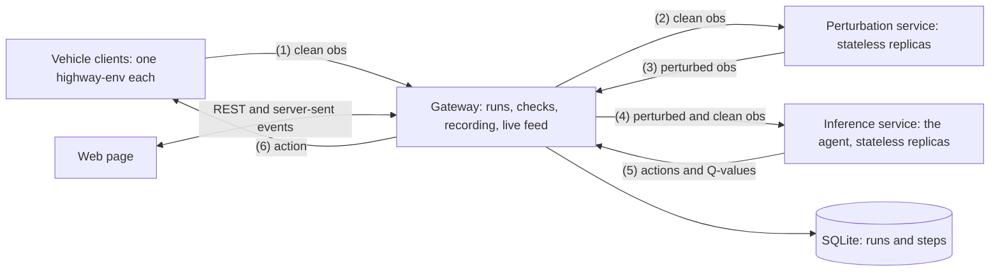

# Internet Connected Autonomous Driving System: Specification (short form)

Status: DRAFT v0.7. The architecture is decided: sections 4 and 6 summarise it, and [`ARCHITECTURE.md`](ARCHITECTURE.md) describes it in full. Requirements tables, interfaces, test matrix, schedule and risks come back in a later version. The last long version is v0.5 (commit `4e87737`).

## 1. What we are building

From the proposal (`proposal.pdf`):

- B1: an internet service through which driving environments and a DRL agent communicate.
- B2: a robust DRL agent that drives under state perturbations.
- B3: a web interface showing vehicle states, actions, perturbations and the agent's responses.
- B4: experiments evaluating the method and the system.

From the course (DSNSWK120 "Internet"): a multilayer internet application, with scalability and quality of service assessed experimentally, and a systematic evaluation of the user interface.

## 2. Decided

- Environment: `highway-v0` only, simulation only.
- Agents: the pretrained vanilla DQN, SA-DQN and WocaR-DQN checkpoints from the models repository (https://github.com/Internet-CADS/models). No new training.
- Perturbations: four attacks ported from the models repository (random noise, PGD, MinBest, worst-Q), each bounded by epsilon in {0, 0.0025, 0.005, 0.0075, 0.01}.
- No communication faults: no emulated delay, loss or jitter, and no fallback action. Only perturbations with a stated bound.
- Lockstep: the environment waits for each action. If a step cannot complete, the run fails and is excluded; no substitute action.
- "Secure" means robust to perturbations. No network-security work.
- Local only: one machine, one-command start, laptops, CPU.
- 5 weeks, about 3 for building; 6 members, about 3 implementing.

## 3. Principles

- Reproducible: the same seed, model and attack give the same observations and actions, however many runs or replicas are active.
- A perturbation is a pure function of the observation, model, attack, epsilon, seed and step. The model's weights never change.
- Both the clean and the perturbed observation are logged for every step.

## 4. Architecture (decided)

- Vehicle client: owns its environment, starts its own run, sends observations, applies the action it receives. No model.
- Gateway: one process, one session per run. Checks input, calls the perturbation and inference services, stores every step and feeds the browsers. Never runs a model and never picks an action.
- Perturbation service: applies the run's attack to one observation. Stateless, so replicas can be added. It is the service the scaling experiment adds replicas to.
- Inference service: the agent. Returns the action and Q-values for the perturbed and the clean observation. Stateless, so replicas can be added.
- Web page: run list, live scene with the perturbation as a transparent overlay, the chosen and the clean action, replay.
- Links: gRPC, with one stream per run from each vehicle and single calls to the two services. REST and server-sent events for the browser.

Why this shape:

- The environments become real clients of the service (B1).
- The tiers are distinct (course).
- The CPU-heavy environment stepping stays out of the service, so load tests measure the service.
- The expensive attack stage scales on its own.

## 5. How we show it works

- Robustness: a reduced grid (model x seed x attack x epsilon) run through the service, checking that the models repository ranking is reproduced (WocaR crashes less than vanilla under gradient attacks).
- Scalability and quality of service: local load tests of concurrent runs, latency percentiles, throughput against the number of perturbation replicas, overload and replica failure.
- User interface: a small task-based usability test with about 5 people.

## 6. Decisions

| ID | Decision | Chosen | Rejected |
|----|----------|--------|----------|
| A1 | Topology | Vehicle clients, one gateway, stateless perturbation and inference services | One simulation service calling a remote agent (v0.4); vehicles talking straight to the agent |
| A2 | Transport | gRPC: one stream per run from each vehicle, single calls to the services. REST and server-sent events for the browser | WebSocket with JSON; a broker such as NATS |
| A3 | Where perturbations run | A separate stateless perturbation service | Inside the gateway; inside the inference service |
| A4 | Who starts a run | The vehicle client | The UI |

The other architecture decisions, with their reasons, are in the decision log in [`ARCHITECTURE.md`](ARCHITECTURE.md) (section 3).

## 7. Open questions for the supervisor

Until the supervisor answers, the defaults in the last column apply. The defaults that affect the architecture are listed in [`ARCHITECTURE.md`](ARCHITECTURE.md) (section 19), with what changes if the answer differs.

| ID | Question | Default used |
|----|----------|--------------|
| Q1 | Which parts of the 50-value observation may the attacker perturb (all, as in the models repository)? | All 50 values |
| Q2 | Licence and attribution of the models repository and its vendored code: copy files or depend on it? | Copy the 21 checkpoint files with a note of their source; attribute the ported attack code |
| Q3 | What concurrency is expected in the load test? Placeholder: 50 runs, 5 viewers each. | 50 runs, 5 viewers each |
| Q4 | Is a 23 to 31 percent clean crash rate acceptable for demos and experiments? | Yes; only relative robustness is claimed |
| Q5 | Is it acceptable to leave "unreliable communication" out of scope and make the vehicles the clients? | Yes |
| Q6 | Does the UI need more than a single local page? | One local page |
| Q7 | What does the course expect of the UI evaluation? | A task-based test with about 5 people (section 5) |
