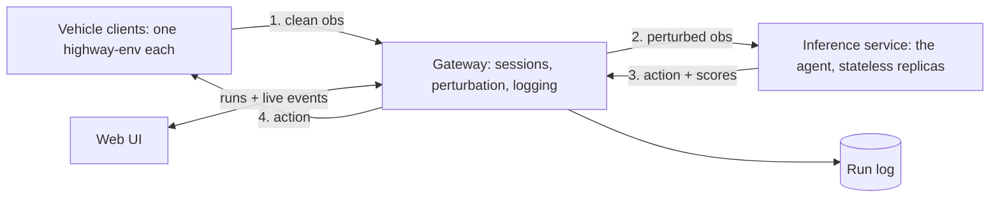

# Internet Connected Autonomous Driving System: Specification (short form)

Status: DRAFT v0.6. Deliberately short while the overall architecture is undecided. Requirements tables, interfaces, test matrix, schedule and risks come back once sections 4 and 6 are settled. The last long version is v0.5 (commit `4e87737`).

## 1. What we are building

From the proposal (`proposal.pdf`):

- B1: an internet service through which driving environments and a DRL agent communicate.
- B2: a robust DRL agent that drives under state perturbations.
- B3: a web interface showing vehicle states, actions, perturbations and the agent's responses.
- B4: experiments evaluating the method and the system.

From the course (DSNSWK120 "Internet"): a multilayer internet application, with scalability and quality of service assessed experimentally, and a systematic evaluation of the user interface.

## 2. Decided

- Environment: `highway-v0` only, simulation only.
- Agents: the pretrained vanilla DQN, SA-DQN and WocaR-DQN checkpoints from the models repository (https://github.com/Internet-CADS/models). No new training.
- Perturbations: four attacks ported from the models repository (random noise, PGD, MinBest, worst-Q), each bounded by epsilon in {0, 0.0025, 0.005, 0.0075, 0.01}.
- No communication faults: no emulated delay, loss or jitter, and no fallback action. Only perturbations with a stated bound.
- Lockstep: the environment waits for each action. If a step cannot complete, the run fails and is excluded; no substitute action.
- "Secure" means robust to perturbations. No network-security work.
- Local only: one machine, one-command start, laptops, CPU.
- 5 weeks, about 3 for building; 6 members, about 3 implementing.

## 3. Principles

- Reproducible: the same seed, model and attack give the same observations and actions, however many runs or replicas are active.
- A perturbation is a pure function of the observation, model, attack, epsilon, seed and step. The model's weights never change.
- Both the clean and the perturbed observation are logged for every step.

## 4. Proposed architecture (not yet agreed)

- Vehicle client: owns its environment, sends observations, applies the action it receives. No model.
- Gateway: one session per run; validates input, applies the perturbation, calls inference, logs, feeds the browsers. Never picks an action.
- Inference service: the agent. Stateless, so replicas can be added.
- Web UI: live scene, chosen action, perturbation, agent response.

Why this shape: the environments become real clients of the service (B1), the tiers are distinct (course), and the CPU-heavy environment stepping stays out of the server so load tests measure the service.

## 5. How we show it works

- Robustness: a reduced grid (model x seed x attack x epsilon) run through the service, checking that the models repository ranking is reproduced (WocaR crashes less than vanilla under gradient attacks).
- Scalability and quality of service: local load tests of concurrent runs, latency percentiles, throughput against replica count, overload and replica failure.
- User interface: a small task-based usability test with about 5 people.

## 6. Open decisions

| ID | Decision | Options | Leaning |
|----|----------|---------|---------|
| A1 | Topology | Vehicle clients, gateway, inference tier / one simulation service calling a remote agent (v0.4) | Vehicle clients |
| A2 | Transport | gRPC and server-sent events / WebSocket with JSON / a broker such as NATS | gRPC and SSE |
| A3 | Where perturbations run | Inside the gateway / a separate attacker service | Gateway first |
| A4 | Who starts a run | The vehicle client / the UI | Vehicle client |

## 7. Open questions for the supervisor

| ID | Question |
|----|----------|
| Q1 | Which parts of the 50-value observation may the attacker perturb (all, as in the models repository)? |
| Q2 | Licence and attribution of the models repository and its vendored code: copy files or depend on it? |
| Q3 | What concurrency is expected in the load test? Placeholder: 50 runs, 5 viewers each. |
| Q4 | Is a 23 to 31 percent clean crash rate acceptable for demos and experiments? |
| Q5 | Is it acceptable to leave "unreliable communication" out of scope and make the vehicles the clients? |
| Q6 | Does the UI need more than a single local page? Default: no. |
| Q7 | What does the course expect of the UI evaluation? |
