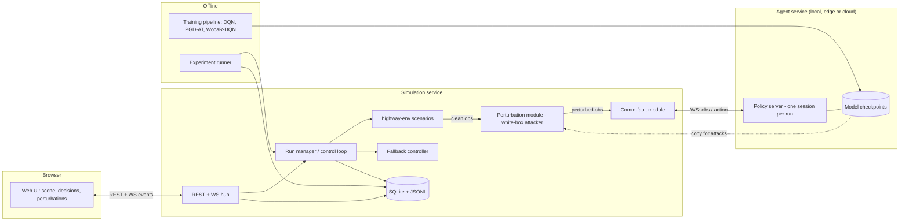

# Internet Connected Autonomous Driving System: Technical Specification and Options Study

Status: DRAFT v0.3 for team and supervisor review. v0.3 incorporates the team answers (5-week plan, robustness-only security, simulation only, existing models repository, concurrency target). Not yet agreed.

Purpose of this document: work out the realistic options for building the system described in the project proposal, recommend one, and define requirements, interfaces, verification and a schedule so the team can decide.

## 0. Conventions

- "Proposal" means `proposal.pdf` (one page: A Introduction, B Detailed Objectives with four bullets, C References). It is the only authoritative source. Bullets are cited as B1 to B4 in the order they appear.
- Every requirement carries a source tag: `[P-A]`, `[P-B1]` to `[P-B4]` (stated in the proposal), or `[ASM]` (our assumption, to be confirmed). Nothing tagged `[ASM]` is a proposal requirement.
- "Uncertain" marks technical facts from memory that were not verified against documentation while writing. Verify them in the first week (see section 9, WP0).
- Keywords: MUST = needed to satisfy the proposal or a safety/security basic; SHOULD = valuable, droppable under schedule pressure; MAY = stretch.

## 1. Project summary (from the proposal)

### 1.1 Goal

Develop an internet-connected autonomous driving system that integrates a robust deep reinforcement learning (DRL) agent. The system supports interaction between multiple driving environments and the agent through an internet-based interface or service, and the agent keeps operating safely under state perturbations. A web-based visualisation interface monitors the driving process and the agent's decisions (Proposal A).

### 1.2 Detailed objectives (Proposal B)

| ID | Proposal text, paraphrased closely | Notes |
|----|-----------------------------------|-------|
| B1 | An internet-based application or service enabling communication between driving environments and an autonomous vehicle (agent). Environments such as highway, merge and roundabout from the highway-env website may be used, "or other driving environments". | The environment link in the proposal is `highway-env.farama.org/environments/merge/`. |
| B2 | A robust DRL method for secure autonomous driving under state perturbations. Sub-tasks: formulate driving as an RL task, analyse the impact of state perturbations, develop defence strategies. | |
| B3 | A web monitoring and visualisation interface showing vehicle states, selected actions, encountered perturbations and the agent's responses. | |
| B4 | Experiments evaluating the proposed method and system. | |

### 1.3 Sources of perturbation named in the proposal

"Malicious attacks, unreliable communication, or sensor noise" (Proposal A). The system must therefore be able to emulate all three: adversarial perturbation, communication degradation, and random noise.

### 1.4 Reference methods (Proposal C)

1. Liang et al., 2022, "Efficient adversarial training without attacking: Worst-case-aware robust reinforcement learning" (WocaR-RL), NeurIPS 35.
2. Zhang et al., 2021, "Robust reinforcement learning on state observations with learned optimal adversary", arXiv:2101.08452.
3. Xu et al., 2022, "Trustworthy reinforcement learning against intrinsic vulnerabilities: Robustness, safety, and generalizability", arXiv:2209.08025.

Answer to the earlier open question "is reproducing WocaR-DQN mandatory?": the question was whether this project itself has to implement and train WocaR-DQN, or may use any robust method. This is now moot: the team already has WocaR-DQN, SA-DQN and vanilla DQN implemented, trained and evaluated on highway-env (section 6A), so this project reuses them and the remaining work is the internet-connected system, the monitoring UI and the experiments around it.

### 1.5 Stakeholders

| Stakeholder | Interest |
|-------------|----------|
| Student team | Deliver a working system and report within the semester. |
| Supervisor / examiners `[ASM]` | Academic soundness of the robust-RL method and experiments; demonstrable system. |
| Demo audience / users of the web UI `[ASM]` | Understand what the agent does and what perturbations occurred. |

### 1.6 Constraints

The proposal states no deadline, budget, team size, hardware, language or deployment target. The team supplied the following (source: team answers, not the proposal):

- C-1: 5 weeks until hand-in, of which about 3 weeks are for building the system (the rest: week 1 for setup and verification, final week for experiments, report and demo).
- C-2: 6 members; about 3 do most of the implementation (roles proposed in section 9.1).
- C-3: Mostly laptops; CPU inference of the small MLP policies is enough. The system must nevertheless be deployable so that many clients can be handled concurrently (section 7A).
- C-4: Open-source tooling, Python as the main language (assumption, follows the existing repository).

### 1.7 Out of scope (explicit)

- Physical or scaled vehicles and hardware-in-the-loop testing. Simulation is sufficient (team decision).
- Teleoperation, i.e. a human driving the vehicle remotely (team decision). Remote monitoring is read-only.
- Network-security hardening (TLS, mTLS, access control, penetration testing). "Secure" in the proposal is read by the team as robustness to perturbations only. At most an optional shared token to keep a public demo from being abused (FR-14, MAY).
- V2X radio stacks; perception from raw camera or lidar; certification (ISO 26262, ISO 21448, ISO/SAE 21434, UNECE R155/R156 are not claimed); multi-agent learning (other vehicles are highway-env scripted vehicles).
- New robust-RL research: the models repository provides the trained agents. New training (e.g. PGD adversarial training) is an optional stretch item.

## 2. Terminology

| Term | Meaning here |
|------|--------------|
| Environment / sim | A highway-env scenario (`highway-v0`, `merge-v0`, `roundabout-v0`, ...) stepped by our simulation service. |
| Agent | The DRL policy, served as a network service that maps an observation to a discrete action. |
| Run / episode | One execution of an environment from reset to termination or truncation, identified by `runId`. |
| State perturbation | Modification of the observation the agent receives, bounded in L-infinity norm by epsilon in normalised observation space (threat model of the reference papers). |
| Communication fault | Delay, jitter, loss or disconnect on the agent link. Distinct from state perturbation. |
| Clean / perturbed observation | What the environment produced / what the agent actually receives. |

## 3. Requirements

### 3.1 Functional requirements

| ID | Requirement | Priority | Source |
|----|-------------|----------|--------|
| FR-01 | The system MUST let a client create, list, stop and fetch the log of runs for scenarios `highway`, `merge`, `roundabout`, with seed and step limit as parameters. | MUST | P-B1 |
| FR-02 | The agent MUST run as a separate network service, reachable only through the defined protocol (section 7). The simulation MUST NOT import the policy. | MUST | P-B1, P-A |
| FR-03 | One agent service instance MUST serve at least 3 concurrent runs (different scenarios) without cross-talk (sessions keyed by `runId`). | MUST | P-A "multiple driving environments", ASM |
| FR-04 | The agent MUST return one discrete action per observation, optionally with Q-values (or equivalent action scores) for display. | MUST | P-B3 |
| FR-05 | A perturbation module MUST be insertable between environment and agent with modes `none`, random L-infinity noise, and the white-box gradient attacks already implemented in the models repository (10-step PGD, MinBest, worst-Q), all bounded by a configurable epsilon in the normalised observation space. The module is a port of the repository's `perturb()` code (section 6A), not a rewrite. A learned adversary MAY be added. Perturbations MUST be seeded and reproducible. | MUST (noise, PGD, MinBest, worst-Q) | P-B2, P-A |
| FR-06 | A communication-fault module MUST emulate added latency, jitter, packet or message loss, and disconnects on the agent link, configurable per run. | MUST | P-A "unreliable communication" |
| FR-07 | If no valid action arrives before the step deadline, the simulation MUST apply a defined safe fallback action and record the event. | MUST | P-A "safe operation" |
| FR-08 | Load every checkpoint group once | All 21 selected checkpoints load; a greedy action on a fixed observation matches the models repository's own loader for the same checkpoint |
| FR-09 | Every step MUST be logged with: `runId`, `t`, raw observation, perturbed observation, perturbation metadata (mode, epsilon, norm of delta), action, action scores, reward, termination/truncation flags, fallback flag, timestamps for send/receive. | MUST | P-B3, P-B4 |
| FR-10 | The web UI MUST show live, per run: vehicle states, selected action, encountered perturbations, and the agent's response. At least 2 browsers MUST be able to watch the same run. | MUST | P-B3 |
| FR-11 | The UI SHOULD show the clean versus perturbed observation, the perturbation magnitude, and whether the perturbed action differs from the action the agent would pick on the clean observation. | SHOULD | P-B3 "responses of the agent" |
| FR-12 | The UI SHOULD replay a finished run from its log. | SHOULD | ASM |
| FR-13 | A batch experiment runner MUST execute a grid (agent x attack x epsilon x seed x scenario) headlessly and write result tables and plots reproducibly. | MUST | P-B4 |
| FR-14 | Control endpoints MAY be protected by a single shared token (config option, default off). No further access control is required. | MAY | team answer 2 |
| FR-15 | The same scenario, seed, config and deterministic agent MUST yield identical clean observation sequences. | MUST | P-B4 (reproducible experiments), ASM |

### 3.2 Non-functional requirements

Numeric thresholds are `[ASM]`; they are chosen to be testable and will be recalibrated after the first measurements (section 8).

| ID | Category | Requirement | Source |
|----|----------|-------------|--------|
| NFR-LAT-1 | Latency | Agent service round trip (request received to response sent, CPU inference of an MLP policy) p95 <= 10 ms; observation sent to action received p95 <= 50 ms on one machine or LAN, with one active session. | ASM |
| NFR-LAT-2 | Latency | The step deadline is configurable (default 200 ms). Deadline misses are counted and reported per run. | ASM |
| NFR-LAT-3 | Latency | Time from a step being logged to the corresponding UI update p95 <= 500 ms on a LAN with 5 viewers. | ASM |
| NFR-PERF-1 | Throughput | Headless lockstep evaluation, with a local agent loopback, achieves >= 50 steps/s per run on a laptop (uncertain; to be measured in WP0). | ASM |
| NFR-SAF-1 | Safety | Under any communication fault in FR-06, including permanent agent loss, the simulation process never crashes or hangs; runs end normally with fallback actions recorded. | P-A |
| NFR-SAF-2 | Safety | The fallback action is never `LANE_LEFT`/`LANE_RIGHT`/`FASTER`; it is `IDLE` or a simple rule-based controller (see D3 and D6). | ASM |
| NFR-SAF-3 | Reduced evaluation (section 8.3) through our service | Ranking WocaR < vanilla crash rate at epsilon 0.01 reproduced; deviations from the repository numbers are explained |
| NFR-REL-1 | Reliability | The simulation client reconnects to a restarted agent within 5 s (exponential backoff) and resumes the run or fails it cleanly. A 1 hour soak test with random agent restarts shows no unhandled exception. | ASM |
| NFR-REL-2 | Reliability | Completed steps are durably written (flushed) within 1 s; a service restart loses at most the last second of a run. | ASM |
| NFR-ROB-1 | Robustness | Every perturbed observation satisfies the L-infinity bound (max abs delta <= epsilon + 1e-6) and stays within the observation range in the normalised space; verified on every step by a unit test and logged (`linf`). | P-B2 |
| NFR-ROB-2 | Robustness | Malformed or non-finite observations (wrong shape, NaN, Inf, out of range) are rejected by the agent service with an `error` message; the simulation then applies the fallback action. No crash, no silent clipping. | P-A "sensor noise" |
| NFR-SCAL-1 | Scalability | The deployment handles N concurrent sessions (placeholder N = 50 on one laptop-class machine, N = 200 with several workers; validate by load test, section 7A) with the agent round-trip p95 <= 50 ms and step-to-UI latency p95 <= 500 ms at 5 viewers per run. Numbers are placeholders until measured. | team answer 5 |
| NFR-SCAL-2 | Scalability | Overload degrades gracefully: when the session limit is reached, new runs are refused with a clear error (HTTP 429/503) instead of slowing existing runs below their deadline. | team answer 5 |
| NFR-PRV-1 | Privacy | The system processes only simulation data and no personal data. If user accounts are added later, a data-protection review is required first (GDPR applies if the team is in the EU). | ASM |
| NFR-COST-1 | Track cloud cost and machine used | Within the budget agreed in Q3 |
| NFR-FEAS-1 | Feasibility | Only open-source components; one-command local start (`docker compose up`); CI runs unit and integration tests on every push. | ASM |
| NFR-MNT-1 | Maintainability | Protocol schemas defined once in a shared package and versioned; breaking changes bump the protocol version. | ASM |

## 4. Key design facts about highway-env that shape the options

These are from memory of the highway-env documentation (Farama/Gymnasium based) and MUST be verified in WP0.

- Environments follow the Gymnasium API: `reset(seed=...)` returns `(obs, info)`; `step(a)` returns `(obs, reward, terminated, truncated, info)`.
- Default observation `Kinematics`: a matrix of `vehicles_count` (default 5) rows by features (default `presence, x, y, vx, vy`), ego vehicle first, normalised to a configured range. Flattened it is a short vector, so an MLP policy suffices and CPU inference is cheap.
- Default action `DiscreteMetaAction` has 5 actions: `0 LANE_LEFT`, `1 IDLE`, `2 LANE_RIGHT`, `3 FASTER`, `4 SLOWER`. Note that index 0 is not a no-op.
- Default policy frequency is low (on the order of 1 Hz) with a higher simulation frequency (on the order of 15 Hz); configurable.
- Other vehicles are driven by built-in IDM/MOBIL models. Merge and roundabout have non-straight road geometry, so a front end cannot assume horizontal lanes.
- Rendering uses pygame and can produce `rgb_array` frames; headless rendering is possible but needs care in containers (uncertain).

## 5. Architecture options

For each decision: options with pros and cons, rough effort in person-weeks (pw) for the whole team-level task, cost, the requirements affected, then a recommendation, main risks and a fallback. Effort figures are estimates with wide error bars (factor 2).

### D1. Where does the driving intelligence run?

| Option | Description | Pros | Cons | Effort / cost |
|--------|-------------|------|------|---------------|
| D1-a In-process | Policy is a Python object called by the simulator in the same process. | Simplest; fastest; ideal for training and large evaluations. | Does not satisfy B1 (no internet interface); no latency/fault story. | 0 pw extra |
| D1-b Remote agent service (cloud or any host) | Policy served by a separate network service; simulator sends observations, receives actions. | Directly realises B1 and "internet-connected"; allows testing latency, loss and security; matches the proposal's picture of an agent that interacts with environments through a service. | Added latency and failure modes; needs fallback logic; more moving parts. | 2 to 3 pw; free locally, small VM for WAN demo |
| D1-c On-vehicle policy, cloud only for monitoring and data | Driving decisions local; the internet carries telemetry and updates. | Realistic for real vehicles (safety-critical control must not depend on a network); no latency risk on the control loop. | The agent-environment link would not be internet-based, so B1 reads as only partly met; connectivity-loss experiments become trivial. | 2 pw |
| D1-d Hybrid: remote agent with local fallback policy | D1-b plus a simple local controller on the simulator side used when the remote answer is late or missing. | Satisfies B1; gives principled degradation (FR-07, NFR-SAF-1); closest to how a real vehicle would be built. | Slightly more code; fallback policy design needs care. | 3 to 4 pw |
| D1-e Edge | Agent on a nearby node (same LAN/campus) between vehicle and cloud. | Lower latency than cloud. | In this project it is the same code as D1-b with a different host; no extra design. | covered by D1-b |

Recommendation: D1-d. Remote agent service as the primary path (D1-b), with the in-process mode (D1-a) kept as an evaluation/training shortcut behind the same agent interface, and a local fallback (`IDLE` at minimum). Edge versus cloud is a deployment choice, not an architecture choice (D10).
Risks: latency makes the fallback fire often at high policy frequency; mitigated by lockstep mode (D6) and by measuring.
Fallback if the remote path proves unstable: D1-a for all experiments, keep the service only for the demo.
Implications: FR-02, FR-03, FR-07, NFR-LAT-*, NFR-SAF-1/2.

### D2. Simulation platform and the meaning of "vehicle"

| Option | Pros | Cons | Effort / cost |
|--------|------|------|---------------|
| D2-a highway-env only (highway, merge, roundabout) | Named in the proposal; lightweight (CPU, pure Python); discrete meta-actions suit DQN-type methods; fast iteration; scenarios ready. | Abstract kinematic simulation; no sensors; limited realism. | 1 pw |
| D2-b highway-env plus a second environment (e.g. `intersection-v0` or `racetrack-v0`) | Tests generalisation; proposal allows "other driving environments". | Extra tuning and training time per environment. | +1 to 2 pw |
| D2-c CARLA (or SUMO for traffic-level) | Realistic, sensors, rich visuals. | Needs a GPU and significant setup (CARLA recommends a capable GPU; uncertain on exact requirements); perception becomes the problem, outside the proposal; very high schedule risk. | 6+ pw, GPU |
| D2-d Scaled physical vehicle (e.g. Donkey Car, F1TENTH, Duckietown) | Real hardware, real network. | Cost (hundreds of EUR per vehicle), build time, safety in lab, tiny overlap with the proposal's highway/merge/roundabout; field testing logistics. | 8+ pw, hardware budget |

Recommendation: D2-a with D2-b as a stretch (SHOULD: one extra scenario, `intersection-v0` or similar, only after the main experiments run). The environment is wrapped behind a thin factory so a new scenario is a config change.
Risks: results may not transfer to richer simulators; state this limitation in the report.
Fallback: none needed; D2-a is the floor.
Implications: the simulation-only decision (section 1.7); hardware-in-the-loop and field tests are not planned (section 8).

### D3. Learning stack and robust method (reduced by the existing models repository)

The team already has vanilla DQN, SA-DQN and WocaR-DQN implemented, trained and evaluated on highway-env (section 6A). The decision is therefore about reuse, not training.

| Option | Description | Pros | Cons / risks | Effort |
|--------|-------------|------|--------------|--------|
| D3-a Serve pretrained checkpoints from the models repository | Agent service loads `frame_<N>.pth` for the three groups | Zero training cost; results already exist for comparison; WocaR is the most robust against gradient attacks in the repository results | Checkpoint loading depends on the repository's `models.py` (`model_setup`) and, through it, on the vendored `auto_LiRPA`; weak clean performance (23 to 31 percent crash rate); trained on one environment configuration only | 1 to 2 pw |
| D3-b Serve a reimplemented plain-PyTorch MLP that loads the state dict | Avoids the `auto_LiRPA` dependency at serving time | Light, fast container image | Must verify key-by-key that outputs equal the original (dueling head); small extra effort | +0.5 pw |
| D3-c New training (PGD adversarial training, noise augmentation, retrain WocaR) | Stretch | Could improve clean/robust trade-off | Competes with the build time; repository training took 2M frames per run (compute not stated per run here) | 2 to 3 pw |
| D3-d Other environments (merge, roundabout) | Requires training new agents | Matches the proposal's examples | Not covered by any existing checkpoint; adds training and tuning work | 3+ pw |

Recommendation: D3-a, with D3-b as an optimisation if the image size or dependency handling is a problem. Training (D3-c) is a stretch item. Because only `highway-v0` has trained agents, the system is specified for highway-v0 first; merge and roundabout are supported by the environment factory but without trained agents (the stub or vanilla-from-scratch is a stretch).
Fallback: vanilla DQN checkpoints only, with the attacker. Implications: FR-05, FR-08, NFR-SAF-3.

### D4. Threat model, perturbation placement and attack set

Where perturbations are applied:

| Option | Pros | Cons |
|--------|------|------|
| D4-a Sim-side module before the agent link (clean obs from env, perturbed obs sent) | Full knowledge of clean obs; exact epsilon control; seeded; logs raw and perturbed. | The attack module needs a copy of the model weights for gradient (white-box) attacks, so it is a second consumer of checkpoints. |
| D4-b Network proxy (tc/netem, Toxiproxy, mitmproxy) between sim and agent | Realistic placement; no code in sim. | Can only degrade timing/delivery or tamper with bytes; cannot compute gradient attacks; hard to enforce an L-infinity bound. |
| D4-c Inside the agent service ("attack mode") | Has the model; simple. | Mixes attacker and defender in one trust domain; the logged "raw" observation is then not at the sim; confusing for the security story. |

Recommendation: D4-a for state perturbations (attacker module with its own copy of the checkpoint, white-box), plus D4-b (Toxiproxy or Linux `tc netem` in a container with NET_ADMIN) for communication faults, with an in-process delay/drop shim as a portable fallback (macOS laptops cannot run `tc` natively).
Attack set (reused from the models repository): none; random L-infinity noise; 10-step PGD; MinBest; worst-Q; stretch: learned adversary. Epsilon grid in normalised observation space as in the repository: {0, 0.0025, 0.005, 0.0075, 0.01}; the models were trained at epsilon 0.005 (SA-DQN and WocaR), and vanilla DQN reaches about 74 percent crash rate at 0.01. The earlier draft grid (up to 0.1) was far too large for these models.
Important design point: perturbations of a normalised kinematic vector may violate physical consistency (e.g. `presence` flag). Decide which features are attackable (open question Q1); the proposal does not say.
Implications: FR-05, FR-06, FR-09, FR-15.

### D5. Communication technology and protocol

Payload is small (a few hundred bytes per message at 1 to 15 Hz), so bandwidth is not a differentiator. Latency, ease of implementation, browser support and tooling are.

| Option | Pros | Cons |
|--------|------|------|
| D5-a HTTP/REST request per step (`POST /act`) | Simplest; stateless; easy to test with curl and load-balance; works through proxies. | New connection or header overhead per step; no server push (browser needs a second channel). |
| D5-b WebSocket with JSON messages | Persistent, low overhead, full duplex, works for both agent link and browser; trivial with FastAPI. | Application-level reconnect, ordering, schema and backpressure are ours; JSON slower than binary (irrelevant at this rate). |
| D5-c gRPC bidirectional streaming (protobuf) | Strong typed schema, deadlines built in, HTTP/2, code generation. | Browsers need gRPC-Web plus a proxy (Envoy); heavier tooling for a student team. |
| D5-d MQTT broker (e.g. Mosquitto) | Standard IoT/vehicle-telemetry style; QoS levels; good for loss-prone links. | Broker to run; request/response pattern awkward (need correlation ids); added hop latency; per-session topics. |
| D5-e ZeroMQ / raw TCP | Fast and flexible. | No browser support, hand-rolled framing and security. |

Recommendation: D5-b WebSocket + JSON for the agent link and for the browser event feed, plus plain REST (`FastAPI`) for run control and log download. Messages carry `protocolVersion`, `runId`, `seq` and timestamps (section 7). Schemas live in one shared Python package (Pydantic) and are exported as JSON Schema for the front end.
Risks: head-of-line blocking if one connection multiplexes sessions; avoid by one WebSocket per run (`/ws/agent/{runId}`), not a single shared queue.
Fallback: D5-a (`POST /act`) behind the same Python client interface, selectable by config. This is also the easiest thing to debug.
Implications: NFR-LAT-1/2, NFR-MNT-1, FR-03.

### D6. Time model: lockstep versus real-time

| Option | Description | Pros | Cons |
|--------|-------------|------|------|
| D6-a Lockstep | Simulator pauses until the action arrives (with a long timeout). | Deterministic; reproducible experiments; latency has no effect on outcome. | Hides the latency problem; not a model of a real vehicle. |
| D6-b Real-time paced with deadline | Simulator advances at a fixed rate; if the action misses the deadline, the fallback is applied and the late action is discarded (or applied next step). | Makes latency and loss matter, which is the point of "internet-connected"; allows measuring deadline-miss impact. | Non-deterministic with real networks; harder tests. |
| D6-c Hybrid, selectable per run | `mode: lockstep|realtime` in the run config. Evaluation grids use lockstep; communication experiments use real-time with emulated (seeded) delay. | Gets both. | Two code paths (small: only the wait/deadline logic differs). |

Recommendation: D6-c. Default step deadline 200 ms (ASM), configurable; the draft's 2000 ms timeout is far above any plausible control deadline for a 1 to 5 Hz policy and would make fallback almost meaningless.
Seeded delay injection (D4-b shim) gives reproducible real-time experiments. Fallback: D6-a only.

### D7. Data pipeline and storage

| Option | Pros | Cons |
|--------|------|------|
| D7-a JSON Lines file per run | Trivial, append-only, human-readable, matches the draft. | Querying across runs is awkward; no index; large for batch grids. |
| D7-b SQLite (runs and steps tables) | Stdlib, single file, SQL queries for the UI and experiment analysis. | Single-writer; schema migrations. |
| D7-c PostgreSQL / TimescaleDB | Multi-user, scalable, time-series features. | Another service to operate; overkill for the data volume (about 10^5 to 10^7 rows). |
| D7-d Columnar files (Parquet) for batch results | Compact, fast with pandas/polars. | Not for live append. |
| D7-e InfluxDB/Prometheus + Grafana | Ready dashboards for metrics. | Not designed for per-step vehicle state plus perturbation records; extra services. |

Recommendation: D7-b SQLite as the system of record (WAL mode), with a JSONL export per run, and Parquet for batch experiment outputs. Raw and perturbed observations are both stored from day one (kept from the draft; it is the right call). Large batch evaluations write directly to Parquet without the live pipeline.
Fallback: D7-a only.
Estimate: 300 steps/run x ~1 KB/step = 0.3 MB/run; 10^4 runs = 3 GB; fine.
Implications: FR-09, FR-12, FR-13, NFR-REL-2.

### D8. Monitoring and visualisation interface

| Option | Pros | Cons | Effort |
|--------|------|------|--------|
| D8-a Custom single page: JS + `<canvas>`, driven by structured events (vehicle poses plus road geometry) | Precise control; shows actions, Q-values, perturbations; no build step; light. | Must draw roads for merge and roundabout (curved lanes); more front-end work. | 2 to 3 pw |
| D8-b Stream rendered frames from highway-env (`rgb_array`, JPEG over WebSocket) plus side panels for numbers | Fast to implement; exact scenario drawing for free; any scenario works. | CPU cost and headless pygame setup in containers; bandwidth; cannot overlay custom data on the scene; no replay from log without re-simulating. | 1 pw |
| D8-c Dashboard tool (Grafana, Streamlit, Gradio, Dash) | Quick charts; Streamlit/Gradio are quick to code. | Weak live scene rendering; limited custom interaction; extra service. | 1 to 2 pw |
| D8-d Foxglove or Rerun | Purpose-built robotics visualisation. | Learning curve; not a plain "web interface" users open; uncertain on embedding/licensing. | 2 pw |

Recommendation: D8-a with a plain-JS page (optionally with Chart.js or uPlot from a pinned CDN or vendored file for the Q-value and reward charts). Send the static road geometry once per run (sampled lane centre-lines taken from the environment's road network; the exact API needs verification) and vehicle poses per step. Lane polylines handle merge and roundabout.
Fallback: D8-b for the scene (frames), with D8-a-style panels for numbers.
Implications: FR-10, FR-11, FR-12, NFR-LAT-3.

### D9. Security approach (reduced: robustness only)

Team decision: "secure" means robustness to perturbations. The threat model covers (T1) adversarial and random perturbation of the observation, (T2) communication faults (delay, loss, disconnect), (T3) malformed or non-finite input. Network security (TLS, mTLS, authentication, DoS protection) is out of scope. The one optional item is a shared token on the control endpoints so that a publicly reachable demo cannot be driven by strangers (FR-14, MAY). Options considered: none (default on localhost/LAN), shared token (optional), TLS reverse proxy (not planned). Recommendation: none by default, shared token optional.

### D10. Deployment

| Option | Pros | Cons |
|--------|------|------|
| D10-a Local processes (`uv run ...`) | Fastest for development. | Not reproducible for others. |
| D10-b Docker Compose on one machine (sim, agent, optional proxy) | One-command start; networks can be separated; supports `tc`/Toxiproxy experiments. | Localhost is not the internet; Docker on macOS adds a VM layer (latency measurements differ). |
| D10-c Compose on 2 hosts: sim on laptop, agent on a small cloud VM | Real WAN round-trip times and exposure; best demonstration of "internet-connected". | VM cost and admin; the evaluation is not reproducible because network conditions vary. |
| D10-d Kubernetes or managed ML serving | Scalable, rollouts. | Disproportionate for this project. |

Recommendation: D10-b as the default and for all reproducible experiments, D10-c once for a demo and for a measured WAN latency data point (agent on a VM in a nearby region; record RTT percentiles). Training happens offline on available GPU/CPU and is not part of runtime deployment.
Fallback: D10-a/b only; WAN data point replaced by emulated latency.

### D11. Summary of recommended choices

| Decision | Recommended | Fallback |
|----------|-------------|----------|
| D1 Agent location | Remote agent service with local safe fallback (D1-d) | In-process agent for experiments |
| D2 Platform | highway-env (+1 extra scenario if time) | n/a |
| D3 Robust method | Serve the existing pretrained vanilla/SA-DQN/WocaR-DQN checkpoints; reuse the repository attack code; new training only as stretch | Serve vanilla DQN only if loading WocaR checkpoints fails |
| D4 Perturbation | Sim-side white-box attacker; separate comm-fault module | In-process delay shim only |
| D5 Protocol | WebSocket + JSON, REST control | HTTP `POST /act` |
| D6 Time model | Selectable lockstep or real-time | Lockstep only |
| D7 Storage | SQLite + JSONL export + Parquet for batches | JSONL only |
| D8 UI | Canvas page from events and road geometry | Streamed frames |
| D9 Security | Robustness only (observation perturbation, communication faults, input validation); optional shared token | none needed |
| D10 Deployment | Docker Compose; one WAN demo on a VM | Local processes |

## 6A. Existing assets: the models repository

Source: https://github.com/Internet-CADS/models (read-only; facts below were checked in `README.md`, `entries/05_wocar_dqn_r3/` including `evaluate.py`, `highway_adapter.py`, `defaults.json`, `config_highway_wocar.json`, `visualize_perturbation.py`, and in the checkpoint folders). The checks were done on a local worktree of that repository, which may not be identical to branch `main`; re-verify against `main`.

| Fact | Value (verified in files unless marked) |
|------|---------------------------------------|
| Environment | `highway-v0`, 4 lanes, 15 other vehicles, 60-step episodes (`duration` 60), `simulation_frequency` 5, `policy_frequency` 1, off-road terminal |
| Observation | Kinematics, 10 vehicles x (presence, x, y, vx, vy), normalised, relative (`absolute: false`), flattened to 50 inputs by `highway_adapter.py` (`LegacyHighwayEnv`, which also converts the Gymnasium 5-tuple to a 4-value API) |
| Actions | 5 discrete meta-actions: 0 LANE_LEFT, 1 IDLE, 2 LANE_RIGHT, 3 FASTER, 4 SLOWER |
| Reward | collision -2, right lane 0.1, high speed 0.4, no reward normalisation |
| Network | Dueling MLP 50-128-128-5 (`model_width` 1); checkpoint is the state dict of `model.features`, loaded in `evaluate.py` via `model_setup(...)` then `features.load_state_dict` |
| Checkpoints | `entries/05_wocar_dqn_r3/artifacts/run_2/<vanilla_dqn\|sa_dqn\|wocar_dqn>/model_<seed>/frame_<N>.pth`, about 98 KB each, seeds 1 to 7, every 50k frames to 2M; many hundreds of files are tracked in git (840 `run_2` checkpoints on the checked branch) |
| Attacks | `perturb()` in `evaluate.py`: `random_linf`, `pgd` (10 steps, cross-entropy against the best action), `minbest`, `worst_q`; budget epsilon in normalised space; certification via `is_certified()` (CROWN-IBP through `auto_LiRPA`) |
| Reported results (README, rev 3, 7 seeds, 300 episodes) | Crash rate, clean: vanilla 23, SA-DQN 29, WocaR 31 percent. Gradient attacks eps 0.005: 44 / 43 / 38. Eps 0.01: 74 / 61 / 53. Random noise eps 0.005: 26 / 31 / 32. WocaR is most robust against gradient attacks; SA-DQN is not reliably better than vanilla |

What it provides: trained policies, attack code, an evaluation harness, a perturbation visualisation script and HTML reports. What it does not provide:

- No serving code: no network service, no session handling, no monitoring UI, no logging pipeline.
- Evaluation code is a batch script using multiprocessing and a vendored fork of the authors' code; `evaluate.py` changes the working directory and manipulates `sys.path` at import, so it must be wrapped or its attack code copied rather than imported as a library.
- Dependencies: PyTorch, highway-env, the vendored `auto_LiRPA` (needed by `model_setup(robust_model=True)` and certification; whether plain inference needs it is not verified, see D3-b), plus a long `requirements.txt` including Atari and gym packages.
- Weak driving quality: clean crash rate 23 to 31 percent, robust agents drive worse clean than vanilla, no help against random noise, and training instability (late collapse) is documented.
- Only one environment configuration (`highway-v0`, 60 steps). No merge or roundabout agents.
- Licence and authorship: the repository has no top-level LICENSE file in the checked tree; the vendored `auto_LiRPA` carries its own LICENSE (I believe it is BSD-3-Clause; verify), and `upstream/` is derived from the WocaR-RL authors' code, whose licence was not checked. For a student project and a report this is probably fine, but the team should state attribution in the report and check licences before publishing (Q5).

Consequences for this specification: the agent service wraps these checkpoints (FR-08), the perturbation module ports `perturb()` (FR-05), the environment configuration of the service must equal the repository configuration for the agents to behave as evaluated, and the experiment section reproduces a subset of the repository results as a system check.

## 6. Recommended architecture

### 6.1 Components

| Component | Responsibility | Tech |
|-----------|----------------|------|
| Simulation service (`sim`) | Owns environments; runs the control loop per run; applies perturbation and fault modules; applies fallback; writes logs; serves REST, browser WebSocket and static UI. | Python 3.12 (to be verified against highway-env, PyTorch and dependency support), FastAPI, asyncio, highway-env |
| Perturbation module | Takes clean observation, returns perturbed observation plus metadata. Holds a model copy for white-box attacks. | PyTorch, in `sim` process (or worker) |
| Comm-fault module | Delay, jitter, loss, disconnect on the agent link, seeded. | In-process shim; Toxiproxy or `tc netem` optional |
| Agent service (`agent`) | Loads a checkpoint; serves one session per run; returns action and scores; exposes `/healthz` and model metadata. | FastAPI, PyTorch (CPU) |
| Fallback controller | Safe action when the deadline is missed: `IDLE` (index 1) initially; optionally a rule-based IDM-style check. | in `sim` |
| Web UI | Live scene, decisions, perturbations, charts, run list, replay. | Static HTML/JS, canvas |
| Data store | `runs`, `steps`, `events` tables; JSONL export. | SQLite (WAL) |
| Experiment runner | Headless batch grid from a YAML config; calls the same env wrapper, perturbation module and agent (local loopback or remote); writes Parquet and plots. | Python CLI, pandas, matplotlib |
| Training pipeline | Offline training of baseline and robust agents; checkpoints with metadata. | PyTorch, Gymnasium; not deployed |
| Reverse proxy (S-b/S-c) | Routing by `runId` and load balancing across workers; no security role. | Caddy, nginx or Traefik |
| Shared `protocol` package | Pydantic models, constants, JSON Schema export. | Python |

### 6.2 Diagram



### 6.3 Data flow of one step (lockstep or real-time)

1. Run manager takes the clean observation `o_t` from the environment.
2. Perturbation module computes `o'_t` (within epsilon), records mode, epsilon and `||o'_t - o_t||_inf`.
3. `o'_t` plus `runId`, `t`, `seq`, `sentAt` is sent to the agent through the fault module (which may delay, drop or disconnect).
4. Agent returns `action`, `scores`, `modelId`, `recvAt`, `sentAt`.
5. If the deadline passes without a valid reply (real-time mode) or the timeout expires (lockstep, long), the fallback action is applied and `fallback=true` is recorded. A late reply is counted and discarded.
6. Environment steps with the action, returning `(obs, reward, terminated, truncated, info)`.
7. The step record is written to the store; `state`, `decision`, `perturbation` events are broadcast to subscribers.

### 6.4 Repository layout (proposed)

Kept close to the draft but made self-consistent (the draft mixed `src/` and `app/` paths).

```
.
├── docs/SPEC.md
├── protocol/                 # shared schemas, JSON Schema export
├── sim_service/              # FastAPI app, runner, envs, perturbation, faults, store, static UI
├── agent_service/            # policy server
├── training/                 # DQN, PGD-AT, WocaR-DQN, configs
├── experiments/              # grid configs, analysis notebooks/scripts
├── tests/                    # unit, integration, e2e
├── docker-compose.yml
├── pyproject.toml            # uv workspace
└── README.md
```

A `uv` workspace with a committed `uv.lock` is a reasonable packaging choice (the draft proposed it); alternatives such as Poetry or pip-tools work equally well. The decision is not architecture-relevant; pick one and pin Python.

## 7. Interfaces

### 7.1 Overview

| ID | Between | Style | Direction | Contents |
|----|---------|-------|-----------|----------|
| IF-1 | Browser and Sim | REST (HTTPS) | request/response | Run lifecycle, config, log download, run list. |
| IF-2 | Browser and Sim | WebSocket `/ws/runs/{runId}` | server to client | `state`, `decision`, `perturbation`, `status` events; buffered history replayed on connect (bounded). |
| IF-3 | Sim and Agent | WebSocket `/ws/agent/{runId}` (fallback `POST /act`) | request/response over a stream | `hello`, `obs`, `action`, `error`. |
| IF-4 | Agent and checkpoint store | files | read | Checkpoint plus `meta.json`. |
| IF-5 | Training and checkpoint store | files | write | Same format as IF-4. |
| IF-6 | Perturbation module and checkpoint store | files | read | Same checkpoint, for white-box gradients. |
| IF-7 | Sim and data store | SQLite | read/write | `runs`, `steps` tables. |
| IF-8 | Experiment runner and Sim components | Python API or REST | | Same env wrapper and agent client as the service. |

### 7.2 REST (IF-1) sketch

| Method and path | Purpose |
|-----------------|---------|
| `POST /runs` | Create and start a run. Body: `scenario`, `seed`, `maxSteps`, `mode` (`lockstep` or `realtime`), `deadlineMs`, `agentUrl` (optional), `perturbation` (`mode`, `epsilon`, `steps`, `seed`), `faults` (`delayMs`, `jitterMs`, `lossProb`, `disconnectAtStep`). Returns `{ "runId": ... }`. |
| `GET /runs`, `GET /runs/{id}` | List and detail incl. status `pending|running|finished|aborted|error`. |
| `GET /runs/{id}/log` | Step records (JSONL or paged JSON). |
| `DELETE /runs/{id}` | Abort. |
| `GET /healthz` | Liveness. |

The draft's `DELETE` marked an aborted run as `finished`; use a distinct `aborted` status so evaluation scripts can exclude it.

### 7.3 Agent link messages (IF-3)

All messages carry `protocolVersion`, `runId`, `seq`. Timestamps are ISO 8601 UTC or epoch milliseconds from a monotonic-plus-wall pair; clock offset between hosts must not be assumed zero, so latency is measured at the sender as send-to-receive on its own clock.

```json
{ "type": "hello", "protocolVersion": 1, "runId": "r-17", "scenario": "merge",
  "obsSpec": { "shape": [5, 5], "features": ["presence","x","y","vx","vy"], "normalised": true },
  "actionSpec": { "type": "discrete", "n": 5, "names": ["LANE_LEFT","IDLE","LANE_RIGHT","FASTER","SLOWER"] } }

{ "type": "obs", "runId": "r-17", "seq": 42, "t": 42, "deadlineMs": 200, "obs": [ ... ] }

{ "type": "action", "runId": "r-17", "seq": 42, "t": 42, "action": 1,
  "scores": [0.2, 0.9, 0.1, 0.05, 0.3], "modelId": "wocar-dqn-s1-ckpt-500k", "inferenceMs": 1.3 }

{ "type": "error", "runId": "r-17", "code": "BAD_OBS_SHAPE", "message": "..." }
```

The `hello` handshake lets the agent verify observation and action specifications and reject mismatches instead of silently acting on a different layout. The `seq` echo allows late and duplicate replies to be recognised in real-time mode. The agent MUST be stateless with respect to a step (frame stacking, if used, is stated in `obsSpec`).

### 7.4 Browser events (IF-2)

```json
{ "type": "road",  "runId": "r-17", "lanes": [ { "id": "...", "polyline": [[x,y], ...], "width": 4.0 } ] }
{ "type": "state", "runId": "r-17", "t": 42, "vehicles": [ { "id": 0, "ego": true, "x": 12.3, "y": 0.1, "heading": 0.02, "speed": 24.0 } ] }
{ "type": "decision", "runId": "r-17", "t": 42, "action": 1, "scores": [ ... ], "cleanAction": 3, "reward": 0.31, "fallback": false, "latencyMs": 8 }
{ "type": "perturbation", "runId": "r-17", "t": 42, "mode": "pgd", "epsilon": 0.05, "linf": 0.05, "faultKind": null }
{ "type": "status", "runId": "r-17", "status": "finished", "totalReward": 21.4, "crashed": false }
```

`cleanAction` (the action the agent would choose on the clean observation) needs one extra forward pass in the sim-side model copy, and is only available if the attacker module has the model; it is optional. The `road` event is sent once at connection and on reconnect.

### 7.5 Step record (store and log)

Fields: `runId, t, obs_raw, obs_perturbed, perturbation{mode, epsilon, linf}, action, scores, clean_action?, reward, terminated, truncated, fallback, late_reply, sent_at, recv_at, rtt_ms, vehicles?` (vehicles optional, enabling replay without re-simulation).

## 7A. Scalability and deployment

Requirement from the team: laptops for development, but the system must be deployable to serve many clients concurrently. Nothing below has been measured yet; where a bottleneck is named it is a hypothesis to be tested.

### 7A.1 Where the load is (hypotheses, to be measured)

- Policy inference: a 50-128-128-5 MLP on CPU is tiny (about 20k parameters, order of tens of microseconds to under a millisecond per observation; to be measured). Gradient attacks, however, cost about 10 forward and backward passes per step, so a sim-side attacker is noticeably more expensive than inference and runs in the simulation process.
- Simulation stepping: the repository notes that going from 15 to 25 other vehicles made the simulator 2.7 times slower per step, which shows that highway-env stepping cost depends strongly on vehicle count and may dominate. Absolute steps per second were not found in the files, so this is to be measured (NFR-PERF-1).
- Web UI: one `state` event per step per run times the number of viewers; at 1 to 5 Hz this is small per run but multiplies with viewers. JSON serialisation and WebSocket fan-out in a single Python process may bottleneck first at hundreds of viewers. To be measured.
- Real-time pacing makes sessions wall-clock bound, so N sessions means N concurrent loops; the event loop must never run CPU-heavy work (simulation, PGD) directly.

### 7A.2 Deployment options

| Option | Description | Pros | Cons |
|--------|-------------|------|------|
| S-a Single async process | One FastAPI/uvicorn process, many sessions as asyncio tasks, simulation and attacks run in a thread or process pool | Simplest; lowest latency; fine for laptop demo and N in the tens | Python GIL: CPU-bound stepping limits scaling to roughly one core unless stepping is in separate processes; a crash kills all sessions |
| S-b Several worker processes behind a reverse proxy | N uvicorn/gunicorn workers behind Caddy or nginx (or Traefik) | Uses all cores; isolates crashes | A run and its viewers must reach the same worker (sticky routing by `runId`); state must be per worker or externalised; more config |
| S-c Containers with Docker Compose | Separate containers for sim workers, agent service replicas, proxy, optional store; `docker compose up --scale` | Reproducible; one command; same files for laptop and VM | Docker overhead on macOS; shared state design still needed |
| S-d Cloud VM running S-c | One or a few VMs, Compose as above | Real WAN latency and more cores | Cost and admin; results depend on network |
| S-e Kubernetes / autoscaling | Orchestrated scaling | Scales out | Disproportionate for a 3-week build; not recommended |

Recommendation: build S-a first with clean boundaries, deliver S-c (Compose with the agent service as a separately scalable container and the sim service replicable), and use S-d for the single concurrency/WAN demonstration. S-b is the scaling path inside S-c.
Fallback: S-a only, with the load test reporting the measured limit honestly.

### 7A.3 Session and state design (needed for any scaling option)

- A run is the unit of scaling: one simulation environment, one agent session, one event stream, owned by exactly one worker process for its whole life. Environments are not shared between runs.
- The agent service is stateless per step: the observation is self-contained (`obsSpec` has no frame stacking), the model is loaded once per process, and the session only holds `runId`, `seq` and model id. Any agent replica can serve any step, which allows round-robin load balancing and horizontal scaling of agents. Sticky routing is only needed per WebSocket connection.
- The sim worker owns the mutable state (environment, RNG, step counter, attacker state, event buffer). Routing by `runId` (hash or a lookup table in the proxy or a small registry) sends REST calls and viewer WebSockets to the owning worker. Alternative: write all events to a shared store (SQLite is not suited to many writers across hosts; Redis or PostgreSQL would be) and let any worker serve viewers; this is more infrastructure and is only justified beyond a single host.
- Per-run event history is bounded (ring buffer with a stated size); viewers joining mid-run receive the road geometry plus the last K events (the earlier draft buffered unbounded history).
- Admission control: maximum sessions per worker (NFR-SCAL-2); a `/healthz` and a `/load` endpoint expose active sessions, deadline-miss rate and event-loop lag for the proxy and the load test.
- Seeds and RNG are per run, so results do not depend on how runs are distributed over workers.

### 7A.4 Load-test requirements

| ID | Test | Placeholder parameters | Pass criterion (placeholder) |
|----|------|------------------------|-------------------------------|
| LT-1 | N concurrent real-time runs, 1 Hz decisions, 5 viewers each | N = 10, 50, 200 | Agent RTT p95 <= 50 ms, p99 <= 150 ms; deadline-miss rate <= 1 percent; UI latency p95 <= 500 ms |
| LT-2 | Lockstep batch throughput (headless) on one laptop and one VM | 1, 4, 8 workers | Report steps/s per worker and scaling efficiency (no threshold; informs NFR-PERF-1) |
| LT-3 | Same as LT-1 with PGD attack enabled in all runs | N = 10, 50 | Report additional CPU per step; no deadline-miss increase beyond placeholder 5 percent |
| LT-4 | Overload: 2x the session limit | | Excess runs refused (429/503); existing runs unaffected (NFR-SCAL-2) |
| LT-5 | Worker kill during load | | Only the sessions on that worker fail, with a defined status; others continue |

Tool suggestion: a small asyncio Python client (websockets) that creates runs and subscribes viewers; Locust or k6 are alternatives but need WebSocket plugins (uncertain). Record CPU, memory and event-loop lag with `psutil` or `docker stats`. Values N and thresholds are placeholders to be set after a first measurement in week 1 or 2.

## 8. Verification and validation plan

### 8.1 Levels and tools

| Level | What | Tools |
|-------|------|-------|
| Unit | Perturbation bound (`linf <= epsilon + 1e-6`), seeding, schema validation, fallback logic, action index mapping | pytest |
| Integration (software-in-the-loop) | sim + agent in Compose; protocol conformance; concurrency | pytest, pytest-asyncio, httpx, websockets |
| Simulation experiments | Robustness grids (agent x attack x epsilon x seed x scenario) | Experiment runner, pandas, bootstrap CIs |
| Network impairment | Delay, jitter, loss, disconnect on the agent link | In-process shim; Toxiproxy or `tc netem` in Linux containers |
| Robustness checks | Malformed and non-finite observations, perturbation bounds | pytest, a property-based test (e.g. Hypothesis) |
| Soak | 1 hour continuous runs with agent restarts | script |
| UI | Manual scripted walkthrough, plus a headless-browser smoke test (Playwright) | |

Hardware-in-the-loop and field tests: not applicable under the out-of-scope decision (section 1.7). If the team later adds a scaled vehicle, add a HIL level and a latency budget measurement over the real radio link.

### 8.2 Requirement-to-test matrix

| Requirement | Test | Acceptance criterion |
|-------------|------|----------------------|
| FR-01, FR-15 | Create runs for 3 scenarios with fixed seeds twice | Runs complete; clean `obs_raw` sequences identical between repeats with a deterministic agent |
| FR-02, FR-03 | Start 3 concurrent runs on 1 agent; one run with a wrong obs shape | Each run's records carry only its own `runId`/`seq`; the bad run gets an `error` and ends, the others are unaffected |
| FR-04, FR-09 | Compare log against a scripted agent | All fields present for 100% of steps; scores sum/length matches action space |
| FR-05 | Unit and integration: perturbation bounds; attack effect | Bound respected on every step; PGD lowers the baseline's mean return versus no attack at the upper epsilon (otherwise the attack is broken) |
| FR-06, NFR-SAF-1, NFR-REL-1 | Inject 100 ms and 500 ms delay, 10% and 50% loss, kill the agent mid-run, restart it | No crash; fallback steps equal missed deadlines; reconnect within 5 s; run ends with a defined status |
| FR-07, NFR-SAF-2 | Agent never answers | All steps are `fallback=true` with action `IDLE`; run terminates normally |
| FR-08 | Train baseline and each robust agent | Checkpoint plus metadata present; training reproducible from config and seed within expected variance |
| FR-10, FR-11, NFR-LAT-3 | Two browsers, 5 viewers load test | Both show identical state; UI latency p95 <= 500 ms; the perturbation and action fields visible each step |
| FR-12 | Replay a finished run | Replay equals the original scene sequence |
| FR-13 | Run a small grid twice | Same result tables (within tolerance for GPU nondeterminism) |
| NFR-ROB-1, NFR-ROB-2 | Unit tests with crafted observations (NaN, wrong shape, out of range); bound checks over a full attack run | Bound holds on 100% of steps; invalid input rejected, run continues with fallback |
| NFR-LAT-1, NFR-LAT-2, NFR-SCAL-1, NFR-SCAL-2 | Load test (section 7A) with N sessions, 10^4 steps; overload test above the limit | Percentile thresholds met at placeholder N, or measured values recorded and thresholds revised with justification; overload refused cleanly |
| NFR-PERF-1 | Headless loop benchmark | >= 50 steps/s or revise |
| NFR-REL-2 | Kill the sim process during a run | At most the last second of data lost; no corrupt DB (SQLite WAL integrity check) |
| NFR-SAF-3 | Main experiment (below) | Criterion as stated in NFR-SAF-3, after thresholds are agreed |
| NFR-COST-1 | Track costs and training hours | Within budget stated in WP0 |

### 8.3 Main experiment (B4), reusing the models repository

- Agents: the 21 checkpoints (vanilla DQN, SA-DQN, WocaR-DQN; seeds 1 to 7) at the peak-of-mean frames of the repository (vanilla 1.5M, SA-DQN 1.6M, WocaR 1.45M; to be verified from `report.py` output). The full repository evaluation (7 seeds, 300 episodes, 4 attacks) already exists and is the reference; we do not repeat it in full.
- Our experiment is a reduced one through our system: all three groups, at least 3 seeds each, epsilon in {0, 0.005, 0.01}, attacks none, random, PGD, worst-Q (MinBest optional), 100 episodes per cell, scenario highway-v0 with the repository configuration (15 vehicles, 60 steps, Kinematics 10 x 5, 5 meta-actions, 1 Hz decisions). It is a system-validation experiment: do we reproduce the repository ranking through the networked pipeline?
- Communication experiment (new, not in the repository): for the WocaR and vanilla models, delay 0/100/300/1000 ms and loss 0/10/30 percent in real-time mode, measuring crash rate, return, fallback rate; with and without fallback `IDLE`.
- Metrics: crash rate (main), mean return, episode length, action-flip rate, fallback and deadline-miss rate, latency percentiles.
- Statistics: mean over seeds with spread (the repository shows the seed spread dominates; per-seed 95 percent bootstrap CIs inside a seed are not enough). Comparisons stated in advance.
- Caveats for the report: the attacks are lower bounds on true worst-case behaviour; the clean crash rate of the agents is high (23 to 31 percent), so absolute safety is not claimed; one environment configuration only.

## 9. Work breakdown and schedule (5 weeks, about 3 build weeks)

Cut line (reflecting the team answers): everything labelled MUST is needed for the proposal objectives; SHOULD is dropped first when late; STRETCH only if there is slack.

| Class | Items |
|-------|-------|
| MUST | Agent service serving the 3 checkpoint groups (FR-02, FR-04, FR-08); simulation service with run lifecycle, control loop and logging (FR-01, FR-09, FR-15); perturbation module ported from the repository (FR-05, NFR-ROB-1); input validation and fallback (FR-07, NFR-ROB-2, NFR-SAF-1/2); communication-fault shim (FR-06); live web UI with vehicle states, actions, perturbations, agent response (FR-10); concurrency to N sessions and a load test (FR-03, NFR-SCAL-1/2); reduced main experiment and communication experiment (FR-13, section 8.3); report |
| SHOULD | UI clean-versus-perturbed display and `cleanAction` (FR-11); replay (FR-12); SQLite store (JSONL files are enough for MUST); Docker Compose with scaling (S-c); real-time mode with deadline analysis |
| STRETCH | New training (PGD adversarial training, other environments); learned adversary; WAN demo on a VM; optional shared token (FR-14); plain-PyTorch serving model (D3-b) unless needed for the image |

### 9.1 Roles (proposal for the team to accept or change)

| Member | Role | Main responsibility |
|--------|------|---------------------|
| 1 (implementer) | Simulation service lead | Control loop, run manager, protocol package, logging, concurrency design |
| 2 (implementer) | Agent and perturbation lead | Checkpoint loading, agent service, port of attack code, fault shim, input validation |
| 3 (implementer) | UI and deployment lead | Web UI, event stream, Docker Compose, deployment, load-test harness |
| 4 | Evaluation lead | Experiment runner, reproduction of repository numbers, communication experiment, statistics |
| 5 | Verification and documentation lead | Test plan execution, CI, requirement traceability, report structure and figures |
| 6 | Integration and project lead | Weekly integration, risk list, supervisor contact, licence/attribution check, stretch item (training) if capacity |

### 9.2 Work packages and schedule

Riskiest items first: checkpoint loading, the attack port and the concurrency design are tested in week 1.

| WP | Content | Week | Owner (proposed) | Depends on | Risk |
|----|---------|------|-------------------|------------|------|
| WP0 | Verify models-repo facts on `main`; load all 3 groups and reproduce one greedy action and one attack outcome outside the repository; measure step speed and inference time; decide D3-a versus D3-b; fix configuration equal to the repository; first load-test numbers on a trivial loop | 1 | 2, 4 | | High information value |
| WP1 | Protocol package and walking skeleton: sim service, agent service wrapper, minimal UI, one run end to end | 1 to 2 | 1, 2, 3 | WP0 | Low |
| WP2 | Perturbation module (port of `perturb()`), bound tests, fallback, input validation | 2 | 2 | WP0 | Medium |
| WP3 | Fault shim and real-time or lockstep deadline logic | 2 to 3 | 1 | WP1 | Medium |
| WP4 | UI: road geometry, decisions, perturbation panel, multi-viewer | 2 to 4 | 3 | WP1 | Medium |
| WP5 | Concurrency: session design, admission control, Compose with scaling, load tests LT-1 to LT-5 | 3 to 4 | 1, 3, 5 | WP1, WP2 | Medium to high |
| WP6 | Experiment runner and reduced main experiment; communication experiment | 3 to 5 | 4 | WP2, WP3 | Medium |
| WP7 | SHOULD items (replay, clean-versus-perturbed, SQLite) | 3 to 4 | 3, 1 | WP4 | Low |
| WP8 | Freeze, final experiments, report, demo | 5 | all | all | |
| WP-S | STRETCH items | any slack | 6 | | |

### 9.3 Milestones

| Milestone | End of week | Exit criterion |
|-----------|-------------|----------------|
| M0 Feasibility | 1 | Checkpoints load and act outside the repository; attack reproduces a measurable crash-rate increase; decisions D3 and configuration frozen |
| M1 Walking skeleton | 2 | One run through agent service and UI; perturbation module wired |
| M2 Core system | 3 | MUST system features working: fault shim, fallback, UI items, logs; first load test |
| M3 Scale and tests | 4 | Compose deployment, LT-1 to LT-5 results, verification matrix mostly green; feature freeze |
| M4 Delivery | 5 | Reduced main and communication experiments, report, demo |

Cut order if late: stretch items, replay, SQLite, `cleanAction`, Compose scaling (keep S-a), real-time mode analysis (keep lockstep), then reduce the experiment grid (seeds, epsilons).

## 10. Risks (top items)

| ID | Risk | Likelihood | Impact | Mitigation |
|----|------|------------|--------|------------|
| R1 | Checkpoints do not load or behave differently outside the repository (dependency on `model_setup`, vendored `auto_LiRPA`, key mismatches) | Medium | High | WP0 in week 1 with output comparison against the repository loader; fallback: vendor the needed repository files; D3-b |
| R2 | Environment configuration in our service differs from the repository (observation, vehicle count, frequencies) so agents behave worse than reported | Medium | High | Reuse the repository configuration and `highway_adapter.py` logic; reproduce one reported number in WP0 |
| R3 | Simulation stepping is the throughput limit and the concurrency target (N) is not reachable on laptops | Medium | Medium | Measure in week 1; worker processes; reduce N; report the measured limit |
| R4 | Three build weeks are too short for all MUST items | High | High | Strict cut line (section 9); skeleton in week 2; weekly integration |
| R5 | Weak agents (23 to 31 percent clean crash rate) make safety claims untenable | Certain | Medium | State the limitation; claim only relative robustness; do not describe the system as safe |
| R6 | Attack code is slow in the sim loop (about 10 forward and backward passes per step) and misses real-time deadlines | Medium | Medium | Lockstep for attack experiments; measure; run attacks in a process pool |
| R7 | Event-loop blocking by CPU-heavy work degrades all sessions | Medium | Medium | Run stepping and attacks off the event loop; expose event-loop lag in `/load` |
| R8 | Non-reproducible results (GPU, real network, multiprocessing) | Low to medium | Medium | CPU only, seeds per run, lockstep for the main experiment |
| R9 | Licence or attribution problem with the models repository or its upstream code | Low | Medium | Check licences (Q5); attribute in report |
| R10 | Front-end effort for road geometry exceeds plan | Medium | Low | Frame-streaming fallback (D8-b) |
| R11 | Team coordination across 6 members with 3 implementers | Medium | Medium | Roles in 9.1; protocol package as the single contract; weekly integration |

## 11. Open questions (still open after the team answers)

Answered and removed: schedule and team size, meaning of "secure", simulation versus hardware, teleoperation, WocaR reproduction (use the existing models), compute (laptops, CPU).

| ID | Question | Why it matters |
|----|----------|----------------|
| Q1 | Which observation features may the attacker perturb (all 50 inputs including `presence`, or only some)? The repository perturbs the full normalised vector at epsilon up to 0.01. Is keeping that threat model acceptable? | Defines the threat model and keeps results comparable with the repository |
| Q2 | Is highway-v0 (the only environment with trained agents) enough for the proposal's "multiple driving environments", or must merge and roundabout be supported with trained agents? If yes, training moves from stretch to must. | Largest scope driver; the proposal names highway, merge and roundabout as examples and allows other environments |
| Q3 | What deployment target and budget for the concurrency requirement: laptop only, a university server, or a cloud VM? | Selects S-c versus S-d and the N in NFR-SCAL-1 |
| Q4 | What concurrency numbers does the supervisor expect (how many simultaneous clients, how many viewers)? | N and latency percentiles are placeholders |
| Q5 | Licence and attribution of the models repository and the vendored WocaR-RL and `auto_LiRPA` code: who checks, and is the models repository allowed to be copied into the system repository or should it be a dependency (submodule, package)? | Repository structure and the report |
| Q6 | Which checkpoint(s) are the official "served" ones (peak-of-mean frames of all 7 seeds, or a chosen seed)? Is the clean crash rate of 23 to 31 percent acceptable as the agent quality, or is improving clean driving a goal? | Defines the baseline for demos and for NFR-SAF-3 |
| Q7 | Should the communication faults be evaluated in real-time mode (non-deterministic) or lockstep with emulated delay? | Experiment design (D6) |
| Q8 | Does the UI need anything beyond a shared public page (accounts, run history per user)? Default: no. | Scope |

## 12. Review of the earlier draft (spec.md): what was kept, changed or removed

Kept: sim service as hub with separate agent and browser links; WebSocket protocol; logging of raw and perturbed observations from day one; shared protocol package; Docker Compose with service DNS; configurable agent URL; e2e tests for loop, determinism and browser feed; fallback on agent loss as an acceptance test.

Corrected or changed:

1. Action 0 is `LANE_LEFT`, not a no-op; `IDLE` is index 1. The draft used 0 both as the stub action and as the timeout fallback, which would make the vehicle swerve left on every missed deadline (violates the intent of NFR-SAF-2).
2. `env.step` returns five values in Gymnasium (`terminated`, `truncated`); the draft's four-value loop was wrong.
3. Scope: the draft placed trained DRL models, perturbation and the training pipeline out of scope. That is acceptable only for a walking skeleton; as a project spec it omitted the proposal's core (B2, B4). Now WP1 is the skeleton and the rest is specified.
4. The perturbation middleware (`transform(obs)` only) cannot implement gradient-based attacks, which need the policy network. Added an attacker with a model copy (D4).
5. The 2000 ms action timeout is not meaningful as a control deadline, and combined with strict lockstep it hides latency effects. Replaced by a configurable deadline and an explicit lockstep/real-time mode (D6).
6. The browser rendered "2-3 horizontal gray lanes" with a constant camera, which does not fit merge or roundabout geometry. Road geometry is now sent explicitly (D8).
7. One persistent agent WebSocket with a sequential queue serves one run at a time and blocks the others, contradicting the proposal's "multiple driving environments". Now one session per run (D5, FR-03).
8. Five hard-coded Q-values; made generic via `actionSpec` and a handshake.
9. Dockerfile copied the virtualenv twice (to `/app/.venv` and `site-packages`), and the project layout mixed `src/sim_service/...` and `sim-service/app/...` paths while the entry point was `sim_service.app.main`. The Docker details are removed from the spec (implementation detail, to be settled in WP1) and the layout is simplified. The draft also ended with a stray code fence.
10. Aborted runs were marked `finished`; an `aborted` status is added so evaluations can exclude them.
11. Added what the draft lacked entirely: stakeholders and constraints, traceable requirements, security and threat model, communication-fault emulation, V&V with acceptance criteria, schedule and risks.
12. Removed the claim that tests use "the repo's own uv environment" as an architecture constraint; tooling choice is recorded as a convention, not a requirement.


Revision v0.3 (after team answers): schedule and roles rebuilt for 3 build weeks; robustness-only security (network hardening removed, optional token kept); simulation and no teleoperation made explicit out-of-scope; training ladder replaced by reuse of the models repository (section 6A) with training as stretch; attack epsilon grid corrected to the repository scale; scalability and deployment section and load-test requirements added; risks and open questions rewritten.