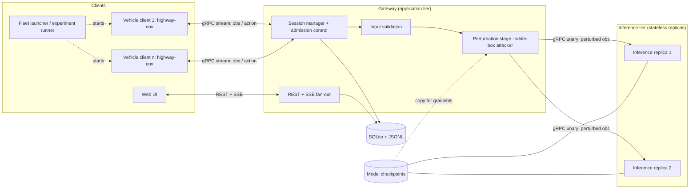

# Internet Connected Autonomous Driving System: Technical Specification and Options Study

Status: DRAFT v0.5 for team and supervisor review. v0.5 is a restructuring, not an increment: the communication-fault module, the fallback action and the real-time mode are removed (team decision), the vehicles become network clients of a layered service (proposed, not yet agreed), and the course module DSNSWK120 is added as a source of requirements. The topology (D1) and the transports (D5) are proposals for the team to accept or change; see Q5 and Q7.

Purpose of this document: work out the realistic options for building the system described in the project proposal, recommend one, and define requirements, interfaces, verification and a schedule so the team can decide.

## 0. Conventions

- "Proposal" means `proposal.pdf` (one page: A Introduction, B Detailed Objectives with four bullets, C References). Bullets are cited as B1 to B4 in the order they appear.
- "Course" means the module description of DSNSWK120 "Internet" (15 ECTS project module, https://moduler.aau.dk/course/2025-2026/DSNSWK120?lang=en-GB). Its objectives are cited as K1 to K5, S1 to S4 and C1 to C3 (section 1.3).
- Every requirement carries a source tag: `[P-A]`, `[P-B1]` to `[P-B4]` (stated in the proposal), `[CRS-..]` (course objective), `[TEAM]` (team decision) or `[ASM]` (our assumption, to be confirmed). Nothing tagged `[ASM]` is a proposal or course requirement.
- "Uncertain" marks technical facts from memory that were not verified against documentation while writing. Verify them in the first week (section 9, WP0).
- Keywords: MUST = needed to satisfy the proposal, the course or a robustness basic; SHOULD = valuable, droppable under schedule pressure; MAY = stretch.
- Requirement IDs are stable across versions. IDs removed in v0.5 are listed as removed and are not reused.

## 1. Project summary

### 1.1 Goal (from the proposal)

Develop an internet-connected autonomous driving system that integrates a robust deep reinforcement learning (DRL) agent. The system supports interaction between multiple driving environments and the agent through an internet-based interface or service, and the agent keeps operating safely under state perturbations. A web-based visualisation interface monitors the driving process and the agent's decisions (Proposal A).

### 1.2 Detailed objectives (Proposal B)

| ID | Proposal text, paraphrased closely | Notes |
|----|-----------------------------------|-------|
| B1 | An internet-based application or service enabling communication between driving environments and an autonomous vehicle (agent). Environments such as highway, merge and roundabout from the highway-env website may be used, "or other driving environments". | v0.5 reads this literally: the driving environments are the clients of the service. |
| B2 | A robust DRL method for secure autonomous driving under state perturbations. Sub-tasks: formulate driving as an RL task, analyse the impact of state perturbations, develop defence strategies. | |
| B3 | A web monitoring and visualisation interface showing vehicle states, selected actions, encountered perturbations and the agent's responses. | |
| B4 | Experiments evaluating the proposed method and system. | "System" is evaluated by the scalability and quality-of-service experiments (section 8.4). |

### 1.3 Course objectives (DSNSWK120) and where this specification meets them

Paraphrased from the module description. This table is the answer to "how does the project live up to the course".

| ID | Objective (paraphrased) | Met by |
|----|-------------------------|--------|
| K1, K2 | Knowledge of the internet, internet technologies, services and concepts | Transport options study (D5): HTTP/2, gRPC streaming, server-sent events, REST; load balancing of long-lived connections (7A.3) |
| K3 | Analyse and model requirements for an internet application | Sections 1 and 3, traceable to proposal and course |
| K4 | Structure an application in a multilayer architecture using common patterns | Four tiers (section 6): clients, gateway (session and application logic), stateless inference tier, data tier. Patterns: API gateway, stateless service replicas, session per run, admission control, publish/subscribe fan-out |
| K5, C1 | Design, implement and test a running internet application or service | Sections 6 to 9 |
| S1 | Systematic test that the service meets the users' needs | Requirement-to-test matrix (8.2) |
| S2 | Systematic evaluation of the user interface | Usability evaluation (FR-23, section 8.5). This was missing in v0.4 |
| S3 | Justify choices of requirements and architecture | Options tables with recommendation and fallback (section 5) |
| S4 | High-quality service with focus on scalable architecture and quality of service; assessed by experimental methods | NFR-SCAL-1 to 3, NFR-LAT-1 and 3, NFR-REL-3; load tests and QoS experiments (7A.4, 8.4) |
| C2, C3 | Reflect on the form of work; apply project management | Roles, work packages, milestones, risks (sections 9 and 10); reflection chapter in the report |

### 1.4 Sources of perturbation and what is in scope

The proposal names "malicious attacks, unreliable communication, or sensor noise" (Proposal A).

- Malicious attacks: in scope, as three gradient attacks bounded in L-infinity norm (PGD, MinBest, worst-Q).
- Sensor noise: in scope, as random L-infinity noise with the same bound.
- Unreliable communication: out of scope from v0.5 (team decision). Dropping actions and adding jitter does not give a well-defined perturbation: the effect depends on timing and on an arbitrary fallback rule, not on a bounded change of the state. The system therefore applies only perturbations with a stated norm bound, and the link between vehicle and agent is treated as reliable or failed, never degraded (FR-18). This delimitation must be stated in the report and confirmed with the supervisor (Q5).

### 1.5 Reference methods (Proposal C)

1. Liang et al., 2022, "Efficient adversarial training without attacking: Worst-case-aware robust reinforcement learning" (WocaR-RL), NeurIPS 35.
2. Zhang et al., 2021, "Robust reinforcement learning on state observations with learned optimal adversary", arXiv:2101.08452.
3. Xu et al., 2022, "Trustworthy reinforcement learning against intrinsic vulnerabilities: Robustness, safety, and generalizability", arXiv:2209.08025.

The team already has WocaR-DQN, SA-DQN and vanilla DQN implemented, trained and evaluated on highway-env (section 6A). This project reuses them; its own work is the internet service, the monitoring UI, the perturbation module, and the experiments around them. C1 is the method behind the best of the served agents, C2 is a possible additional attack (stretch), C3 is background (a survey).

### 1.6 Stakeholders

| Stakeholder | Interest |
|-------------|----------|
| Student team | Deliver a working system and report within the semester. |
| Supervisor / examiners `[ASM]` | Academic soundness of the robust-RL experiments; a demonstrable internet service that meets the course objectives. |
| Users of the web UI `[ASM]` | Understand what the agent does and what perturbations occurred. They are also the participants of the usability evaluation. |

### 1.7 Constraints

Supplied by the team, not by the proposal:

- C-1: 5 weeks until hand-in, of which about 3 weeks are for building the system.
- C-2: 6 members; about 3 do most of the implementation (roles proposed in section 9.1).
- C-3: Laptops only, CPU only. No real deployment: the system runs on one machine, started with one command (Docker Compose or plain processes). Scalability is shown by local load tests (section 7A).
- C-4: Open-source tooling, Python as the main language (it follows the existing models repository).
- C-5: `highway-v0` is the committed environment. Other environments are stretch and need new training.

### 1.8 Out of scope (explicit)

- Communication faults: emulated latency, jitter, loss or disconnects, a fallback action, and a real-time mode with deadlines (team decision, section 1.4).
- Physical or scaled vehicles and hardware-in-the-loop testing.
- Teleoperation. Remote monitoring is read-only apart from aborting a run.
- Network-security hardening (TLS, mTLS, access control, penetration testing). "Secure" in the proposal is read as robustness to state perturbations only. At most an optional shared token (FR-14, MAY).
- Real deployment: cloud VMs, production hosting, WAN demos, autoscaling or Kubernetes.
- Further environments (merge, roundabout, intersection) and the training of agents for them: stretch only.
- V2X radio stacks; perception from raw camera or lidar; certification; multi-agent learning.
- New robust-RL research. New training is an optional stretch item.

## 2. Terminology

| Term | Meaning here |
|------|--------------|
| Vehicle client | A process that owns one highway-env environment, connects to the gateway, sends observations and applies the actions it receives. One vehicle client per run. |
| Gateway | The internet-facing service. Owns sessions, applies the perturbation, calls the inference service, logs, and feeds the browsers. Does not run environments and does not choose actions. |
| Inference service | The DRL policy served as a stateless network service that maps an observation and a model id to a discrete action. It is the "agent" of the proposal. |
| Run / episode | One execution of an environment from reset to termination or truncation, identified by `runId`. One run is one session on the gateway. |
| State perturbation | Modification of the observation the agent receives, bounded in L-infinity norm by epsilon in normalised observation space (threat model of the reference papers). The only kind of perturbation in this system. |
| Clean / perturbed observation | What the environment produced / what the inference service receives. |
| Lockstep | The vehicle client does not step the environment until the action for the current observation has arrived. The only time model. |
| Replay vehicle | A synthetic vehicle client that sends a recorded observation sequence without running highway-env. Used only as a cheap load generator. |

## 3. Requirements

### 3.1 Functional requirements

| ID | Requirement | Priority | Source |
|----|-------------|----------|--------|
| FR-01 | A vehicle client MUST be able to open a run on the gateway with scenario, seed, step limit, served model (group, seed) and perturbation (attack, epsilon) as parameters. Any client MUST be able to list runs, fetch one run, fetch its log, and abort it. The environment is created through a factory keyed by scenario name, but only `highway-v0` is required. | MUST | P-B1 |
| FR-02 | Vehicle client, gateway and inference service MUST be separately startable processes that communicate only through the defined protocols (section 7). In networked mode the vehicle client MUST NOT import the policy, and the gateway MUST NOT choose actions. | MUST | P-B1, CRS-K4 |
| FR-03 | One gateway MUST serve concurrent runs (different seeds, models and perturbation settings; see NFR-SCAL-1 for the number) without cross-talk. Sessions are keyed by `runId`. | MUST | P-A "multiple driving environments" |
| FR-04 | The inference service MUST return one discrete action per observation together with the Q-values of all actions. | MUST | P-B3 |
| FR-05 | The perturbation module MUST support these four attack types, each with a configurable epsilon (L-infinity budget in normalised observation space) from the grid {0, 0.0025, 0.005, 0.0075, 0.01} (other values allowed): random L-infinity noise, 10-step PGD, MinBest, and worst-Q (min-Q targeted). Epsilon 0 or attack `none` means no perturbation. The attacks are ported from `perturb()` in `entries/05_wocar_dqn_r3/evaluate.py` of the models repository (section 6A), not re-derived. A perturbation MUST be a pure function of (clean observation, model, attack, epsilon, run seed, step index), so that it is reproducible and independent of which process computes it. Any additional attack is stretch. | MUST | P-B2, P-A |
| FR-06 | Removed in v0.5 (communication-fault module). | | TEAM |
| FR-07 | Removed in v0.5 (fallback action on a missed deadline). Replaced by FR-18. | | TEAM |
| FR-08 | The inference service MUST load the pretrained checkpoints of the models repository (vanilla DQN, SA-DQN, WocaR-DQN; seeds 1 to 7) at the peak-of-mean frames (vanilla `frame_1500000.pth`, SA-DQN `frame_1600000.pth`, WocaR-DQN `frame_1450000.pth`), and report the model id with every response and through a model listing. Training is NOT required. | MUST | P-B2, TEAM |
| FR-09 | Every step MUST be logged with: `runId`, `t`, clean observation, perturbed observation, perturbation metadata (attack, epsilon, norm of delta), action, Q-values, reward, termination and truncation flags, model id, the id of the inference replica that answered, and timings (perturbation, inference call, round trip seen by the vehicle). | MUST | P-B3, P-B4, CRS-S4 |
| FR-10 | The web UI MUST show live, per run: vehicle states, selected action, encountered perturbation, and the agent's response. At least 2 browsers MUST be able to watch the same run. | MUST | P-B3 |
| FR-11 | The UI SHOULD show the clean versus perturbed observation, the perturbation magnitude, and whether the action differs from the action the agent would pick on the clean observation. | SHOULD | P-B3 "responses of the agent" |
| FR-12 | The UI SHOULD replay a finished run from its log. | SHOULD | ASM |
| FR-13 | A batch experiment runner MUST execute a grid (model group x seed x attack x epsilon) on `highway-v0` headlessly by launching vehicle clients against the running service, and write result tables and plots reproducibly. | MUST | P-B4 |
| FR-14 | Control endpoints MAY be protected by a single shared token (config option, default off). | MAY | TEAM |
| FR-15 | The same scenario, seed, model and perturbation setting MUST yield identical clean observations, perturbed observations and actions, regardless of the number of concurrent runs, the number of inference replicas, and the transport used. | MUST | P-B4, TEAM "well defined perturbations" |
| FR-16 | The vehicle link MUST be strict lockstep: exactly one action per observation, in order, identified by `t`. The vehicle client MAY pace its steps (for example 1 Hz for a watchable demo); pacing MUST NOT change any result. | MUST | TEAM |
| FR-17 | The inference service MUST be stateless between steps: any replica can serve any step of any run, and replicas can be added or removed by configuration only. | MUST | CRS-S4, CRS-K4 |
| FR-18 | No substitute action is ever applied. If a step cannot be completed (inference unavailable after one retry on another replica, invalid observation, protocol violation, vehicle disconnect), the run MUST end with status `error` and a reason code. Runs with status `error` or `aborted` are excluded from results and counted in the report. | MUST | TEAM |
| FR-19 | The vehicle link SHOULD have a second implementation (HTTP with JSON) behind the same client interface, selectable by configuration, for debugging and for the transport comparison (section 8.4). | SHOULD | CRS-K1, CRS-S4 |
| FR-20 | The inference service SHOULD support micro-batching (several pending requests answered by one forward pass) with a configurable window, default off. | SHOULD | CRS-S4 |
| FR-21 | The vehicle client MUST have an in-process reference mode behind the same driver interface (perturbation and policy called directly, no network), used to verify that the networked system gives identical results. | MUST | P-B4 |
| FR-22 | The UI MAY start a run by assigning a configuration to an idle, connected vehicle client. | MAY | ASM |
| FR-23 | The web UI MUST be evaluated systematically with users (section 8.5) and the findings reported. | MUST | CRS-S2 |

### 3.2 Non-functional requirements

Numeric thresholds are `[ASM]` placeholders: chosen to be testable, to be recalibrated after the first local measurements. Everything is measured on one machine (loopback or Docker network), and the load generator shares that machine.

| ID | Category | Requirement | Source |
|----|----------|-------------|--------|
| NFR-LAT-1 | Latency | Inference service handling time (request received to response sent, including CPU inference) p95 <= 10 ms. Round trip seen by the vehicle client (observation sent to action received) p95 <= 50 ms with one active run and no attack. Attack computation is measured and reported separately. | ASM |
| NFR-LAT-2 | | Removed in v0.5 (step deadline). | TEAM |
| NFR-LAT-3 | Latency | Time from a step being completed to the corresponding UI update p95 <= 500 ms with 5 viewers per run. | ASM |
| NFR-PERF-1 | Throughput | One unpaced run through the networked system without attack achieves >= 50 steps/s on a laptop (uncertain; to be measured in WP0). | ASM |
| NFR-SAF-1, NFR-SAF-2 | | Removed in v0.5 (behaviour under communication faults; choice of fallback action). | TEAM |
| NFR-SAF-3 | Robustness | Reproduction target: with the pretrained models served through the system, the crash rate under the gradient attacks at epsilon 0.01 is lower for WocaR-DQN than for vanilla DQN, with a gap consistent with the models repository (about 53 versus 74 percent; to be re-measured). Absolute safety is not claimed: the clean crash rate of these agents is 23 to 31 percent. | P-B2, P-B4 |
| NFR-REL-1 | | Removed in v0.5 (reconnect and resume). Replaced by NFR-REL-3. | TEAM |
| NFR-REL-2 | Reliability | Completed steps are durably written within 1 s; a gateway restart loses at most the last second of a run. | ASM |
| NFR-REL-3 | Reliability | With at least 2 inference replicas, killing one replica under load fails no run (the affected calls are retried on another replica). Killing the gateway ends its runs with status `error` at the vehicle clients, which exit cleanly. A 1 hour soak test shows no unhandled exception and no growth of memory beyond a stated bound. | CRS-S4 |
| NFR-ROB-1 | Robustness | Every perturbed observation satisfies the L-infinity bound (max abs delta <= epsilon + 1e-6) and stays within the observation range; verified by unit test and logged per step (`linf`). | P-B2 |
| NFR-ROB-2 | Robustness | Malformed or non-finite observations (wrong shape, NaN, Inf, out of range) are rejected by the gateway with an error code and the run ends with status `error` (FR-18). No crash, no silent clipping, no effect on other runs. | P-A |
| NFR-SCAL-1 | Scalability | On one laptop-class machine the system sustains N concurrent runs paced at 1 Hz (placeholder N = 50; N = 200 as a stretch target) with vehicle round trip p95 <= 50 ms without attack, no failed runs, and UI latency p95 <= 500 ms at 5 viewers per run. | CRS-S4, TEAM |
| NFR-SCAL-2 | Scalability | Overload degrades gracefully: when the session limit is reached, new runs are refused with a clear error instead of slowing existing runs. | CRS-S4 |
| NFR-SCAL-3 | Scalability | Adding replicas of the bottleneck tier increases throughput. The load test identifies which tier is the bottleneck with and without attacks and reports throughput and p95 latency for 1, 2 and 4 replicas (no fixed threshold; the scaling efficiency is reported). | CRS-S4 |
| NFR-UX-1 | Usability | The usability evaluation has at least 5 participants, a fixed task list, and reports task completion and a System Usability Scale score (placeholder target: 68 or above). | CRS-S2 |
| NFR-PRV-1 | Privacy | The system processes only simulation data. The usability evaluation collects anonymous answers only, with consent; no accounts, no personal data stored. | ASM |
| NFR-COST-1 | Cost | No paid resources: laptops, CPU only. | C-3 |
| NFR-FEAS-1 | Feasibility | Only open-source components; one-command local start (`docker compose up`); CI runs unit and integration tests on every push. | ASM |
| NFR-MNT-1 | Maintainability | Protocol schemas are defined once in a shared package and versioned; breaking changes bump the protocol version. | ASM |

## 4. Key design facts about highway-env that shape the options

The environment configuration used by the models (section 6A) was checked in the repository. The generic highway-env facts below are from memory of the documentation and should be verified in WP0.

- Environments follow the Gymnasium API: `reset(seed=...)` returns `(obs, info)`; `step(a)` returns `(obs, reward, terminated, truncated, info)`.
- Observation `Kinematics`: a matrix of vehicles by features, ego vehicle first, normalised to a configured range. Flattened it is a short vector, so an MLP policy suffices and CPU inference is cheap.
- `DiscreteMetaAction` has 5 actions: `0 LANE_LEFT`, `1 IDLE`, `2 LANE_RIGHT`, `3 FASTER`, `4 SLOWER`. Index 0 is not a no-op.
- Other vehicles are driven by built-in IDM/MOBIL models.
- Stepping cost depends strongly on the vehicle count (section 7A.1). It is pure-Python CPU work, which is the main reason to keep it out of the server.

## 5. Architecture options

For each decision: options with pros and cons, rough effort in person-weeks (pw), then a recommendation, main risks and a fallback. Effort figures are estimates with wide error bars (factor 2).

### D1. Topology: who is the client and where does the agent run?

| Option | Description | Pros | Cons | Effort |
|--------|-------------|------|------|--------|
| D1-a In-process | Policy is a Python object called by the simulator. | Simplest and fastest. | No internet service at all; fails B1 and the course. | 0 pw |
| D1-b Simulation hub with remote agent (v0.4) | One simulation service owns all environments and calls a remote agent service; browsers are the only external clients. | One place for everything; few processes. | The environments are not clients, so B1 is met only between two back-end processes. Environment stepping (CPU-bound Python) runs in the server and limits the load test to what highway-env can do. With the fault module removed, little is left to justify the split. | 2 to 3 pw |
| D1-c Vehicle clients, gateway, inference tier | Each vehicle is a client process that owns its environment and connects to a gateway. The gateway perturbs, calls a stateless inference tier, logs and feeds browsers. | Reads B1 literally. Clear multilayer architecture (course K4). Stepping cost leaves the server, so the load test measures the service. The inference tier scales by adding replicas. | One more process type and one more protocol than D1-b. Runs are started from the client side, not from the UI. | 3 to 4 pw |
| D1-d Vehicle clients directly to the agent | No gateway; each vehicle talks to the agent service. | Fewest hops. | No place for perturbation, logging and monitoring except inside the agent (attacker and defender in one service) or the client (fat client holding the model). | 2 pw |

Recommendation: D1-c, with D1-a kept as the in-process reference mode behind the same driver interface (FR-21).
Compared with v0.4 this is roughly cost-neutral (estimate): the fault shim, the fallback controller, the reconnect logic and the real-time mode disappear; the vehicle client and one more protocol are added.
Risks: three process types to integrate in three build weeks; mitigated by the walking skeleton in week 2.
Fallback: D1-b with lockstep only. It still satisfies the proposal, but the course argument is weaker.
Implications: FR-01 to FR-03, FR-16 to FR-18, FR-21.

### D2. Simulation platform

| Option | Pros | Cons | Effort |
|--------|------|------|--------|
| D2-a highway-env, `highway-v0` committed | Named in the proposal; lightweight; trained agents exist for it. | Abstract kinematic simulation; limited realism. | 1 pw |
| D2-b Further highway-env scenarios | Named as examples in the proposal. | Needs new agents trained per scenario. | +3 pw or more |
| D2-c CARLA or SUMO | Realistic. | GPU, setup effort, perception becomes the problem. | 6+ pw |
| D2-d Scaled physical vehicle | Real hardware. | Cost, build time, little overlap with the proposal. | 8+ pw |

Recommendation: D2-a (team decision). The protocol carries `obsSpec` and `actionSpec`, so another scenario is a configuration change on the service side; the missing part would be trained agents.

### D3. Learning stack and robust method

The team already has vanilla DQN, SA-DQN and WocaR-DQN trained and evaluated (section 6A). The decision is about reuse.

| Option | Description | Pros | Cons / risks | Effort |
|--------|-------------|------|--------------|--------|
| D3-a Serve the pretrained checkpoints with the repository loader | `model_setup` then `features.load_state_dict` | No training; results exist for comparison | Depends on the repository's `models.py` and, through it, on the vendored `auto_LiRPA` | 1 to 2 pw |
| D3-b Reimplemented plain-PyTorch dueling MLP loading the same state dict | No `auto_LiRPA` at serving time | Light image; one small `policy` package shared by gateway and inference service | Outputs must be verified equal to the original, key by key | +0.5 pw |
| D3-c New training | Stretch | Could improve the clean and robust trade-off | Competes with the build time | 2 to 3 pw |

Recommendation: D3-a, with D3-b if the dependency or image size is a problem. Because the model is needed in two services (inference, and the attacker in the gateway), D3-b is more attractive than in v0.4; decide in WP0.
Fallback: vanilla DQN checkpoints only. Implications: FR-05, FR-08, NFR-SAF-3.

### D4. Threat model and perturbation placement

| Option | Pros | Cons |
|--------|------|------|
| D4-a In the vehicle client, before sending | Models a compromised sensor. | Fat client holding model weights; the server never sees the clean observation unless the client is trusted to send both. |
| D4-b In the gateway, as a stage between vehicle and inference | The attacker sits in the path between vehicle and agent, which is where a network attacker would sit. Gateway sees clean and perturbed observation and logs both. Clients stay thin. | Gradient attacks cost about 10 forward and backward passes per step and must run off the event loop. The gateway holds a copy of the model weights. |
| D4-c Separate stateless attacker service called by the gateway | Same placement as D4-b, but the expensive part scales by adding replicas like the inference tier. | One more service and call per step. |
| D4-d Inside the inference service | Has the model already. | Attacker and defender in one trust domain; confusing security story. |

Recommendation: D4-b, implemented behind a `Perturber` interface and run in a worker pool. Because FR-05 makes a perturbation a pure function of its inputs, moving it to D4-c later is a deployment change; D4-c is a SHOULD and becomes relevant if the load test shows the attacks to be the bottleneck (section 7A.1).
Attack set (MUST): random L-infinity noise; 10-step PGD (cross-entropy against the best action); MinBest (logit-margin attack); worst-Q (min-Q targeted PGD). Epsilon grid as in the repository: {0, 0.0025, 0.005, 0.0075, 0.01}; SA-DQN and WocaR-DQN were trained at 0.005.
Randomness: the random generator of a step is derived from (run seed, step index), not from a running stream, so that the result does not depend on the process that computes it.
Open point: which feature groups may be perturbed (Q1). Default: the whole 50-dimensional vector, as in the repository.
Communication faults: not emulated (section 1.4).

### D5. Transports

Payload is small (a few hundred bytes per message), so bandwidth is not a differentiator. There are three links with different needs.

Vehicle link (vehicle client to gateway): one long-lived session per run, strict request and reply, typed messages.

| Option | Pros | Cons |
|--------|------|------|
| D5-a HTTP request per step with JSON | Simplest; testable with curl; stateless requests. | Session state must be looked up per request; abort cannot be pushed to the vehicle; header overhead per step. |
| D5-b WebSocket with JSON | Persistent and full duplex; trivial with FastAPI. | Schema, ordering and error semantics are ours to define; the v0.4 choice, nothing new to learn or compare. |
| D5-c gRPC bidirectional stream (protobuf over HTTP/2) | Typed schema with code generation; status codes, deadlines and flow control built in; one stream per run maps exactly to a session. | Tooling step (code generation); browsers cannot use it directly (not needed here). |
| D5-d Message broker (NATS or MQTT) | Decoupling; NATS queue groups would load-balance replicas without a proxy; fits a connected-vehicle story. | A broker to run and learn; request and reply through a broker adds a hop; largest change for the team. |
| D5-e WebTransport / HTTP/3 | Most novel. | Python support is immature (uncertain); too risky for three build weeks. |

Internal link (gateway to inference service): stateless unary call, load-balanced per call. gRPC unary fits; plain HTTP would also work.

Browser feed (gateway to browser): server to client only.

| Option | Pros | Cons |
|--------|------|------|
| WebSocket | Full duplex. | Duplex is not needed; reconnect and resume are ours. |
| Server-sent events (SSE) | Plain HTTP; automatic reconnect; `Last-Event-ID` gives resume after reconnect for free; trivial to load-test. | One direction only (sufficient). |

Recommendation: D5-c gRPC for the vehicle link (one bidirectional stream per run) and gRPC unary for the internal link; REST plus SSE for the browser. D5-a is implemented as the second vehicle transport (FR-19, SHOULD), which gives a debugging path and a transport comparison experiment.
Risks: gRPC keeps one HTTP/2 connection open, so naive load balancing sends all calls to one replica; see 7A.3. Running the gRPC server and FastAPI in one asyncio process is assumed to work (uncertain; WP0 spike).
Fallback: D5-b WebSocket with JSON on the vehicle link and HTTP on the internal link, as in v0.4.
Alternative for the team to consider (Q7): D5-d with NATS, if an event-driven architecture is preferred over a layered request and reply one.

### D6. Time model

Lockstep only (team decision following from section 1.4). The vehicle client waits for each action; latency never changes an outcome, which makes every result reproducible (FR-15). Optional pacing in the vehicle client (FR-16) gives a watchable 1 Hz demo and wall-clock-bound sessions for the load test.
There is no deadline and no fallback. A generous technical timeout (default 5 s per inference call, 30 s of silence on a vehicle stream; placeholders) only detects dead peers and ends the run with status `error` (FR-18).

### D7. Data pipeline and storage

| Option | Pros | Cons |
|--------|------|------|
| D7-a JSON Lines file per run | Trivial, append-only, human-readable. | Querying across runs is awkward. |
| D7-b SQLite (runs and steps tables, WAL mode) | Single file, SQL for the UI and the analysis. | Single writer, so one gateway process owns it. |
| D7-c PostgreSQL | Multi-writer, needed for several gateway processes. | Another service; not needed on one machine. |
| D7-d Parquet export for batch analysis | Compact, fast with pandas. | Not for live append. |

Recommendation: D7-b as the system of record with observations stored as float32 blobs, JSONL export per run, and a Parquet export for the experiment analysis. Vehicle poses (for scene replay) are stored only when the run asks for it (`recordScene`), which keeps batch grids small.
Estimate: about 0.6 KB per step without scene; a full reduced grid (section 8.3) is below 1 GB.
Fallback: D7-a only.

### D8. Monitoring and visualisation interface

| Option | Pros | Cons | Effort |
|--------|------|------|--------|
| D8-a Custom single page: JS and `<canvas>`, driven by structured events | Precise control; shows actions, Q-values and perturbations; light; replay from the log. | Must draw the road (a straight multi-lane highway is easy). | 2 to 3 pw |
| D8-b Stream rendered frames from the vehicle client | Exact scene for free. | Bandwidth and CPU in the client; no overlays; no replay without re-simulating. | 1 pw |
| D8-c Dashboard tool (Grafana, Streamlit, Dash) | Quick charts. | Weak live scene rendering. | 1 to 2 pw |

Recommendation: D8-a. The vehicle client sends the static road geometry once at the start of the run and the vehicle poses with every observation; the gateway relays them.
Fallback: D8-b for the scene, with D8-a-style panels for numbers.

### D9. Security approach (robustness only)

"Secure" means robustness to state perturbations. The threat model covers (T1) adversarial and random perturbation of the observation within an L-infinity bound, and (T3) malformed or non-finite input. T2 (communication faults) was removed in v0.5. Network security is out of scope; the only optional item is a shared token (FR-14).

### D10. Packaging and local execution

| Option | Pros | Cons |
|--------|------|------|
| D10-a Local processes (start script) | Fastest for development. | Depends on the developer's Python environment. |
| D10-b Docker Compose on one machine | One-command start; replicas via `--scale`; CPU limits per container make replica scaling measurable on one machine. | Docker on macOS adds a VM layer, so absolute latencies differ from native Linux. |
| D10-c Cloud | Realistic scale. | Out of scope. |

Recommendation: D10-b as the reproducible default, D10-a for development.

### D11. Summary of recommended choices

| Decision | Recommended | Fallback |
|----------|-------------|----------|
| D1 Topology | Vehicle clients, gateway, stateless inference tier; in-process reference mode | Simulation hub with remote agent, lockstep only |
| D2 Platform | highway-env, `highway-v0` only | n/a |
| D3 Models | Serve the existing checkpoints; reuse the repository attack code | Vanilla DQN only |
| D4 Perturbation | Gateway stage behind a `Perturber` interface, pure function per step; attacker service as SHOULD | In-gateway only |
| D5 Transports | gRPC stream (vehicle link), gRPC unary (internal), REST and SSE (browser); HTTP with JSON as second vehicle transport | WebSocket with JSON |
| D6 Time model | Lockstep only, optional pacing | n/a |
| D7 Storage | SQLite, JSONL export, Parquet for analysis | JSONL only |
| D8 UI | Canvas page from events and road geometry | Streamed frames |
| D9 Security | Robustness only (bounded perturbation, input validation) | n/a |
| D10 Packaging | Docker Compose on one machine; plain processes for development | Plain processes |

## 6A. Existing assets: the models repository

Source: https://github.com/Internet-CADS/models, branch `main` (read-only). Facts below were checked for v0.4 in `README.md` and `entries/05_wocar_dqn_r3/` (`evaluate.py`, `highway_adapter.py`, `config_highway_wocar.json`, `defaults.json`, `visualize_perturbation.py`); they were not re-checked for v0.5. Peak-of-mean frames are taken from the team's check of the rev3 evaluation report.

| Fact | Value (verified in files unless marked) |
|------|---------------------------------------|
| Environment | `highway-v0`, 4 lanes, 15 other vehicles, 60-step episodes (`duration` 60), `simulation_frequency` 5, `policy_frequency` 1, off-road terminal |
| Observation | Kinematics, 10 vehicles x (presence, x, y, vx, vy), normalised, relative (`absolute: false`), flattened to 50 inputs by `highway_adapter.py` (`LegacyHighwayEnv`, which also converts the Gymnasium 5-tuple to a 4-value API) |
| Actions | 5 discrete meta-actions: 0 LANE_LEFT, 1 IDLE, 2 LANE_RIGHT, 3 FASTER, 4 SLOWER |
| Reward | collision -2, right lane 0.1, high speed 0.4, no reward normalisation |
| Network | Dueling MLP 50-128-128-5 (`model_width` 1); checkpoint is the state dict of `model.features`, loaded in `evaluate.py` via `model_setup(...)` then `features.load_state_dict` |
| Checkpoints | `entries/05_wocar_dqn_r3/artifacts/run_2/<vanilla_dqn\|sa_dqn\|wocar_dqn>/model_<seed>/frame_<N>.pth`, about 98 KB each, seeds 1 to 7, every 50k frames to 2M, tracked in git. Peak-of-mean frames (rev3 report): vanilla 1,500,000, SA-DQN 1,600,000, WocaR-DQN 1,450,000. On `main`, all 63 files for these three frames (3 frames x 21 models) exist. |
| Attacks | `perturb()` in `evaluate.py`: `random_linf`, `pgd` (`PGD_STEPS = 10`, cross-entropy against the best action), `minbest`, `worst_q`; `DEFAULT_EPSILONS = [0.0, 0.0025, 0.005, 0.0075, 0.01]`; certification via `is_certified()` (CROWN-IBP through `auto_LiRPA`, not needed for serving) |
| Reported results (README, rev 3, 7 seeds, 300 episodes) | Crash rate, clean: vanilla 23, SA-DQN 29, WocaR 31 percent. Gradient attacks eps 0.005: 44 / 43 / 38. Eps 0.01: 74 / 61 / 53. Random noise eps 0.005: 26 / 31 / 32. WocaR is most robust against gradient attacks; SA-DQN is not reliably better than vanilla |

What it does not provide:

- No serving code: no network service, no session handling, no monitoring UI, no logging pipeline.
- Evaluation code is a batch script using multiprocessing and a vendored fork of the authors' code; `evaluate.py` changes the working directory and manipulates `sys.path` at import, so its attack code must be copied and cleaned rather than imported.
- Dependencies: PyTorch, highway-env, the vendored `auto_LiRPA` (whether plain inference needs it is not verified, see D3-b), plus a long `requirements.txt`.
- Weak driving quality: clean crash rate 23 to 31 percent; robust agents drive worse clean than vanilla; no help against random noise.
- Only one environment configuration.
- Licence and authorship: no top-level LICENSE on `main`; only the two copies of `auto_LiRPA/LICENSE` (I believe BSD-3-Clause; verify). `upstream/` is derived from the WocaR-RL authors' code, whose licence was not checked (Q2).

Consequences: the inference service wraps these checkpoints (FR-08), the perturbation module ports `perturb()` (FR-05), the vehicle client's environment configuration must equal the repository configuration, and the main experiment reproduces a subset of the repository results as a system check.

## 6. Recommended architecture

### 6.1 Tiers and components

| Tier | Component | Responsibility | Tech |
|------|-----------|----------------|------|
| Client | Vehicle client (`vehicle_client`) | Owns one highway-env environment per run; opens a run on the gateway; sends observation and vehicle poses; applies the received action; reports reward and termination. Thin: no model, no perturbation, no logging. | Python, highway-env, gRPC client |
| Client | Web UI | Run list, live scene, decisions, perturbations, charts, replay. | Static HTML/JS, canvas, SSE |
| Client | Fleet launcher / experiment runner | Starts vehicle clients for a grid or a load profile; collects results from the gateway. | Python CLI |
| Application | Gateway (`gateway`) | Session per run; admission control; input validation; perturbation stage; inference call with retry; step log; event fan-out; REST API; serves the static UI. Never steps an environment, never chooses an action. | Python, asyncio, gRPC server, FastAPI |
| Application | Perturbation module | Clean observation in, perturbed observation and metadata out; holds model copies for white-box gradients; runs in a worker pool. Optionally a separate attacker service (D4-c). | PyTorch |
| Service | Inference service (`inference`) | Loads all 21 checkpoints once; answers `Act(modelId, obs)` with action and Q-values; stateless; N replicas; optional micro-batching. | Python, gRPC server, PyTorch (CPU) |
| Data | Store | `runs` and `steps` tables; JSONL and Parquet export. | SQLite (WAL) |
| Shared | `protocol` package | Protobuf definitions and generated code; Pydantic models for REST and SSE; constants. | Python |
| Shared | `policy` package | Model definition and checkpoint loader, used by the inference service and the perturbation module. | PyTorch |

### 6.2 Diagram



### 6.3 Data flow of one run

1. The vehicle client resets its environment with the run seed and opens a stream to the gateway with `Hello`: run configuration, `obsSpec`, `actionSpec`, road geometry.
2. The gateway checks the specifications and the model id, applies admission control, creates the run and answers `Welcome` with the `runId` (or refuses, NFR-SCAL-2).
3. The vehicle client sends `Obs` with step index `t`, the clean observation `o_t` and the vehicle poses.
4. The gateway validates `o_t` (NFR-ROB-2). The perturbation stage computes `o'_t` within epsilon and records attack, epsilon and `||o'_t - o_t||_inf`.
5. The gateway calls `Act(modelId, o'_t)` on an inference replica. On failure it retries once on another replica; a second failure ends the run with status `error` (FR-18).
6. The gateway sends `Action` with `t` and the action to the vehicle client.
7. The vehicle client steps the environment and sends `Result` with reward, `terminated`, `truncated` and `crashed`.
8. The gateway writes the step record and publishes one `step` event to the subscribed browsers.
9. Steps 3 to 8 repeat until termination, truncation or the step limit. The gateway closes the stream with `Summary` (status, total reward, crashed).

### 6.4 Repository layout (proposed)

```
.
├── docs/SPEC.md
├── protocol/                 # .proto files, generated code, Pydantic models for REST and SSE
├── policy/                   # model definition and checkpoint loader
├── vehicle_client/           # env wrapper, driver interface (remote gRPC, remote HTTP, in-process)
├── gateway/                  # sessions, validation, perturbation, store, REST, SSE, static UI
├── inference_service/        # policy server, micro-batching
├── experiments/              # fleet launcher, grid configs, analysis
├── loadtest/                 # replay vehicles, SSE viewers, load profiles
├── tests/                    # unit, integration, e2e
├── docker-compose.yml
├── pyproject.toml            # uv workspace
└── README.md
```

## 7. Interfaces

### 7.1 Overview

| ID | Between | Style | Contents |
|----|---------|-------|----------|
| IF-1 | Browser or CLI and gateway | REST (HTTP) | Run list, run detail, log download, abort, health and load. |
| IF-2 | Browser and gateway | SSE `GET /v1/runs/{runId}/events` | `road`, `step`, `status` events; resume with `Last-Event-ID`. |
| IF-3 | Vehicle client and gateway | gRPC bidirectional stream `Gateway.Drive` (second transport: HTTP with JSON, FR-19) | `Hello`, `Welcome`, `Obs`, `Action`, `Result`, `Abort`, `Summary`, `Error`. |
| IF-4 | Gateway and inference service | gRPC unary `Inference.Act`, `Inference.ListModels` | Model id and observation in; action, Q-values, replica id and handling time out. |
| IF-5 | Inference service and perturbation module to checkpoint files | files, read-only | Checkpoint files of the models repository. |
| IF-6 | Gateway and store | SQLite | `runs`, `steps`. |
| IF-7 | Vehicle client and driver | Python interface `Driver` | `open(config)`, `act(t, obs, poses)`, `report(t, result)`, `close()`. Implementations: gRPC, HTTP, in-process (FR-21). |

### 7.2 REST (IF-1)

| Method and path | Purpose |
|-----------------|---------|
| `GET /v1/runs`, `GET /v1/runs/{id}` | List and detail, including status `running`, `finished`, `aborted` or `error`, the reason code, and labels (for example `experimentId`, `synthetic`). |
| `GET /v1/runs/{id}/log` | Step records (JSONL or paged JSON). |
| `DELETE /v1/runs/{id}` | Abort: the gateway sends `Abort` on the vehicle stream; status becomes `aborted`. |
| `GET /v1/models` | Served models (group, seed, frame). |
| `GET /healthz`, `GET /load` | Liveness; active sessions, session limit, event-loop lag, worker-pool queue length. |

Runs are created by the vehicle client through IF-3, not by REST. The HTTP transport of FR-19 adds `POST /v1/runs` (the `Hello`), `POST /v1/runs/{id}/obs` (returns the action) and `POST /v1/runs/{id}/result`.

### 7.3 Vehicle link (IF-3) and inference link (IF-4)

Sketch of the protobuf definitions; field numbers and details are settled in WP1.

```proto
service Gateway {
  rpc Drive(stream VehicleMsg) returns (stream GatewayMsg);
}

message VehicleMsg { oneof msg { Hello hello = 1; Obs obs = 2; Result result = 3; } }
message GatewayMsg { oneof msg { Welcome welcome = 1; Action action = 2; Abort abort = 3; Summary summary = 4; Error error = 5; } }

message Hello {
  uint32 protocol_version = 1;
  string scenario = 2;            // "highway-v0"
  uint64 seed = 3;
  uint32 max_steps = 4;
  string model_id = 5;            // "wocar_dqn/model_1/frame_1450000"
  string attack = 6;              // none | random_linf | pgd | minbest | worst_q
  float epsilon = 7;
  ObsSpec obs_spec = 8;           // shape [10,5], flattened 50, features, normalised
  ActionSpec action_spec = 9;     // discrete, n = 5, names
  Road road = 10;                 // lane polylines and widths
  bool record_scene = 11;
  map<string, string> labels = 12;
}
message Welcome { string run_id = 1; }
message Obs     { uint32 t = 1; repeated float obs = 2; repeated Vehicle vehicles = 3; }
message Action  { uint32 t = 1; uint32 action = 2; }
message Result  { uint32 t = 1; float reward = 2; bool terminated = 3; bool truncated = 4; bool crashed = 5; }
message Summary { string status = 1; float total_reward = 2; bool crashed = 3; uint32 steps = 4; }
message Error   { string code = 1; string message = 2; }

service Inference {
  rpc Act(ActRequest) returns (ActReply);
  rpc ListModels(Empty) returns (ModelList);
}
message ActRequest { string model_id = 1; repeated float obs = 2; }
message ActReply   { uint32 action = 1; repeated float scores = 2; string replica_id = 3; float handle_ms = 4; }
```

Rules:

- Order on a stream is `Hello`, `Welcome`, then per step `Obs`, `Action`, `Result`, with `t` increasing by one from 0. Anything else is a `PROTOCOL_VIOLATION`.
- The `Hello` lets the gateway reject a mismatch of observation or action layout instead of acting on a different layout.
- `Act` is idempotent (deterministic policy, no state), which is what makes the single retry in step 5 of section 6.3 safe.
- Error codes: `SPEC_MISMATCH`, `UNKNOWN_MODEL`, `OVERLOADED`, `BAD_OBS_SHAPE`, `NON_FINITE_OBS`, `OBS_OUT_OF_RANGE`, `PROTOCOL_VIOLATION`, `INFERENCE_UNAVAILABLE`, `VEHICLE_DISCONNECTED`, `ABORTED`.
- Observations are float32 on every transport. A float32 written as a JSON number and read back is the same float32, so the HTTP transport does not break FR-15 (to be covered by a test).
- Latency is measured on one clock at a time: the vehicle client measures observation sent to action received; the gateway measures perturbation time and the inference call; the replica reports its own handling time. No clock comparison between processes.

### 7.4 Browser events (IF-2)

```json
{ "type": "road",   "runId": "r-17", "lanes": [ { "id": "...", "polyline": [[0, 0], [1000, 0]], "width": 4.0 } ] }
{ "type": "step",   "runId": "r-17", "t": 42,
  "vehicles": [ { "id": 0, "ego": true, "x": 12.3, "y": 0.1, "heading": 0.02, "speed": 24.0 } ],
  "action": 1, "scores": [0.2, 0.9, 0.1, 0.05, 0.3], "cleanAction": 3,
  "attack": "pgd", "epsilon": 0.005, "linf": 0.005,
  "reward": 0.31, "terminated": false, "truncated": false,
  "modelId": "wocar_dqn/model_1/frame_1450000", "replicaId": "inference-2",
  "perturbMs": 4.1, "inferMs": 1.9 }
{ "type": "status", "runId": "r-17", "status": "finished", "totalReward": 21.4, "crashed": false }
```

Each event has an SSE `id` (the step index), so a browser that reconnects with `Last-Event-ID` receives what it missed from a bounded per-run buffer; a browser joining mid-run receives `road` and the buffered steps. `cleanAction` (the action on the clean observation) costs one extra forward pass in the gateway's model copy and is optional (FR-11).

### 7.5 Step record (store and log)

Fields: `runId, t, obs_clean, obs_perturbed, attack, epsilon, linf, action, scores, clean_action?, reward, terminated, truncated, crashed, model_id, replica_id, perturb_ms, infer_ms, handle_ms, rtt_ms?, vehicles?`. `rtt_ms` is measured by the vehicle client and reported with the next message; `vehicles` is stored only with `recordScene`.

## 7A. Scalability and quality of service (local)

There is no real deployment: the deliverable is a set of local load tests against one machine, plus a design that would also scale out. Nothing below has been measured; where a bottleneck is named it is a hypothesis to be tested.

### 7A.1 Where the load is (hypotheses)

- Environment stepping is in the vehicle clients, not in the service. The models repository notes that stepping became 2.7 times slower going from 15 to 25 other vehicles, so it is expensive; with real vehicle clients the load generator, not the service, may limit the test. Replay vehicles (section 2) avoid this.
- Policy inference: a 50-128-128-5 MLP is tiny (about 20k parameters). Per-request overhead in Python (deserialisation, scheduling) probably exceeds the forward pass. One inference replica may therefore serve many runs, and the inference tier may not be the bottleneck without attacks.
- Gradient attacks cost about 10 forward and backward passes per step and run in the gateway's worker pool. With attacks enabled, this is the likely bottleneck, which is the argument for the attacker service (D4-c).
- Event fan-out: one `step` event per step per viewer; JSON serialisation in one Python process may limit at hundreds of viewers.
- The gateway's event loop must never run CPU-heavy work directly (attacks, bulk serialisation); event-loop lag is exposed in `/load`.

### 7A.2 Process-structure options

| Option | Description | Pros | Cons |
|--------|-------------|------|------|
| S-a One gateway, one inference replica | Minimum | Simplest | One core each for the Python parts |
| S-b One gateway, N inference replicas (and N attacker workers or replicas) | Stateless tiers scaled by configuration | Uses several cores; a killed replica does not fail runs | Needs per-call load balancing (7A.3) |
| S-c Several gateway processes | Sessions distributed over gateways | Removes the last single process | Viewers must reach the gateway that owns the run, and the store needs several writers (PostgreSQL); design discussion only |
| S-d Cloud, Kubernetes, autoscaling | | | Out of scope |

Recommendation: S-a in the walking skeleton, S-b as the MUST target (it is what FR-17 and NFR-SCAL-3 need), S-c described in the report only.

### 7A.3 Session and state design

- A run is the unit of state: one vehicle stream, one session, one event buffer, owned by one gateway process for its whole life.
- The session holds only bookkeeping (`runId`, configuration, step index, totals). It holds no random state: perturbation randomness is derived per step (D4).
- Inference replicas hold no run state and have all 21 models loaded (about 2 MB in total), so any replica serves any step.
- Load balancing of the internal link: gRPC multiplexes all calls over one HTTP/2 connection, so a connection-level balancer (or plain Docker service DNS) pins every call to one replica. Use client-side load balancing in the gateway (resolver over all replica addresses, `round_robin` policy) or an HTTP/2-aware proxy. Which of the two works with Compose replicas is uncertain and is a WP0 spike.
- Admission control: maximum sessions per gateway (NFR-SCAL-2); a refused `Hello` gets `OVERLOADED`.
- Results do not depend on how runs are distributed over replicas (FR-15); this is tested, not assumed.

### 7A.4 Load tests

Replica scaling on one machine is only meaningful while cores are free: report the core count, give each replica a CPU limit in Compose, and stop at the core count. N and thresholds are placeholders until the first measurement.

| ID | Test | Parameters (placeholders) | Result or pass criterion |
|----|------|---------------------------|--------------------------|
| LT-1 | N concurrent runs paced at 1 Hz, 5 SSE viewers each, no attack | N = 10, 50, 200 | NFR-SCAL-1: vehicle round trip p95 <= 50 ms, p99 <= 150 ms; no failed runs; UI latency p95 <= 500 ms |
| LT-2 | Unpaced throughput, no attack | 1 to 64 concurrent replay vehicles | Steps/s and latency percentiles against concurrency; the saturation point |
| LT-3 | LT-2 with PGD in every run | same | Cost of the attack stage; which tier saturates first |
| LT-4 | Horizontal scaling | 1, 2, 4 inference replicas; 1, 2, 4 attacker workers | NFR-SCAL-3: throughput and p95 per configuration; scaling efficiency; bottleneck named |
| LT-5 | Overload: twice the session limit | | Excess runs refused with `OVERLOADED`; existing runs unaffected (NFR-SCAL-2) |
| LT-6 | Failure under load: kill one inference replica; kill the gateway | 2 or more replicas | NFR-REL-3 |
| LT-7 | Transport comparison (SHOULD, needs FR-19) | gRPC stream versus HTTP with JSON, same load as LT-2 | Round trip percentiles, throughput, bytes per step |
| LT-8 | Micro-batching (SHOULD, needs FR-20) | window 0, 1, 2, 5 ms at high concurrency | Throughput against added latency |

With a 20k-parameter model the inference tier may never saturate. If so, LT-4 and LT-8 MAY be repeated with a stated synthetic handling time per request in the inference service (emulating a larger model). This is a load-test setting only, it is never enabled in a run that counts as a result, and it does not change any action.

Tooling: replay vehicles and SSE viewers as a small asyncio program in `loadtest/`; CPU, memory and event-loop lag from `psutil` or `docker stats`.

## 8. Verification and validation plan

### 8.1 Levels and tools

| Level | What | Tools |
|-------|------|-------|
| Unit | Perturbation bound, purity and seeding of perturbations, schema validation, protocol state machine, action index mapping | pytest, a property-based test (e.g. Hypothesis) |
| Integration | Vehicle client, gateway and inference service in Compose; protocol conformance; concurrency; failure rule | pytest, pytest-asyncio, grpcio testing, httpx |
| Equivalence | Networked system against the in-process reference mode | pytest |
| Robustness experiments | Grid of model x seed x attack x epsilon through the service | Experiment runner, pandas |
| Load and QoS | LT-1 to LT-8 | `loadtest/` |
| Soak | 1 hour of continuous runs | script |
| UI function | Scripted walkthrough and a headless-browser smoke test | Playwright |
| UI usability | Task-based evaluation with users (section 8.5) | Test protocol, SUS questionnaire |

### 8.2 Requirement-to-test matrix

| Requirement | Test | Acceptance criterion |
|-------------|------|----------------------|
| FR-01, FR-16 | Open, list, fetch, abort runs; send messages out of order | Lifecycle works; an out-of-order message ends the run with `PROTOCOL_VIOLATION`; a paced and an unpaced run with the same seed give identical logs |
| FR-02 | Import check in CI; start each process alone | The vehicle client package does not depend on `policy` in networked mode; the gateway contains no action selection |
| FR-03 | 3 concurrent runs with different settings, one of them with a wrong observation shape | Each run's records carry only its own data; the bad run ends with `error`, the others are unaffected |
| FR-04, FR-09 | Compare the log against a scripted run | All fields present for every step; 5 Q-values; action equals argmax |
| FR-05, NFR-ROB-1 | For each attack and epsilon: bound check over full episodes; same inputs twice and in another process | Bound holds on every step; outputs identical; at epsilon 0.01 the gradient attacks raise the vanilla crash rate clearly above clean (otherwise the port is broken); one cell agrees with the repository evaluation within sampling error |
| FR-08 | Load the 21 checkpoints; compare actions and Q-values on fixed observations with the repository's own loader | All load; values equal within float tolerance |
| FR-10, FR-11, NFR-LAT-3 | Two browsers on one run; 5 viewers in LT-1; reconnect a viewer mid-run | Identical state in both; latency criterion met; no step missing after reconnect |
| FR-12 | Replay a finished run | Replay equals the original scene sequence |
| FR-13 | Run a small grid twice | Identical result tables |
| FR-15, FR-17, FR-21 | Same run: in-process; networked with 1 replica; with 4 replicas; among 50 concurrent runs; over HTTP if FR-19 exists | Clean observations, perturbed observations and actions identical in all cases |
| FR-18, NFR-ROB-2 | NaN, Inf, wrong shape, out of range; all inference replicas stopped; vehicle killed mid-run | Run ends with `error` and the right code; no substitute action in any log; other runs unaffected; gateway keeps running |
| FR-19, FR-20 | LT-7, LT-8 | Measured and reported |
| FR-23, NFR-UX-1 | Section 8.5 | Evaluation carried out and reported |
| NFR-LAT-1, NFR-PERF-1 | Single-run benchmark | Thresholds met, or measured values recorded and thresholds revised with justification |
| NFR-SCAL-1 to 3, NFR-REL-3 | LT-1 to LT-6, soak | Criteria in 7A.4 |
| NFR-REL-2 | Kill the gateway during a run | At most the last second of data lost; SQLite integrity check passes |
| NFR-SAF-3 | Main experiment (8.3) | Ranking WocaR below vanilla in crash rate under gradient attacks at epsilon 0.01 reproduced; deviations from the repository explained |

### 8.3 Main experiment: robustness (B2, B4)

- Agents: the 21 checkpoints at the peak-of-mean frames. The full repository evaluation (7 seeds, 300 episodes, 4 attacks) exists and is the reference; it is not repeated in full.
- Reduced experiment through the service: all three groups, at least 3 seeds each, all four attacks, epsilon grid {0, 0.0025, 0.005, 0.0075, 0.01}, 100 episodes per cell, `highway-v0` with the repository configuration. If compute time is short, reduce seeds first, then episodes; keep all four attacks.
- Question: is the repository ranking reproduced through the networked pipeline?
- Metrics: crash rate (main), mean return, episode length, action-flip rate (action differs from the clean action).
- Statistics: mean over seeds with spread (the repository shows that the seed spread dominates). Comparisons stated in advance.
- Caveats for the report: attacks are lower bounds on worst-case behaviour; the clean crash rate is high, so absolute safety is not claimed; one environment configuration; communication faults are not studied (section 1.4).

### 8.4 System experiment: scalability and quality of service (B4, course S4)

This replaces the communication experiment of v0.4. It is the experimental assessment the course asks for.

- Capacity: LT-1 and LT-2, sessions against latency percentiles and throughput.
- Cost of robustness evaluation as a service: LT-3, attack stage against plain inference.
- Horizontal scaling: LT-4, with the bottleneck tier identified.
- Overload and failure behaviour: LT-5 and LT-6.
- Transport comparison and micro-batching (SHOULD): LT-7 and LT-8.
- Reported for every test: hardware, core count, CPU limits, number of replicas, whether Docker or native, and that the load generator shares the machine.

### 8.5 User interface evaluation (course S2)

- Participants: at least 5 people outside the team (fellow students are acceptable `[ASM]`; see Q8).
- Method: task-based think-aloud session on a running system, about 15 minutes each, followed by the System Usability Scale questionnaire.
- Tasks (draft): find a running vehicle and say what it is doing; say whether it is under attack and how strong the attack is; find a step where the attack changed the agent's decision; compare two runs with different models; find out why a run ended.
- Measures: task completion, errors and time per task, SUS score, list of observed problems ranked by severity.
- Timing: once in week 4 on the feature-frozen UI; the most severe problems are fixed in week 5 and the rest reported. An earlier paper or mock-up round is a SHOULD.

## 9. Work breakdown and schedule (5 weeks, about 3 build weeks)

| Class | Items |
|-------|-------|
| MUST | Vehicle client with driver interface and in-process reference mode (FR-01, FR-16, FR-21); gateway with sessions, validation, failure rule, logging (FR-02, FR-03, FR-09, FR-18); inference service serving the 21 checkpoints, stateless, with replicas (FR-04, FR-08, FR-17); perturbation module with all four attacks (FR-05, NFR-ROB-1); live web UI (FR-10); one-command local start; load tests LT-1 to LT-6; reduced main experiment (FR-13); UI evaluation (FR-23); report |
| SHOULD | HTTP transport and LT-7 (FR-19); micro-batching and LT-8 (FR-20); attacker service (D4-c); clean-versus-perturbed display (FR-11); replay (FR-12); SQLite store (JSONL files are enough for MUST) |
| STRETCH | UI-started runs (FR-22); additional attacks; new training; further environments; shared token (FR-14) |

### 9.1 Roles (proposal for the team to accept or change)

| Member | Role | Main responsibility |
|--------|------|---------------------|
| 1 (implementer) | Gateway lead | Sessions, protocol package, validation, failure rule, logging, admission control |
| 2 (implementer) | Inference and perturbation lead | Checkpoint loading, `policy` package, inference service and replicas, port of the attack code |
| 3 (implementer) | UI and packaging lead | Web UI, SSE feed, Docker Compose |
| 4 | Vehicle client and evaluation lead | Vehicle client, fleet launcher, main experiment, statistics |
| 5 | Verification and usability lead | Test plan, CI, requirement traceability, UI evaluation |
| 6 | Integration and load-test lead | Weekly integration, load-test harness and QoS experiment, risk list, supervisor contact, licence check |

### 9.2 Work packages and schedule

| WP | Content | Week | Owner (proposed) | Depends on | Risk |
|----|---------|------|-------------------|------------|------|
| WP0 | Verify models-repository facts; load all 3 groups and reproduce one action and one attack outcome outside the repository; decide D3-a versus D3-b; measure step speed and inference time; spikes: gRPC server and FastAPI in one process, per-call load balancing over Compose replicas | 1 | 2, 6 | | High information value |
| WP1 | Protocol package and walking skeleton: one vehicle client, gateway, one inference replica, minimal UI, one run end to end | 1 to 2 | 1, 2, 3, 4 | WP0 | Medium |
| WP2 | Perturbation module: port of `perturb()`, purity, bound tests | 2 | 2 | WP0 | Medium |
| WP3 | Validation, failure rule, retry, admission control; in-process reference mode and equivalence test | 2 to 3 | 1, 4 | WP1 | Medium |
| WP4 | UI: road, scene, decisions, perturbation panel, multi-viewer, resume | 2 to 4 | 3 | WP1 | Medium |
| WP5 | Replicas and Compose; replay vehicles; load tests LT-1 to LT-6 | 3 to 4 | 6, 2 | WP1, WP2 | Medium to high |
| WP6 | Fleet launcher and reduced main experiment | 3 to 5 | 4 | WP2, WP3 | Medium |
| WP7 | SHOULD items | 3 to 4 | 1, 3 | WP3, WP4 | Low |
| WP8 | UI evaluation | 4 | 5 | WP4 | Low |
| WP9 | Freeze, final experiments, report, demo | 5 | all | all | |

### 9.3 Milestones

| Milestone | End of week | Exit criterion |
|-----------|-------------|----------------|
| M0 Feasibility | 1 | Checkpoints load and act outside the repository; an attack reproduces a measurable crash-rate increase; both gRPC spikes answered; D3 and D5 frozen |
| M1 Walking skeleton | 2 | One run from vehicle client through gateway and inference service to the UI; PGD wired in |
| M2 Core system | 3 | All four attacks tested; failure rule; equivalence test green; UI items; first load test |
| M3 Scale and tests | 4 | Replicas; LT-1 to LT-6 results; UI evaluation done; verification matrix mostly green; feature freeze |
| M4 Delivery | 5 | Main and system experiments, report, demo |

Cut order if late: stretch items, then SHOULD items (attacker service, micro-batching, HTTP transport, replay, SQLite, `cleanAction`), then N = 200, then reduce the experiment grid (seeds, then episodes). Not cut: the three tiers, the four attacks, the monitoring UI, the load tests LT-1 to LT-6, the UI evaluation, the main experiment.

## 10. Risks (top items)

| ID | Risk | Likelihood | Impact | Mitigation |
|----|------|------------|--------|------------|
| R1 | Checkpoints do not load or behave differently outside the repository | Medium | High | WP0 with output comparison against the repository loader; vendor the needed files; D3-b |
| R2 | Environment configuration in the vehicle client differs from the repository, so agents behave worse than reported | Medium | High | Reuse the repository configuration and adapter logic; reproduce one reported number in WP0 |
| R3 | The inference tier never saturates with the tiny model, so the horizontal-scaling experiment shows nothing | Medium | Medium | Identify the real bottleneck (LT-3); scale the attack stage instead (D4-c); synthetic handling time as a stated load-test setting (7A.4) |
| R4 | Three build weeks are too short for all MUST items | High | High | Strict cut line; skeleton in week 2; weekly integration |
| R5 | Weak agents (23 to 31 percent clean crash rate) make safety claims untenable | Certain | Medium | Claim only relative robustness |
| R6 | gRPC is new to the team: code generation, asyncio integration, load balancing of long-lived connections | Medium | Medium | WP0 spikes; fallback to WebSocket with JSON (D5) decided at M0, not later |
| R7 | Event-loop blocking by attacks or serialisation degrades all sessions | Medium | Medium | Worker pool; event-loop lag in `/load` |
| R8 | The examiners read the removal of "unreliable communication" as a gap against the proposal | Medium | Medium | Confirm with the supervisor early (Q5); state the delimitation and its reason in the report |
| R9 | Licence or attribution problem with the models repository or its upstream code | Low | Medium | Settle in Q2; attribute in the report |
| R10 | The load generator, not the service, limits the load test on one laptop | Medium | Medium | Replay vehicles; CPU limits per container; report the setup |
| R11 | Team coordination across 6 members with 3 implementers and three process types | Medium | Medium | Protocol package as the single contract; weekly integration |
| R12 | The attack port introduces bugs (the code is embedded in `evaluate.py` with import side effects) | Medium | Medium | Copy and clean the four functions; tests against the repository results |
| R13 | Too few participants or too late a UI for a meaningful usability evaluation | Medium | Low | Fix the date in week 4 now; recruit in week 2 |

## 11. Open questions

| ID | Question | Why it matters |
|----|----------|----------------|
| Q1 | Which feature groups of the 50-dimensional observation may the attacker perturb (all, as in the repository, or e.g. not `presence`)? | Threat model; comparability with the repository |
| Q2 | Licence and attribution of the models repository and the vendored WocaR-RL and `auto_LiRPA` code; copy the needed files or depend on the repository? | Repository structure and the report |
| Q3 | What concurrency numbers does the supervisor expect for the local load test? Placeholders: 50 runs, 5 viewers each | Acceptance criteria of NFR-SCAL-1 |
| Q4 | Is a 23 to 31 percent clean crash rate acceptable for demos and experiments? Which seed is shown in demos? | Baseline for demos and NFR-SAF-3 |
| Q5 | Does the supervisor accept that "unreliable communication" is delimited out of scope, and that the vehicles are the clients of the service (D1-c)? | The two structural changes of v0.5 |
| Q6 | Does the UI need anything beyond a single local page (accounts, run history per user)? Default: no | Scope |
| Q7 | Transport: gRPC and SSE as recommended, WebSocket as in v0.4, or a broker (NATS)? To be frozen at M0 | D5, R6 |
| Q8 | What does the course expect of the UI evaluation (method, number and kind of participants)? | FR-23, NFR-UX-1 |

## 12. Revision history

v0.2 to v0.4: see git history. In short: v0.3 rebuilt the schedule for 3 build weeks, reduced security to robustness, and replaced training by reuse of the models repository; v0.4 committed `highway-v0`, removed real deployment, and made the four attacks MUST.

v0.5:

- Removed: communication-fault module (FR-06), fallback action (FR-07), step deadline (NFR-LAT-2), fault-safety requirements (NFR-SAF-1, NFR-SAF-2), reconnect and resume (NFR-REL-1), real-time mode (D6), the fallback controller, the communication experiment, threat T2.
- Changed topology (D1): from a simulation hub calling a remote agent to vehicle clients, a gateway and a stateless inference tier. The environments leave the server.
- Changed transports (D5): gRPC on the vehicle and inference links, SSE to the browser; WebSocket becomes the fallback.
- Added: course objectives as a requirement source (section 1.3); failure rule without substitute actions (FR-18); topology-independent determinism (FR-15 extended); perturbation as a pure function (FR-05 extended); stateless replicas (FR-17); in-process reference mode (FR-21); second transport and micro-batching as SHOULD (FR-19, FR-20); scalability and QoS experiment (8.4); UI usability evaluation (FR-23, NFR-UX-1, 8.5).
- Kept from v0.4 without change of substance: environment, models, attacks and epsilon grid, storage, UI concept, local-only packaging, main robustness experiment.
